# Rapport de la campagne admission-20261026

> **Rapport partiel** : lignes manquantes, discordantes ou en attente du juge écartées et comptées (voir « Complétude »).

Jeu `set-v3` (empreinte `8081ad7474a1`), manifeste de génération `d2438fd2e24e`, 1 tirage(s) par question. Seuil α = 0,05 ; bootstrap : 2 000 tirages, graine 20261011.

Unité statistique : (modèle, piste, unité) ; les questions d'une unité sont agrégées par minimum, puis les seeds par moyenne. Une unité sans score (erreur du banc, contexte du banc dépassé ; avec --partial, ligne absente, discordante ou en attente du juge) est écartée et comptée dans « Exclues ». Un contexte du modèle dépassé (le prompt seul ne tient pas dans son contexte maximal déclaré, moins une marge de 256 tokens) vaut un échec (score 0) ; un dépassement dû au plafond de réponse, au palier ou au plafond de la configuration est un contexte du banc dépassé. Un modèle est classé sur un périmètre si sa couverture (unités définies sur unités du périmètre) atteint 90,0 %. Le classement, le meneur, les groupes indiscernables, les comparaisons et la corrélation de Spearman portent sur les modèles classés et sur les unités définies pour chacun d'eux ; le score sur toutes les unités définies de chaque modèle est publié à côté, avec son effectif et sa couverture.

Source `oneruler-fr-cwe` exclue du score et de la couverture de tous les modèles (décision du 2026-10-29) : la tâche ne mesure plus le modèle : prompts sous-estimés d'environ 27 % par est_prompt_tokens, contexte dépassé pour presque tous les modèles (160 context_exceeded sur 248 lignes dès le palier 8 192, troncature silencieuse d'Ollama aux paliers 16 384 et 32 768). Ses lignes restent générées, notées et exportées.

## Complétude

| Contrôle | Valeur |
|---|---|
| Clés attendues | 4 800 |
| Lignes retenues | 3 358 |
| Génération manquante | 1 442 |
| Génération discordante | 0 |
| Correction manquante | 0 |
| Correction discordante | 0 |
| En attente du juge | 0 |
| Configuration | concordante |

## Modèles

| Modèle | Famille | Pistes | Empreinte | Usage bureautique |
|---|---|---|---|---|
| `hf.co/IFM/K2-Horizon-3.7B-GGUF:Q4_K_M` | k2horizon | think_off | `2e334d42ac17` | — |
| `hf.co/unsloth/NVIDIA-Nemotron-3.5-Bolt-E4B-GGUF:UD-Q4_K_XL` | nemotron | think_off | `7988467f401f` | — |
| `gemma4-ud:12b-iq3_xxs` | gemma | think_off, think_on | `cddd549bcb68` | — |
| `bonsai:27b-q1_0` | bonsai | think_off, think_on | `d3053a5d5f81` | — |

Prompts tronqués en silence par Ollama, reclassés en dépassement de contexte à limite du banc (unités nulles, hors comparaisons) : `gemma4-ud:12b-iq3_xxs` 32.

## Piste sans réflexion (think_off)

### Score global

Méthode : test z sur la différence appariée (erreur-type groupée), intervalle moyenne ± z·ET, IC bootstrap apparié de la différence. Unités : 736, dont 736 communes aux modèles classés (classement, meneur et comparaisons). Meneur : `hf.co/unsloth/NVIDIA-Nemotron-3.5-Bolt-E4B-GGUF:UD-Q4_K_XL`.

Avertissement : hors classement, couverture sous le seuil : `bonsai:27b-q1_0` (21,3 %). Leur score sur leurs seules unités définies est publié sans rang, groupe ni comparaison.

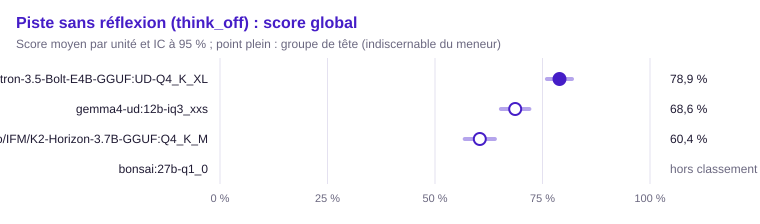

| Groupe | Rang | Modèle | Score (unités communes) | IC 95 % | IC simultané | ET groupée | Unités communes | Score (toutes unités définies) | Couverture | Exclues | Contexte dépassé : modèle / banc | Troncature |
|---|---|---|---|---|---|---|---|---|---|---|---|---|
| 1 | 1 | `hf.co/unsloth/NVIDIA-Nemotron-3.5-Bolt-E4B-GGUF:UD-Q4_K_XL` | 78,9 % | [76,0 % ; 81,9 %] | [75,4 % ; 82,5 %] | 0,015 | 736 | 78,9 % (736) | 100,0 % | 0 | 0 / 0 | 4,3 % (33/776) |
| 2 | 2 | `gemma4-ud:12b-iq3_xxs` | 68,6 % | [65,3 % ; 72,0 %] | [64,6 % ; 72,7 %] | 0,017 | 736 | 68,6 % (736) | 100,0 % | 0 | 0 / 0 | 3,5 % (27/776) |
| 3 | 2 | `hf.co/IFM/K2-Horizon-3.7B-GGUF:Q4_K_M` | 60,4 % | [56,9 % ; 63,9 %] | [56,1 % ; 64,7 %] | 0,018 | 736 | 60,4 % (736) | 100,0 % | 0 | 0 / 0 | 22,0 % (171/776) |
| — | — | `bonsai:27b-q1_0` | — | — | — | — | 0 | 49,7 % (157) | 21,3 % (hors classement) | 579 | 0 / 0 | 0,0 % (0/157) |

Comparaisons au meneur (Holm sur les m − 1 comparaisons au meneur, m modèles du périmètre) :

| Modèle | Unités | Différence | ET appariée | IC 95 % | IC bootstrap | Corrélation | p | p (Holm) | Distingué |
|---|---|---|---|---|---|---|---|---|---|
| `hf.co/IFM/K2-Horizon-3.7B-GGUF:Q4_K_M` | 736 | +18,5 pts | 0,017 | [+15,2 pts ; +21,8 pts] | [+15,2 pts ; +21,9 pts] | 0,49 | < 0,001 | < 0,001 | oui |
| `gemma4-ud:12b-iq3_xxs` | 736 | +10,3 pts | 0,016 | [+7,2 pts ; +13,4 pts] | [+7,4 pts ; +13,6 pts] | 0,51 | < 0,001 | < 0,001 | oui |

Matrice exploratoire « qui bat qui » (BH) :

- `hf.co/unsloth/NVIDIA-Nemotron-3.5-Bolt-E4B-GGUF:UD-Q4_K_XL` devant `hf.co/IFM/K2-Horizon-3.7B-GGUF:Q4_K_M` (+18,5 pts, p BH < 0,001)
- `gemma4-ud:12b-iq3_xxs` devant `hf.co/IFM/K2-Horizon-3.7B-GGUF:Q4_K_M` (+8,2 pts, p BH < 0,001)
- `hf.co/unsloth/NVIDIA-Nemotron-3.5-Bolt-E4B-GGUF:UD-Q4_K_XL` devant `gemma4-ud:12b-iq3_xxs` (+10,3 pts, p BH < 0,001)

#### Raisonnement (`reasoning`)

Méthode : McNemar exact apparié, intervalle de Wilson. Unités : 90, dont 90 communes aux modèles classés (classement, meneur et comparaisons). Meneur : `hf.co/unsloth/NVIDIA-Nemotron-3.5-Bolt-E4B-GGUF:UD-Q4_K_XL`.

Avertissement : hors classement, couverture sous le seuil : `bonsai:27b-q1_0` (0,0 %). Leur score sur leurs seules unités définies est publié sans rang, groupe ni comparaison.

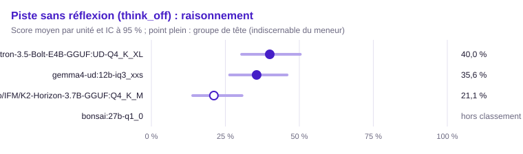

| Groupe | Rang | Modèle | Score (unités communes) | IC 95 % | IC simultané | ET groupée | Unités communes | Score (toutes unités définies) | Couverture | Exclues | Contexte dépassé : modèle / banc | Troncature |
|---|---|---|---|---|---|---|---|---|---|---|---|---|
| 1 | 1 | `hf.co/unsloth/NVIDIA-Nemotron-3.5-Bolt-E4B-GGUF:UD-Q4_K_XL` | 40,0 % | [30,5 % ; 50,3 %] | [28,6 % ; 52,6 %] | 0,052 | 90 | 40,0 % (90) | 100,0 % | 0 | 0 / 0 | 24,6 % (32/130) |
| 1 | 1 | `gemma4-ud:12b-iq3_xxs` | 35,6 % | [26,4 % ; 45,8 %] | [24,7 % ; 48,2 %] | 0,050 | 90 | 35,6 % (90) | 100,0 % | 0 | 0 / 0 | 12,3 % (16/130) |
| 2 | 1 | `hf.co/IFM/K2-Horizon-3.7B-GGUF:Q4_K_M` | 21,1 % | [14,0 % ; 30,6 %] | [12,7 % ; 33,0 %] | 0,043 | 90 | 21,1 % (90) | 100,0 % | 0 | 0 / 0 | 47,7 % (62/130) |
| — | — | `bonsai:27b-q1_0` | — | — | — | — | 0 | — (0) | 0,0 % (hors classement) | 90 | 0 / 0 | — (0/0) |

Comparaisons au meneur (Holm sur les m − 1 comparaisons au meneur, m modèles du périmètre) :

| Modèle | Unités | Différence | ET appariée | IC 95 % | b | c | Corrélation | p | p (Holm) | Distingué |
|---|---|---|---|---|---|---|---|---|---|---|
| `hf.co/IFM/K2-Horizon-3.7B-GGUF:Q4_K_M` | 90 | +18,9 pts | 0,044 | [+10,2 pts ; +27,5 pts] | 18 | 1 | 0,58 | < 0,001 | < 0,001 | oui |
| `gemma4-ud:12b-iq3_xxs` | 90 | +4,4 pts | 0,044 | [−4,2 pts ; +13,1 pts] | 10 | 6 | 0,63 | 0,454 | 0,454 | non |

Matrice exploratoire « qui bat qui » (BH) :

- `hf.co/unsloth/NVIDIA-Nemotron-3.5-Bolt-E4B-GGUF:UD-Q4_K_XL` devant `hf.co/IFM/K2-Horizon-3.7B-GGUF:Q4_K_M` (+18,9 pts, p BH < 0,001)
- `gemma4-ud:12b-iq3_xxs` devant `hf.co/IFM/K2-Horizon-3.7B-GGUF:Q4_K_M` (+14,4 pts, p BH 0,016)

#### Suivi de consignes (`instructions`)

Méthode : McNemar exact apparié, intervalle de Wilson. Unités : 130, dont 130 communes aux modèles classés (classement, meneur et comparaisons). Meneur : `hf.co/unsloth/NVIDIA-Nemotron-3.5-Bolt-E4B-GGUF:UD-Q4_K_XL`.

Avertissement : hors classement, couverture sous le seuil : `bonsai:27b-q1_0` (0,0 %). Leur score sur leurs seules unités définies est publié sans rang, groupe ni comparaison.

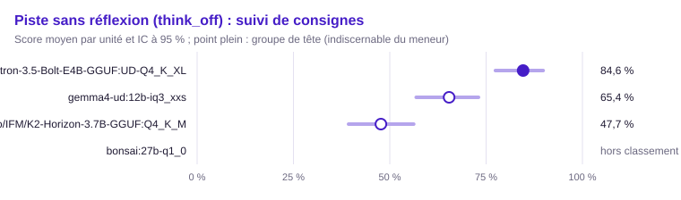

| Groupe | Rang | Modèle | Score (unités communes) | IC 95 % | IC simultané | ET groupée | Unités communes | Score (toutes unités définies) | Couverture | Exclues | Contexte dépassé : modèle / banc | Troncature |
|---|---|---|---|---|---|---|---|---|---|---|---|---|
| 1 | 1 | `hf.co/unsloth/NVIDIA-Nemotron-3.5-Bolt-E4B-GGUF:UD-Q4_K_XL` | 84,6 % | [77,4 % ; 89,8 %] | [75,6 % ; 90,7 %] | 0,032 | 130 | 84,6 % (130) | 100,0 % | 0 | 0 / 0 | 0,0 % (0/130) |
| 2 | 2 | `gemma4-ud:12b-iq3_xxs` | 65,4 % | [56,9 % ; 73,0 %] | [54,9 % ; 74,5 %] | 0,042 | 130 | 65,4 % (130) | 100,0 % | 0 | 0 / 0 | 6,9 % (9/130) |
| 3 | 2 | `hf.co/IFM/K2-Horizon-3.7B-GGUF:Q4_K_M` | 47,7 % | [39,3 % ; 56,2 %] | [37,5 % ; 58,1 %] | 0,044 | 130 | 47,7 % (130) | 100,0 % | 0 | 0 / 0 | 40,8 % (53/130) |
| — | — | `bonsai:27b-q1_0` | — | — | — | — | 0 | — (0) | 0,0 % (hors classement) | 130 | 0 / 0 | — (0/0) |

Comparaisons au meneur (Holm sur les m − 1 comparaisons au meneur, m modèles du périmètre) :

| Modèle | Unités | Différence | ET appariée | IC 95 % | b | c | Corrélation | p | p (Holm) | Distingué |
|---|---|---|---|---|---|---|---|---|---|---|
| `hf.co/IFM/K2-Horizon-3.7B-GGUF:Q4_K_M` | 130 | +36,9 pts | 0,042 | [+28,6 pts ; +45,2 pts] | 48 | 0 | 0,41 | < 0,001 | < 0,001 | oui |
| `gemma4-ud:12b-iq3_xxs` | 130 | +19,2 pts | 0,039 | [+11,5 pts ; +26,9 pts] | 28 | 3 | 0,45 | < 0,001 | < 0,001 | oui |

Matrice exploratoire « qui bat qui » (BH) :

- `hf.co/unsloth/NVIDIA-Nemotron-3.5-Bolt-E4B-GGUF:UD-Q4_K_XL` devant `hf.co/IFM/K2-Horizon-3.7B-GGUF:Q4_K_M` (+36,9 pts, p BH < 0,001)
- `gemma4-ud:12b-iq3_xxs` devant `hf.co/IFM/K2-Horizon-3.7B-GGUF:Q4_K_M` (+17,7 pts, p BH < 0,001)
- `hf.co/unsloth/NVIDIA-Nemotron-3.5-Bolt-E4B-GGUF:UD-Q4_K_XL` devant `gemma4-ud:12b-iq3_xxs` (+19,2 pts, p BH < 0,001)

Métrique continue : part de consignes suivies (`instructions_followed`), meneur `hf.co/unsloth/NVIDIA-Nemotron-3.5-Bolt-E4B-GGUF:UD-Q4_K_XL`.

| Modèle | Moyenne (unités communes) | Unités communes | Moyenne (toutes) | Couverture | Exclues |
|---|---|---|---|---|---|
| `hf.co/IFM/K2-Horizon-3.7B-GGUF:Q4_K_M` | 49,6 % | 130 | 49,6 % (130) | 100,0 % | 0 |
| `hf.co/unsloth/NVIDIA-Nemotron-3.5-Bolt-E4B-GGUF:UD-Q4_K_XL` | 86,9 % | 130 | 86,9 % (130) | 100,0 % | 0 |
| `gemma4-ud:12b-iq3_xxs` | 71,7 % | 130 | 71,7 % (130) | 100,0 % | 0 |
| `bonsai:27b-q1_0` | — | 0 | — (0) | 0,0 % (hors classement) | 130 |

Différence au meneur, IC bootstrap apparié à 95 % :

| Modèle | Unités | Différence | IC bootstrap |
|---|---|---|---|
| `hf.co/IFM/K2-Horizon-3.7B-GGUF:Q4_K_M` | 130 | +37,3 pts | [+29,0 pts ; +45,0 pts] |
| `gemma4-ud:12b-iq3_xxs` | 130 | +15,3 pts | [+8,5 pts ; +22,4 pts] |

#### Appels d'outils (`tools`)

Méthode : McNemar exact apparié, intervalle de Wilson. Unités : 130, dont 130 communes aux modèles classés (classement, meneur et comparaisons). Meneur : `hf.co/unsloth/NVIDIA-Nemotron-3.5-Bolt-E4B-GGUF:UD-Q4_K_XL`.

Avertissement : hors classement, couverture sous le seuil : `bonsai:27b-q1_0` (0,0 %). Leur score sur leurs seules unités définies est publié sans rang, groupe ni comparaison.

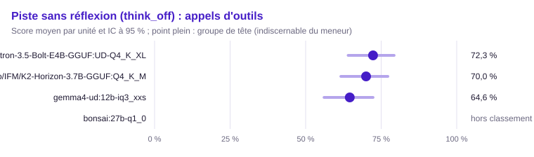

| Groupe | Rang | Modèle | Score (unités communes) | IC 95 % | IC simultané | ET groupée | Unités communes | Score (toutes unités définies) | Couverture | Exclues | Contexte dépassé : modèle / banc | Troncature |
|---|---|---|---|---|---|---|---|---|---|---|---|---|
| 1 | 1 | `hf.co/unsloth/NVIDIA-Nemotron-3.5-Bolt-E4B-GGUF:UD-Q4_K_XL` | 72,3 % | [64,1 % ; 79,3 %] | [62,1 % ; 80,6 %] | 0,039 | 130 | 72,3 % (130) | 100,0 % | 0 | 0 / 0 | 0,0 % (0/130) |
| 1 | 1 | `hf.co/IFM/K2-Horizon-3.7B-GGUF:Q4_K_M` | 70,0 % | [61,6 % ; 77,2 %] | [59,7 % ; 78,6 %] | 0,040 | 130 | 70,0 % (130) | 100,0 % | 0 | 0 / 0 | 6,2 % (8/130) |
| 1 | 1 | `gemma4-ud:12b-iq3_xxs` | 64,6 % | [56,1 % ; 72,3 %] | [54,2 % ; 73,8 %] | 0,042 | 130 | 64,6 % (130) | 100,0 % | 0 | 0 / 0 | 0,0 % (0/130) |
| — | — | `bonsai:27b-q1_0` | — | — | — | — | 0 | — (0) | 0,0 % (hors classement) | 130 | 0 / 0 | — (0/0) |

Comparaisons au meneur (Holm sur les m − 1 comparaisons au meneur, m modèles du périmètre) :

| Modèle | Unités | Différence | ET appariée | IC 95 % | b | c | Corrélation | p | p (Holm) | Distingué |
|---|---|---|---|---|---|---|---|---|---|---|
| `hf.co/IFM/K2-Horizon-3.7B-GGUF:Q4_K_M` | 130 | +2,3 pts | 0,044 | [−6,3 pts ; +11,0 pts] | 18 | 15 | 0,38 | 0,728 | 0,728 | non |
| `gemma4-ud:12b-iq3_xxs` | 130 | +7,7 pts | 0,046 | [−1,3 pts ; +16,6 pts] | 23 | 13 | 0,37 | 0,132 | 0,265 | non |

Matrice exploratoire « qui bat qui » (BH) :

Aucune paire distinguée après correction de Benjamini-Hochberg.

#### Extraction structurée (`extraction`)

Méthode : McNemar exact apparié, intervalle de Wilson. Unités : 110, dont 110 communes aux modèles classés (classement, meneur et comparaisons). Meneur : `hf.co/unsloth/NVIDIA-Nemotron-3.5-Bolt-E4B-GGUF:UD-Q4_K_XL`.

Avertissement : hors classement, couverture sous le seuil : `bonsai:27b-q1_0` (16,4 %). Leur score sur leurs seules unités définies est publié sans rang, groupe ni comparaison.

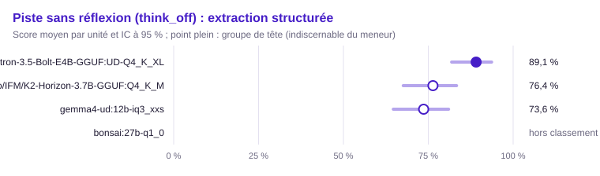

| Groupe | Rang | Modèle | Score (unités communes) | IC 95 % | IC simultané | ET groupée | Unités communes | Score (toutes unités définies) | Couverture | Exclues | Contexte dépassé : modèle / banc | Troncature |
|---|---|---|---|---|---|---|---|---|---|---|---|---|
| 1 | 1 | `hf.co/unsloth/NVIDIA-Nemotron-3.5-Bolt-E4B-GGUF:UD-Q4_K_XL` | 89,1 % | [81,9 % ; 93,6 %] | [80,0 % ; 94,4 %] | 0,030 | 110 | 89,1 % (110) | 100,0 % | 0 | 0 / 0 | 0,0 % (0/110) |
| 2 | 1 | `hf.co/IFM/K2-Horizon-3.7B-GGUF:Q4_K_M` | 76,4 % | [67,6 % ; 83,3 %] | [65,5 % ; 84,6 %] | 0,041 | 110 | 76,4 % (110) | 100,0 % | 0 | 0 / 0 | 10,0 % (11/110) |
| 2 | 1 | `gemma4-ud:12b-iq3_xxs` | 73,6 % | [64,7 % ; 81,0 %] | [62,6 % ; 82,3 %] | 0,042 | 110 | 73,6 % (110) | 100,0 % | 0 | 0 / 0 | 0,0 % (0/110) |
| — | — | `bonsai:27b-q1_0` | — | — | — | — | 0 | 44,4 % (18) | 16,4 % (hors classement) | 92 | 0 / 0 | 0,0 % (0/18) |

Comparaisons au meneur (Holm sur les m − 1 comparaisons au meneur, m modèles du périmètre) :

| Modèle | Unités | Différence | ET appariée | IC 95 % | b | c | Corrélation | p | p (Holm) | Distingué |
|---|---|---|---|---|---|---|---|---|---|---|
| `hf.co/IFM/K2-Horizon-3.7B-GGUF:Q4_K_M` | 110 | +12,7 pts | 0,037 | [+5,6 pts ; +19,9 pts] | 16 | 2 | 0,49 | 0,001 | 0,001 | oui |
| `gemma4-ud:12b-iq3_xxs` | 110 | +15,5 pts | 0,041 | [+7,4 pts ; +23,5 pts] | 20 | 3 | 0,39 | < 0,001 | < 0,001 | oui |

Matrice exploratoire « qui bat qui » (BH) :

- `hf.co/unsloth/NVIDIA-Nemotron-3.5-Bolt-E4B-GGUF:UD-Q4_K_XL` devant `hf.co/IFM/K2-Horizon-3.7B-GGUF:Q4_K_M` (+12,7 pts, p BH 0,002)
- `hf.co/unsloth/NVIDIA-Nemotron-3.5-Bolt-E4B-GGUF:UD-Q4_K_XL` devant `gemma4-ud:12b-iq3_xxs` (+15,5 pts, p BH 0,001)

Métrique continue : F1 (`f1`), meneur `gemma4-ud:12b-iq3_xxs`.

| Modèle | Moyenne (unités communes) | Unités communes | Moyenne (toutes) | Couverture | Exclues |
|---|---|---|---|---|---|
| `hf.co/IFM/K2-Horizon-3.7B-GGUF:Q4_K_M` | — | 0 | 50,9 % (38) | 86,4 % (hors classement) | 72 |
| `hf.co/unsloth/NVIDIA-Nemotron-3.5-Bolt-E4B-GGUF:UD-Q4_K_XL` | — | 0 | 87,7 % (33) | 75,0 % (hors classement) | 77 |
| `gemma4-ud:12b-iq3_xxs` | 62,9 % | 40 | 62,9 % (40) | 90,9 % | 70 |
| `bonsai:27b-q1_0` | — | 0 | 81,9 % (18) | 40,9 % (hors classement) | 92 |

#### Questions sur documents (RAG) (`rag`)

Méthode : McNemar exact apparié, intervalle de Wilson. Unités : 86, dont 86 communes aux modèles classés (classement, meneur et comparaisons). Meneur : `hf.co/unsloth/NVIDIA-Nemotron-3.5-Bolt-E4B-GGUF:UD-Q4_K_XL`.

Avertissement : hors classement, couverture sous le seuil : `bonsai:27b-q1_0` (58,1 %). Leur score sur leurs seules unités définies est publié sans rang, groupe ni comparaison.

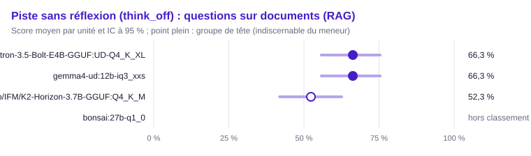

| Groupe | Rang | Modèle | Score (unités communes) | IC 95 % | IC simultané | ET groupée | Unités communes | Score (toutes unités définies) | Couverture | Exclues | Contexte dépassé : modèle / banc | Troncature |
|---|---|---|---|---|---|---|---|---|---|---|---|---|
| 1 | 1 | `hf.co/unsloth/NVIDIA-Nemotron-3.5-Bolt-E4B-GGUF:UD-Q4_K_XL` | 66,3 % | [55,8 % ; 75,4 %] | [53,4 % ; 77,1 %] | 0,051 | 86 | 66,3 % (86) | 100,0 % | 0 | 0 / 0 | 0,0 % (0/86) |
| 1 | 1 | `gemma4-ud:12b-iq3_xxs` | 66,3 % | [55,8 % ; 75,4 %] | [53,4 % ; 77,1 %] | 0,051 | 86 | 66,3 % (86) | 100,0 % | 0 | 0 / 0 | 0,0 % (0/86) |
| 2 | 1 | `hf.co/IFM/K2-Horizon-3.7B-GGUF:Q4_K_M` | 52,3 % | [41,9 % ; 62,6 %] | [39,7 % ; 64,7 %] | 0,054 | 86 | 52,3 % (86) | 100,0 % | 0 | 0 / 0 | 3,5 % (3/86) |
| — | — | `bonsai:27b-q1_0` | — | — | — | — | 0 | 48,0 % (50) | 58,1 % (hors classement) | 36 | 0 / 0 | 0,0 % (0/50) |

Comparaisons au meneur (Holm sur les m − 1 comparaisons au meneur, m modèles du périmètre) :

| Modèle | Unités | Différence | ET appariée | IC 95 % | b | c | Corrélation | p | p (Holm) | Distingué |
|---|---|---|---|---|---|---|---|---|---|---|
| `hf.co/IFM/K2-Horizon-3.7B-GGUF:Q4_K_M` | 86 | +14,0 pts | 0,050 | [+4,2 pts ; +23,7 pts] | 16 | 4 | 0,55 | 0,012 | 0,024 | oui |
| `gemma4-ud:12b-iq3_xxs` | 86 | 0,0 pts | 0,047 | [−9,1 pts ; +9,1 pts] | 8 | 8 | 0,58 | 1,000 | 1,000 | non |

Matrice exploratoire « qui bat qui » (BH) :

- `hf.co/unsloth/NVIDIA-Nemotron-3.5-Bolt-E4B-GGUF:UD-Q4_K_XL` devant `hf.co/IFM/K2-Horizon-3.7B-GGUF:Q4_K_M` (+14,0 pts, p BH 0,035)

Métrique continue : F1 (`f1`), meneur `gemma4-ud:12b-iq3_xxs`.

| Modèle | Moyenne (unités communes) | Unités communes | Moyenne (toutes) | Couverture | Exclues |
|---|---|---|---|---|---|
| `hf.co/IFM/K2-Horizon-3.7B-GGUF:Q4_K_M` | 61,7 % | 50 | 59,3 % (52) | 100,0 % | 34 |
| `hf.co/unsloth/NVIDIA-Nemotron-3.5-Bolt-E4B-GGUF:UD-Q4_K_XL` | 73,0 % | 50 | 73,0 % (50) | 96,2 % | 36 |
| `gemma4-ud:12b-iq3_xxs` | 75,9 % | 50 | 75,9 % (50) | 96,2 % | 36 |
| `bonsai:27b-q1_0` | 72,7 % | 50 | 72,7 % (50) | 96,2 % | 36 |

Différence au meneur, IC bootstrap apparié à 95 % :

| Modèle | Unités | Différence | IC bootstrap |
|---|---|---|---|
| `hf.co/IFM/K2-Horizon-3.7B-GGUF:Q4_K_M` | 50 | +14,2 pts | [+2,9 pts ; +25,3 pts] |
| `hf.co/unsloth/NVIDIA-Nemotron-3.5-Bolt-E4B-GGUF:UD-Q4_K_XL` | 50 | +2,9 pts | [−6,8 pts ; +12,6 pts] |
| `bonsai:27b-q1_0` | 50 | +3,2 pts | [−4,3 pts ; +10,9 pts] |

#### Abstention (`abstention`)

Méthode : McNemar exact apparié, intervalle de Wilson. Unités : 110, dont 110 communes aux modèles classés (classement, meneur et comparaisons). Meneur : `hf.co/unsloth/NVIDIA-Nemotron-3.5-Bolt-E4B-GGUF:UD-Q4_K_XL`.

Avertissement : hors classement, couverture sous le seuil : `bonsai:27b-q1_0` (80,9 %). Leur score sur leurs seules unités définies est publié sans rang, groupe ni comparaison.

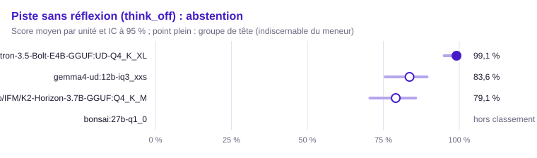

| Groupe | Rang | Modèle | Score (unités communes) | IC 95 % | IC simultané | ET groupée | Unités communes | Score (toutes unités définies) | Couverture | Exclues | Contexte dépassé : modèle / banc | Troncature |
|---|---|---|---|---|---|---|---|---|---|---|---|---|
| 1 | 1 | `hf.co/unsloth/NVIDIA-Nemotron-3.5-Bolt-E4B-GGUF:UD-Q4_K_XL` | 99,1 % | [95,0 % ; 99,8 %] | [93,4 % ; 99,9 %] | 0,009 | 110 | 99,1 % (110) | 100,0 % | 0 | 0 / 0 | 0,9 % (1/110) |
| 2 | 2 | `gemma4-ud:12b-iq3_xxs` | 83,6 % | [75,6 % ; 89,4 %] | [73,6 % ; 90,4 %] | 0,035 | 110 | 83,6 % (110) | 100,0 % | 0 | 0 / 0 | 0,9 % (1/110) |
| 2 | 2 | `hf.co/IFM/K2-Horizon-3.7B-GGUF:Q4_K_M` | 79,1 % | [70,6 % ; 85,6 %] | [68,5 % ; 86,8 %] | 0,039 | 110 | 79,1 % (110) | 100,0 % | 0 | 0 / 0 | 13,6 % (15/110) |
| — | — | `bonsai:27b-q1_0` | — | — | — | — | 0 | 51,7 % (89) | 80,9 % (hors classement) | 21 | 0 / 0 | 0,0 % (0/89) |

Comparaisons au meneur (Holm sur les m − 1 comparaisons au meneur, m modèles du périmètre) :

| Modèle | Unités | Différence | ET appariée | IC 95 % | b | c | Corrélation | p | p (Holm) | Distingué |
|---|---|---|---|---|---|---|---|---|---|---|
| `hf.co/IFM/K2-Horizon-3.7B-GGUF:Q4_K_M` | 110 | +20,0 pts | 0,038 | [+12,5 pts ; +27,5 pts] | 22 | 0 | 0,19 | < 0,001 | < 0,001 | oui |
| `gemma4-ud:12b-iq3_xxs` | 110 | +15,5 pts | 0,037 | [+8,2 pts ; +22,7 pts] | 18 | 1 | −0,04 | < 0,001 | < 0,001 | oui |

Matrice exploratoire « qui bat qui » (BH) :

- `hf.co/unsloth/NVIDIA-Nemotron-3.5-Bolt-E4B-GGUF:UD-Q4_K_XL` devant `hf.co/IFM/K2-Horizon-3.7B-GGUF:Q4_K_M` (+20,0 pts, p BH < 0,001)
- `hf.co/unsloth/NVIDIA-Nemotron-3.5-Bolt-E4B-GGUF:UD-Q4_K_XL` devant `gemma4-ud:12b-iq3_xxs` (+15,5 pts, p BH < 0,001)

#### Rédaction (`writing`)

Méthode : test z sur la différence appariée (erreur-type groupée), intervalle moyenne ± z·ET, IC bootstrap apparié de la différence. Unités : 80, dont 80 communes aux modèles classés (classement, meneur et comparaisons). Meneur : `hf.co/unsloth/NVIDIA-Nemotron-3.5-Bolt-E4B-GGUF:UD-Q4_K_XL`.

Avertissement : hors classement, couverture sous le seuil : `bonsai:27b-q1_0` (0,0 %). Leur score sur leurs seules unités définies est publié sans rang, groupe ni comparaison.

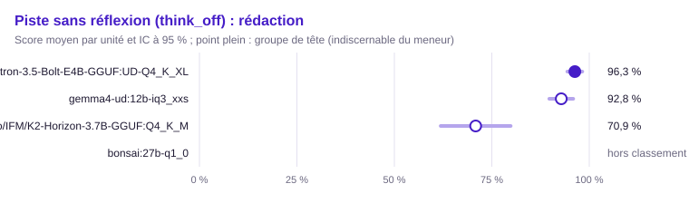

| Groupe | Rang | Modèle | Score (unités communes) | IC 95 % | IC simultané | ET groupée | Unités communes | Score (toutes unités définies) | Couverture | Exclues | Contexte dépassé : modèle / banc | Troncature |
|---|---|---|---|---|---|---|---|---|---|---|---|---|
| 1 | 1 | `hf.co/unsloth/NVIDIA-Nemotron-3.5-Bolt-E4B-GGUF:UD-Q4_K_XL` | 96,3 % | [94,4 % ; 98,2 %] | [93,9 % ; 98,6 %] | 0,010 | 80 | 96,3 % (80) | 100,0 % | 0 | 0 / 0 | 0,0 % (0/80) |
| 2 | 1 | `gemma4-ud:12b-iq3_xxs` | 92,8 % | [89,7 % ; 95,9 %] | [89,1 % ; 96,6 %] | 0,016 | 80 | 92,8 % (80) | 100,0 % | 0 | 0 / 0 | 1,2 % (1/80) |
| 3 | 3 | `hf.co/IFM/K2-Horizon-3.7B-GGUF:Q4_K_M` | 70,9 % | [61,9 % ; 79,8 %] | [59,9 % ; 81,8 %] | 0,046 | 80 | 70,9 % (80) | 100,0 % | 0 | 0 / 0 | 23,8 % (19/80) |
| — | — | `bonsai:27b-q1_0` | — | — | — | — | 0 | — (0) | 0,0 % (hors classement) | 80 | 0 / 0 | — (0/0) |

Comparaisons au meneur (Holm sur les m − 1 comparaisons au meneur, m modèles du périmètre) :

| Modèle | Unités | Différence | ET appariée | IC 95 % | IC bootstrap | Corrélation | p | p (Holm) | Distingué |
|---|---|---|---|---|---|---|---|---|---|
| `hf.co/IFM/K2-Horizon-3.7B-GGUF:Q4_K_M` | 80 | +25,4 pts | 0,045 | [+16,7 pts ; +34,2 pts] | [+16,7 pts ; +34,4 pts] | 0,21 | < 0,001 | < 0,001 | oui |
| `gemma4-ud:12b-iq3_xxs` | 80 | +3,5 pts | 0,017 | [+0,1 pts ; +6,8 pts] | [+0,6 pts ; +7,2 pts] | 0,16 | 0,041 | 0,041 | oui |

Matrice exploratoire « qui bat qui » (BH) :

- `hf.co/unsloth/NVIDIA-Nemotron-3.5-Bolt-E4B-GGUF:UD-Q4_K_XL` devant `hf.co/IFM/K2-Horizon-3.7B-GGUF:Q4_K_M` (+25,4 pts, p BH < 0,001)
- `gemma4-ud:12b-iq3_xxs` devant `hf.co/IFM/K2-Horizon-3.7B-GGUF:Q4_K_M` (+22,0 pts, p BH < 0,001)
- `hf.co/unsloth/NVIDIA-Nemotron-3.5-Bolt-E4B-GGUF:UD-Q4_K_XL` devant `gemma4-ud:12b-iq3_xxs` (+3,5 pts, p BH 0,041)

### Conclusion transversale (k̂_Bonferroni)

Nombre d'usages, sur 7, où le meneur global `hf.co/unsloth/NVIDIA-Nemotron-3.5-Bolt-E4B-GGUF:UD-Q4_K_XL` bat chaque modèle au seuil α/m = 0,0071 :

| Modèle | Usages gagnés |
|---|---|
| `hf.co/IFM/K2-Horizon-3.7B-GGUF:Q4_K_M` | 5 / 7 |
| `gemma4-ud:12b-iq3_xxs` | 3 / 7 |

### Validation externe (Spearman contre l'indice AA)

Indice AA sans raisonnement, modèles mesurés appariés par tag : 0.

- ρ = —, p unilatérale = —, IC bootstrap à 95 % [— ; —]
- Conclusion : sans conclusion (moins de 8 modèles mesurés).

## Piste avec réflexion (think_on)

### Score global

Méthode : test z sur la différence appariée (erreur-type groupée), intervalle moyenne ± z·ET, IC bootstrap apparié de la différence. Unités : 736, dont 736 communes aux modèles classés (classement, meneur et comparaisons). Meneur : `gemma4-ud:12b-iq3_xxs`.

Avertissement : hors classement, couverture sous le seuil : `bonsai:27b-q1_0` (0,0 %). Leur score sur leurs seules unités définies est publié sans rang, groupe ni comparaison.

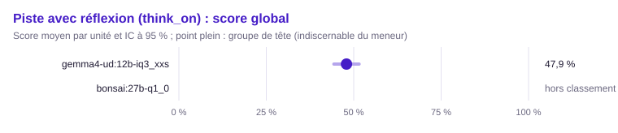

| Groupe | Rang | Modèle | Score (unités communes) | IC 95 % | IC simultané | ET groupée | Unités communes | Score (toutes unités définies) | Couverture | Exclues | Contexte dépassé : modèle / banc | Troncature |
|---|---|---|---|---|---|---|---|---|---|---|---|---|
| 1 | 1 | `gemma4-ud:12b-iq3_xxs` | 47,9 % | [44,3 % ; 51,5 %] | [44,3 % ; 51,5 %] | 0,018 | 736 | 47,9 % (736) | 100,0 % | 0 | 0 / 0 | 42,7 % (331/776) |
| — | — | `bonsai:27b-q1_0` | — | — | — | — | 0 | — (0) | 0,0 % (hors classement) | 736 | 0 / 0 | — (0/0) |

Matrice exploratoire « qui bat qui » (BH) :

Aucune paire distinguée après correction de Benjamini-Hochberg.

#### Raisonnement (`reasoning`)

Méthode : McNemar exact apparié, intervalle de Wilson. Unités : 90, dont 90 communes aux modèles classés (classement, meneur et comparaisons). Meneur : `gemma4-ud:12b-iq3_xxs`.

Avertissement : hors classement, couverture sous le seuil : `bonsai:27b-q1_0` (0,0 %). Leur score sur leurs seules unités définies est publié sans rang, groupe ni comparaison.

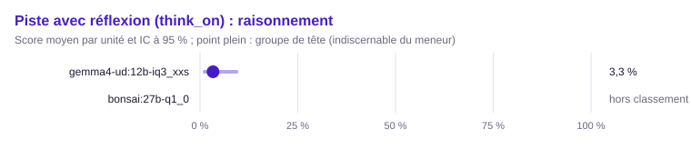

| Groupe | Rang | Modèle | Score (unités communes) | IC 95 % | IC simultané | ET groupée | Unités communes | Score (toutes unités définies) | Couverture | Exclues | Contexte dépassé : modèle / banc | Troncature |
|---|---|---|---|---|---|---|---|---|---|---|---|---|
| 1 | 1 | `gemma4-ud:12b-iq3_xxs` | 3,3 % | [1,1 % ; 9,3 %] | [1,1 % ; 9,3 %] | 0,019 | 90 | 3,3 % (90) | 100,0 % | 0 | 0 / 0 | 84,6 % (110/130) |
| — | — | `bonsai:27b-q1_0` | — | — | — | — | 0 | — (0) | 0,0 % (hors classement) | 90 | 0 / 0 | — (0/0) |

Matrice exploratoire « qui bat qui » (BH) :

Aucune paire distinguée après correction de Benjamini-Hochberg.

#### Suivi de consignes (`instructions`)

Méthode : McNemar exact apparié, intervalle de Wilson. Unités : 130, dont 130 communes aux modèles classés (classement, meneur et comparaisons). Meneur : `gemma4-ud:12b-iq3_xxs`.

Avertissement : hors classement, couverture sous le seuil : `bonsai:27b-q1_0` (0,0 %). Leur score sur leurs seules unités définies est publié sans rang, groupe ni comparaison.

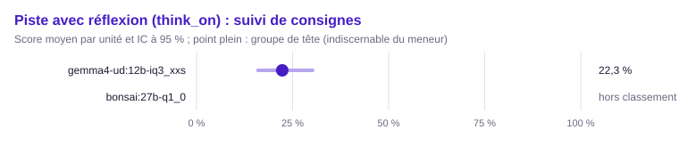

| Groupe | Rang | Modèle | Score (unités communes) | IC 95 % | IC simultané | ET groupée | Unités communes | Score (toutes unités définies) | Couverture | Exclues | Contexte dépassé : modèle / banc | Troncature |
|---|---|---|---|---|---|---|---|---|---|---|---|---|
| 1 | 1 | `gemma4-ud:12b-iq3_xxs` | 22,3 % | [16,0 % ; 30,2 %] | [16,0 % ; 30,2 %] | 0,037 | 130 | 22,3 % (130) | 100,0 % | 0 | 0 / 0 | 76,9 % (100/130) |
| — | — | `bonsai:27b-q1_0` | — | — | — | — | 0 | — (0) | 0,0 % (hors classement) | 130 | 0 / 0 | — (0/0) |

Matrice exploratoire « qui bat qui » (BH) :

Aucune paire distinguée après correction de Benjamini-Hochberg.

Métrique continue : part de consignes suivies (`instructions_followed`), meneur `gemma4-ud:12b-iq3_xxs`.

| Modèle | Moyenne (unités communes) | Unités communes | Moyenne (toutes) | Couverture | Exclues |
|---|---|---|---|---|---|
| `gemma4-ud:12b-iq3_xxs` | 22,3 % | 130 | 22,3 % (130) | 100,0 % | 0 |
| `bonsai:27b-q1_0` | — | 0 | — (0) | 0,0 % (hors classement) | 130 |

#### Appels d'outils (`tools`)

Méthode : McNemar exact apparié, intervalle de Wilson. Unités : 130, dont 130 communes aux modèles classés (classement, meneur et comparaisons). Meneur : `gemma4-ud:12b-iq3_xxs`.

Avertissement : hors classement, couverture sous le seuil : `bonsai:27b-q1_0` (0,0 %). Leur score sur leurs seules unités définies est publié sans rang, groupe ni comparaison.

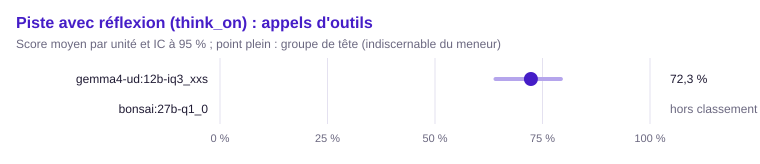

| Groupe | Rang | Modèle | Score (unités communes) | IC 95 % | IC simultané | ET groupée | Unités communes | Score (toutes unités définies) | Couverture | Exclues | Contexte dépassé : modèle / banc | Troncature |
|---|---|---|---|---|---|---|---|---|---|---|---|---|
| 1 | 1 | `gemma4-ud:12b-iq3_xxs` | 72,3 % | [64,1 % ; 79,3 %] | [64,1 % ; 79,3 %] | 0,039 | 130 | 72,3 % (130) | 100,0 % | 0 | 0 / 0 | 4,6 % (6/130) |
| — | — | `bonsai:27b-q1_0` | — | — | — | — | 0 | — (0) | 0,0 % (hors classement) | 130 | 0 / 0 | — (0/0) |

Matrice exploratoire « qui bat qui » (BH) :

Aucune paire distinguée après correction de Benjamini-Hochberg.

#### Extraction structurée (`extraction`)

Méthode : McNemar exact apparié, intervalle de Wilson. Unités : 110, dont 110 communes aux modèles classés (classement, meneur et comparaisons). Meneur : `gemma4-ud:12b-iq3_xxs`.

Avertissement : hors classement, couverture sous le seuil : `bonsai:27b-q1_0` (0,0 %). Leur score sur leurs seules unités définies est publié sans rang, groupe ni comparaison.

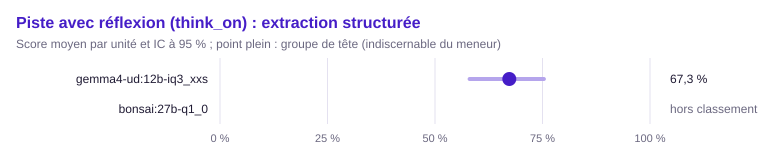

| Groupe | Rang | Modèle | Score (unités communes) | IC 95 % | IC simultané | ET groupée | Unités communes | Score (toutes unités définies) | Couverture | Exclues | Contexte dépassé : modèle / banc | Troncature |
|---|---|---|---|---|---|---|---|---|---|---|---|---|
| 1 | 1 | `gemma4-ud:12b-iq3_xxs` | 67,3 % | [58,1 % ; 75,3 %] | [58,1 % ; 75,3 %] | 0,045 | 110 | 67,3 % (110) | 100,0 % | 0 | 0 / 0 | 22,7 % (25/110) |
| — | — | `bonsai:27b-q1_0` | — | — | — | — | 0 | — (0) | 0,0 % (hors classement) | 110 | 0 / 0 | — (0/0) |

Matrice exploratoire « qui bat qui » (BH) :

Aucune paire distinguée après correction de Benjamini-Hochberg.

Métrique continue : F1 (`f1`), meneur `gemma4-ud:12b-iq3_xxs`.

| Modèle | Moyenne (unités communes) | Unités communes | Moyenne (toutes) | Couverture | Exclues |
|---|---|---|---|---|---|
| `gemma4-ud:12b-iq3_xxs` | 25,4 % | 42 | 25,4 % (42) | 100,0 % | 68 |
| `bonsai:27b-q1_0` | — | 0 | — (0) | 0,0 % (hors classement) | 110 |

#### Questions sur documents (RAG) (`rag`)

Méthode : McNemar exact apparié, intervalle de Wilson. Unités : 86, dont 86 communes aux modèles classés (classement, meneur et comparaisons). Meneur : `gemma4-ud:12b-iq3_xxs`.

Avertissement : hors classement, couverture sous le seuil : `bonsai:27b-q1_0` (0,0 %). Leur score sur leurs seules unités définies est publié sans rang, groupe ni comparaison.

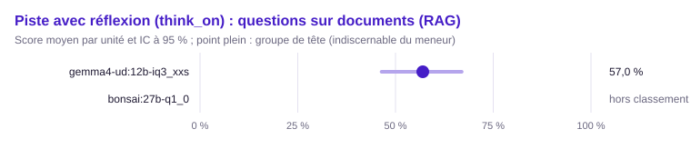

| Groupe | Rang | Modèle | Score (unités communes) | IC 95 % | IC simultané | ET groupée | Unités communes | Score (toutes unités définies) | Couverture | Exclues | Contexte dépassé : modèle / banc | Troncature |
|---|---|---|---|---|---|---|---|---|---|---|---|---|
| 1 | 1 | `gemma4-ud:12b-iq3_xxs` | 57,0 % | [46,4 % ; 66,9 %] | [46,4 % ; 66,9 %] | 0,053 | 86 | 57,0 % (86) | 100,0 % | 0 | 0 / 0 | 27,9 % (24/86) |
| — | — | `bonsai:27b-q1_0` | — | — | — | — | 0 | — (0) | 0,0 % (hors classement) | 86 | 0 / 0 | — (0/0) |

Matrice exploratoire « qui bat qui » (BH) :

Aucune paire distinguée après correction de Benjamini-Hochberg.

Métrique continue : F1 (`f1`), meneur `gemma4-ud:12b-iq3_xxs`.

| Modèle | Moyenne (unités communes) | Unités communes | Moyenne (toutes) | Couverture | Exclues |
|---|---|---|---|---|---|
| `gemma4-ud:12b-iq3_xxs` | 51,9 % | 61 | 51,9 % (61) | 100,0 % | 25 |
| `bonsai:27b-q1_0` | — | 0 | — (0) | 0,0 % (hors classement) | 86 |

#### Abstention (`abstention`)

Méthode : McNemar exact apparié, intervalle de Wilson. Unités : 110, dont 110 communes aux modèles classés (classement, meneur et comparaisons). Meneur : `gemma4-ud:12b-iq3_xxs`.

Avertissement : hors classement, couverture sous le seuil : `bonsai:27b-q1_0` (0,0 %). Leur score sur leurs seules unités définies est publié sans rang, groupe ni comparaison.

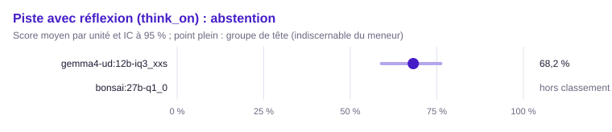

| Groupe | Rang | Modèle | Score (unités communes) | IC 95 % | IC simultané | ET groupée | Unités communes | Score (toutes unités définies) | Couverture | Exclues | Contexte dépassé : modèle / banc | Troncature |
|---|---|---|---|---|---|---|---|---|---|---|---|---|
| 1 | 1 | `gemma4-ud:12b-iq3_xxs` | 68,2 % | [59,0 % ; 76,1 %] | [59,0 % ; 76,1 %] | 0,044 | 110 | 68,2 % (110) | 100,0 % | 0 | 0 / 0 | 14,5 % (16/110) |
| — | — | `bonsai:27b-q1_0` | — | — | — | — | 0 | — (0) | 0,0 % (hors classement) | 110 | 0 / 0 | — (0/0) |

Matrice exploratoire « qui bat qui » (BH) :

Aucune paire distinguée après correction de Benjamini-Hochberg.

#### Rédaction (`writing`)

Méthode : test z sur la différence appariée (erreur-type groupée), intervalle moyenne ± z·ET, IC bootstrap apparié de la différence. Unités : 80, dont 80 communes aux modèles classés (classement, meneur et comparaisons). Meneur : `gemma4-ud:12b-iq3_xxs`.

Avertissement : hors classement, couverture sous le seuil : `bonsai:27b-q1_0` (0,0 %). Leur score sur leurs seules unités définies est publié sans rang, groupe ni comparaison.

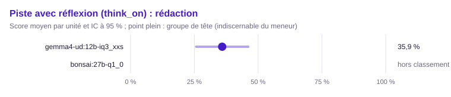

| Groupe | Rang | Modèle | Score (unités communes) | IC 95 % | IC simultané | ET groupée | Unités communes | Score (toutes unités définies) | Couverture | Exclues | Contexte dépassé : modèle / banc | Troncature |
|---|---|---|---|---|---|---|---|---|---|---|---|---|
| 1 | 1 | `gemma4-ud:12b-iq3_xxs` | 35,9 % | [25,7 % ; 46,1 %] | [25,7 % ; 46,1 %] | 0,052 | 80 | 35,9 % (80) | 100,0 % | 0 | 0 / 0 | 62,5 % (50/80) |
| — | — | `bonsai:27b-q1_0` | — | — | — | — | 0 | — (0) | 0,0 % (hors classement) | 80 | 0 / 0 | — (0/0) |

Matrice exploratoire « qui bat qui » (BH) :

Aucune paire distinguée après correction de Benjamini-Hochberg.

### Conclusion transversale (k̂_Bonferroni)

Sans objet : moins de deux modèles comparables.

### Validation externe (Spearman contre l'indice AA)

Indice AA en raisonnement, modèles mesurés appariés par tag : 0.

- ρ = —, p unilatérale = —, IC bootstrap à 95 % [— ; —]
- Conclusion : sans conclusion (moins de 8 modèles mesurés).

## Références

Indice AA du 2026-10-17 : `references/aa-2026-10-17.json` (sha256 `14860c29f48f80cb9321905db49e52f812af791891665390732bf9c28a18770b`).
