# Rapport de la campagne full-20261018

> **Rapport partiel** : lignes manquantes, discordantes ou en attente du juge écartées et comptées (voir « Complétude »).

Jeu `set-v3` (empreinte `8081ad7474a1`), manifeste de génération `3eadf4dd371e`, 1 tirage(s) par question. Seuil α = 0,05 ; bootstrap : 2 000 tirages, graine 20261011.

Unité statistique : (modèle, piste, unité) ; les questions d'une unité sont agrégées par minimum, puis les seeds par moyenne. Une unité sans score (erreur du banc, contexte du banc dépassé ; avec --partial, ligne absente, discordante ou en attente du juge) est écartée et comptée dans « Exclues ». Un contexte du modèle dépassé (le prompt seul ne tient pas dans son contexte maximal déclaré, moins une marge de 256 tokens) vaut un échec (score 0) ; un dépassement dû au plafond de réponse, au palier ou au plafond de la configuration est un contexte du banc dépassé. Un modèle est classé sur un périmètre si sa couverture (unités définies sur unités du périmètre) atteint 90,0 %. Le classement, le meneur, les groupes indiscernables, les comparaisons et la corrélation de Spearman portent sur les modèles classés et sur les unités définies pour chacun d'eux ; le score sur toutes les unités définies de chaque modèle est publié à côté, avec son effectif et sa couverture.

Source `oneruler-fr-cwe` exclue du score et de la couverture de tous les modèles (décision du 2026-10-29) : la tâche ne mesure plus le modèle : prompts sous-estimés d'environ 27 % par est_prompt_tokens, contexte dépassé pour presque tous les modèles (160 context_exceeded sur 248 lignes dès le palier 8 192, troncature silencieuse d'Ollama aux paliers 16 384 et 32 768). Ses lignes restent générées, notées et exportées.

## Complétude

| Contrôle | Valeur |
|---|---|
| Clés attendues | 29 600 |
| Lignes retenues | 24 800 |
| Génération manquante | 4 800 |
| Génération discordante | 0 |
| Correction manquante | 0 |
| Correction discordante | 0 |
| En attente du juge | 0 |
| Configuration | concordante |

## Modèles

| Modèle | Famille | Pistes | Empreinte | Usage bureautique |
|---|---|---|---|---|
| `lfm2.5-thinking:1.2b` | lfm | think_on | `95bd9d45385f` | — |
| `granite4:350m` | granite | think_off | `5eee845b49c4` | — |
| `qwen3.5:0.8b` | qwen | think_off, think_on | `f3817196d142` | — |
| `lfm2.5:8b-a1b-q4_K_M` | lfm | think_off | `9cf756159fc2` | — |
| `ling3-tiny:8b-q4_k_m` | ling | think_off, think_on | `35c797f0aa56` | — |
| `minicpm5:2b-q4_k_m` | minicpm | think_off, think_on | `9f037da2d683` | — |
| `LiquidAI/lfm2.5-2.6b` | lfm | think_on | `83f596831da1` | — |
| `gemma4:e2b-it-qat` | gemma | think_off, think_on | `07ea59a47401` | — |
| `bonsai:8b-q1_0` | bonsai | think_off | `4f22875738aa` | — |
| `qwen3.5:2b` | qwen | think_off, think_on | `324d162be6ca` | — |
| `ministral-3:3b` | ministral | think_off | `f04aa1c738f6` | — |
| `granite4.2:3b` | granite | think_off, think_on | `40577dc168a3` | — |
| `phi4-mini:3.8b` | phi | think_off | `78fad5d182a7` | — |
| `nemotron-3-nano:4b` | nemotron | think_off, think_on | `6cc467f05439` | — |
| `qwen3.5:4b` | qwen | think_off, think_on | `96f38c742e0a` | — |
| `gemma4:e4b-it-qat` | gemma | think_off, think_on | `ee6656371218` | — |
| `qwen3.5:9b` | qwen | think_off, think_on | `6488c96fa5fa` | **hors usage** : sans marge mémoire : 32/34 couches sur le GPU au palier 16 384 (18,9 h projetées) (décision du 2026-10-29) |
| `qwen3.6:35b-a3b` | qwen | think_off, think_on | `096fdbd02fe6` | — |
| `granite4.2:8b` | granite | think_off, think_on | `f586c02fdecd` | **hors usage** : trop lent et sans marge mémoire : 31,4 h projetées, débordement du GPU dès le palier 8 192 (décision du 2026-10-29) |
| `gemma4-ud:12b-iq3_xxs` | gemma | think_off, think_on | `cddd549bcb68` | — |
| `ministral-3:8b` | ministral | think_off | `1922accd5827` | — |
| `bonsai:27b-q1_0` | bonsai | think_off, think_on | `d3053a5d5f81` | — |
| `ministral3-ud:14b-iq2_m` | ministral | think_off | `e5df5c368818` | — |

Prompts tronqués en silence par Ollama, reclassés en dépassement de contexte à limite du banc (unités nulles, hors comparaisons) : `qwen3.5:0.8b` 32, `gemma4:e2b-it-qat` 32, `qwen3.5:2b` 32, `ministral-3:3b` 16, `nemotron-3-nano:4b` 32, `qwen3.5:4b` 32, `gemma4:e4b-it-qat` 32, `qwen3.5:9b` 32, `qwen3.6:35b-a3b` 32.

Modèles hors usage (règle du 2026-10-29 : au moins 1 Gio de VRAM libre aux paliers 8 192 et 16 384, au plus 20 h projetées) : `granite4.2:8b`, `qwen3.5:9b`. Leurs scores sont publiés et classés comme les autres ; ils sont à exclure des recommandations.

## Piste sans réflexion (think_off)

### Score global

Méthode : test z sur la différence appariée (erreur-type groupée), intervalle moyenne ± z·ET, IC bootstrap apparié de la différence. Unités : 736, dont 718 communes aux modèles classés (classement, meneur et comparaisons). Meneur : `qwen3.6:35b-a3b`.

Avertissement : hors classement, couverture sous le seuil : `gemma4-ud:12b-iq3_xxs` (0,0 %), `ministral-3:8b` (0,0 %), `bonsai:27b-q1_0` (0,0 %), `ministral3-ud:14b-iq2_m` (0,0 %). Leur score sur leurs seules unités définies est publié sans rang, groupe ni comparaison.

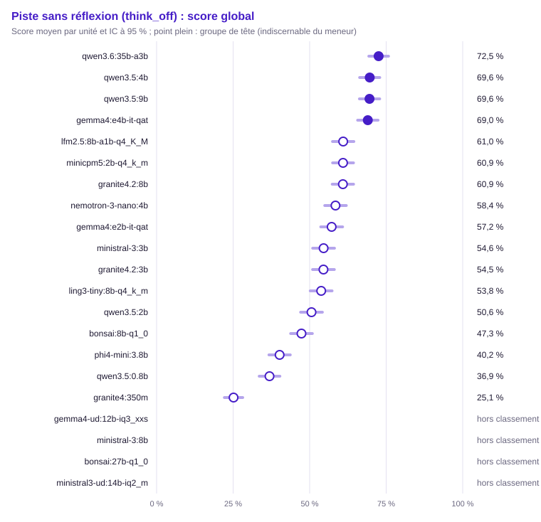

| Groupe | Rang | Modèle | Score (unités communes) | IC 95 % | IC simultané | ET groupée | Unités communes | Score (toutes unités définies) | Couverture | Exclues | Contexte dépassé : modèle / banc | Troncature |
|---|---|---|---|---|---|---|---|---|---|---|---|---|
| 1 | 1 | `qwen3.6:35b-a3b` | 72,5 % | [69,3 % ; 75,8 %] | [67,7 % ; 77,4 %] | 0,016 | 718 | 71,8 % (734) | 99,7 % | 2 | 0 / 2 | 5,7 % (44/774) |
| 1 | 1 | `qwen3.5:4b` | 69,6 % | [66,3 % ; 72,9 %] | [64,6 % ; 74,6 %] | 0,017 | 718 | 69,3 % (734) | 99,7 % | 2 | 0 / 2 | 5,3 % (41/774) |
| 1 | 1 | `qwen3.5:9b` (hors usage) | 69,6 % | [66,2 % ; 72,9 %] | [64,5 % ; 74,6 %] | 0,017 | 718 | 69,3 % (735) | 99,9 % | 1 | 0 / 1 | 5,3 % (41/775) |
| 1 | 1 | `gemma4:e4b-it-qat` | 69,0 % | [65,7 % ; 72,3 %] | [64,0 % ; 74,1 %] | 0,017 | 718 | 68,3 % (736) | 100,0 % | 0 | 0 / 0 | 3,4 % (26/776) |
| 2 | 2 | `lfm2.5:8b-a1b-q4_K_M` | 61,0 % | [57,5 % ; 64,5 %] | [55,6 % ; 66,3 %] | 0,018 | 718 | 60,6 % (735) | 99,9 % | 1 | 0 / 0 | 6,1 % (47/775) |
| 2 | 2 | `minicpm5:2b-q4_k_m` | 60,9 % | [57,5 % ; 64,3 %] | [55,7 % ; 66,1 %] | 0,017 | 718 | 60,1 % (736) | 100,0 % | 0 | 0 / 0 | 2,4 % (19/776) |
| 2 | 2 | `granite4.2:8b` (hors usage) | 60,9 % | [57,4 % ; 64,4 %] | [55,6 % ; 66,2 %] | 0,018 | 718 | 60,6 % (734) | 99,7 % | 2 | 0 / 2 | 8,0 % (62/774) |
| 2 | 5 | `nemotron-3-nano:4b` | 58,4 % | [54,9 % ; 62,0 %] | [53,1 % ; 63,8 %] | 0,018 | 718 | 58,1 % (724) | 98,4 % | 12 | 0 / 8 | 2,2 % (17/764) |
| 2 | 5 | `gemma4:e2b-it-qat` | 57,2 % | [53,6 % ; 60,8 %] | [51,8 % ; 62,6 %] | 0,018 | 718 | 56,3 % (736) | 100,0 % | 0 | 0 / 0 | 3,9 % (30/776) |
| 3 | 5 | `ministral-3:3b` | 54,6 % | [51,0 % ; 58,1 %] | [49,1 % ; 60,0 %] | 0,018 | 718 | 54,0 % (733) | 99,6 % | 3 | 0 / 2 | 2,7 % (21/773) |
| 3 | 5 | `granite4.2:3b` | 54,5 % | [51,0 % ; 58,1 %] | [49,1 % ; 59,9 %] | 0,018 | 718 | 53,7 % (735) | 99,9 % | 1 | 0 / 1 | 9,9 % (77/775) |
| 3 | 5 | `ling3-tiny:8b-q4_k_m` | 53,8 % | [50,2 % ; 57,3 %] | [48,4 % ; 59,2 %] | 0,018 | 718 | 53,6 % (735) | 99,9 % | 1 | 0 / 1 | 7,1 % (55/775) |
| 3 | 5 | `qwen3.5:2b` | 50,6 % | [47,0 % ; 54,2 %] | [45,2 % ; 56,0 %] | 0,018 | 718 | 49,6 % (733) | 99,6 % | 3 | 0 / 3 | 5,7 % (44/773) |
| 4 | 9 | `bonsai:8b-q1_0` | 47,3 % | [43,8 % ; 50,9 %] | [41,9 % ; 52,7 %] | 0,018 | 718 | 46,8 % (735) | 99,9 % | 1 | 0 / 0 | 6,3 % (49/775) |
| 5 | 13 | `phi4-mini:3.8b` | 40,2 % | [36,7 % ; 43,7 %] | [34,9 % ; 45,5 %] | 0,018 | 718 | 39,7 % (735) | 99,9 % | 1 | 0 / 0 | 1,9 % (15/775) |
| 5 | 14 | `qwen3.5:0.8b` | 36,9 % | [33,5 % ; 40,3 %] | [31,8 % ; 42,0 %] | 0,017 | 718 | 36,6 % (734) | 99,7 % | 2 | 0 / 2 | 7,1 % (55/774) |
| 6 | 17 | `granite4:350m` | 25,1 % | [22,1 % ; 28,1 %] | [20,6 % ; 29,7 %] | 0,015 | 718 | 24,7 % (735) | 99,9 % | 1 | 0 / 0 | 4,0 % (31/775) |
| — | — | `gemma4-ud:12b-iq3_xxs` | — | — | — | — | 0 | — (0) | 0,0 % (hors classement) | 736 | 0 / 0 | — (0/0) |
| — | — | `ministral-3:8b` | — | — | — | — | 0 | — (0) | 0,0 % (hors classement) | 736 | 0 / 0 | — (0/0) |
| — | — | `bonsai:27b-q1_0` | — | — | — | — | 0 | — (0) | 0,0 % (hors classement) | 736 | 0 / 0 | — (0/0) |
| — | — | `ministral3-ud:14b-iq2_m` | — | — | — | — | 0 | — (0) | 0,0 % (hors classement) | 736 | 0 / 0 | — (0/0) |

Comparaisons au meneur (Holm sur les m − 1 comparaisons au meneur, m modèles du périmètre) :

| Modèle | Unités | Différence | ET appariée | IC 95 % | IC bootstrap | Corrélation | p | p (Holm) | Distingué |
|---|---|---|---|---|---|---|---|---|---|
| `granite4:350m` | 718 | +47,4 pts | 0,020 | [+43,4 pts ; +51,4 pts] | [+43,3 pts ; +51,6 pts] | 0,18 | < 0,001 | < 0,001 | oui |
| `qwen3.5:0.8b` | 718 | +35,7 pts | 0,019 | [+31,8 pts ; +39,5 pts] | [+32,0 pts ; +39,5 pts] | 0,34 | < 0,001 | < 0,001 | oui |
| `lfm2.5:8b-a1b-q4_K_M` | 718 | +11,6 pts | 0,018 | [+8,0 pts ; +15,2 pts] | [+8,1 pts ; +15,4 pts] | 0,42 | < 0,001 | < 0,001 | oui |
| `ling3-tiny:8b-q4_k_m` | 718 | +18,8 pts | 0,017 | [+15,4 pts ; +22,2 pts] | [+15,3 pts ; +22,1 pts] | 0,50 | < 0,001 | < 0,001 | oui |
| `minicpm5:2b-q4_k_m` | 718 | +11,6 pts | 0,018 | [+8,1 pts ; +15,2 pts] | [+8,1 pts ; +15,2 pts] | 0,42 | < 0,001 | < 0,001 | oui |
| `gemma4:e2b-it-qat` | 718 | +15,3 pts | 0,018 | [+11,8 pts ; +18,9 pts] | [+11,7 pts ; +19,0 pts] | 0,46 | < 0,001 | < 0,001 | oui |
| `bonsai:8b-q1_0` | 718 | +25,2 pts | 0,018 | [+21,6 pts ; +28,8 pts] | [+21,5 pts ; +28,9 pts] | 0,43 | < 0,001 | < 0,001 | oui |
| `qwen3.5:2b` | 718 | +21,9 pts | 0,018 | [+18,5 pts ; +25,4 pts] | [+18,4 pts ; +25,5 pts] | 0,48 | < 0,001 | < 0,001 | oui |
| `ministral-3:3b` | 718 | +18,0 pts | 0,018 | [+14,5 pts ; +21,5 pts] | [+14,6 pts ; +21,5 pts] | 0,46 | < 0,001 | < 0,001 | oui |
| `granite4.2:3b` | 718 | +18,0 pts | 0,018 | [+14,5 pts ; +21,6 pts] | [+14,6 pts ; +21,4 pts] | 0,46 | < 0,001 | < 0,001 | oui |
| `phi4-mini:3.8b` | 718 | +32,4 pts | 0,020 | [+28,4 pts ; +36,3 pts] | [+28,6 pts ; +36,3 pts] | 0,31 | < 0,001 | < 0,001 | oui |
| `nemotron-3-nano:4b` | 718 | +14,1 pts | 0,018 | [+10,6 pts ; +17,6 pts] | [+10,8 pts ; +17,7 pts] | 0,47 | < 0,001 | < 0,001 | oui |
| `qwen3.5:4b` | 718 | +2,9 pts | 0,014 | [+0,3 pts ; +5,6 pts] | [+0,2 pts ; +5,6 pts] | 0,67 | 0,031 | 0,088 | non |
| `gemma4:e4b-it-qat` | 718 | +3,5 pts | 0,016 | [+0,4 pts ; +6,7 pts] | [+0,3 pts ; +6,8 pts] | 0,53 | 0,030 | 0,088 | non |
| `qwen3.5:9b` | 718 | +3,0 pts | 0,014 | [+0,3 pts ; +5,6 pts] | [+0,5 pts ; +5,6 pts] | 0,67 | 0,029 | 0,088 | non |
| `granite4.2:8b` | 718 | +11,7 pts | 0,017 | [+8,3 pts ; +15,0 pts] | [+8,3 pts ; +15,2 pts] | 0,51 | < 0,001 | < 0,001 | oui |

Matrice exploratoire « qui bat qui » (BH) :

- `qwen3.5:0.8b` devant `granite4:350m` (+11,7 pts, p BH < 0,001)
- `lfm2.5:8b-a1b-q4_K_M` devant `granite4:350m` (+35,8 pts, p BH < 0,001)
- `ling3-tiny:8b-q4_k_m` devant `granite4:350m` (+28,6 pts, p BH < 0,001)
- `minicpm5:2b-q4_k_m` devant `granite4:350m` (+35,8 pts, p BH < 0,001)
- `gemma4:e2b-it-qat` devant `granite4:350m` (+32,0 pts, p BH < 0,001)
- `bonsai:8b-q1_0` devant `granite4:350m` (+22,2 pts, p BH < 0,001)
- `qwen3.5:2b` devant `granite4:350m` (+25,5 pts, p BH < 0,001)
- `ministral-3:3b` devant `granite4:350m` (+29,4 pts, p BH < 0,001)
- `granite4.2:3b` devant `granite4:350m` (+29,4 pts, p BH < 0,001)
- `phi4-mini:3.8b` devant `granite4:350m` (+15,0 pts, p BH < 0,001)
- `nemotron-3-nano:4b` devant `granite4:350m` (+33,3 pts, p BH < 0,001)
- `qwen3.5:4b` devant `granite4:350m` (+44,5 pts, p BH < 0,001)
- `gemma4:e4b-it-qat` devant `granite4:350m` (+43,9 pts, p BH < 0,001)
- `qwen3.5:9b` devant `granite4:350m` (+44,4 pts, p BH < 0,001)
- `qwen3.6:35b-a3b` devant `granite4:350m` (+47,4 pts, p BH < 0,001)
- `granite4.2:8b` devant `granite4:350m` (+35,7 pts, p BH < 0,001)
- `lfm2.5:8b-a1b-q4_K_M` devant `qwen3.5:0.8b` (+24,1 pts, p BH < 0,001)
- `ling3-tiny:8b-q4_k_m` devant `qwen3.5:0.8b` (+16,9 pts, p BH < 0,001)
- `minicpm5:2b-q4_k_m` devant `qwen3.5:0.8b` (+24,0 pts, p BH < 0,001)
- `gemma4:e2b-it-qat` devant `qwen3.5:0.8b` (+20,3 pts, p BH < 0,001)
- `bonsai:8b-q1_0` devant `qwen3.5:0.8b` (+10,4 pts, p BH < 0,001)
- `qwen3.5:2b` devant `qwen3.5:0.8b` (+13,7 pts, p BH < 0,001)
- `ministral-3:3b` devant `qwen3.5:0.8b` (+17,7 pts, p BH < 0,001)
- `granite4.2:3b` devant `qwen3.5:0.8b` (+17,6 pts, p BH < 0,001)
- `nemotron-3-nano:4b` devant `qwen3.5:0.8b` (+21,6 pts, p BH < 0,001)
- `qwen3.5:4b` devant `qwen3.5:0.8b` (+32,7 pts, p BH < 0,001)
- `gemma4:e4b-it-qat` devant `qwen3.5:0.8b` (+32,1 pts, p BH < 0,001)
- `qwen3.5:9b` devant `qwen3.5:0.8b` (+32,7 pts, p BH < 0,001)
- `qwen3.6:35b-a3b` devant `qwen3.5:0.8b` (+35,7 pts, p BH < 0,001)
- `granite4.2:8b` devant `qwen3.5:0.8b` (+24,0 pts, p BH < 0,001)
- `lfm2.5:8b-a1b-q4_K_M` devant `ling3-tiny:8b-q4_k_m` (+7,2 pts, p BH < 0,001)
- `lfm2.5:8b-a1b-q4_K_M` devant `bonsai:8b-q1_0` (+13,6 pts, p BH < 0,001)
- `lfm2.5:8b-a1b-q4_K_M` devant `qwen3.5:2b` (+10,4 pts, p BH < 0,001)
- `lfm2.5:8b-a1b-q4_K_M` devant `ministral-3:3b` (+6,4 pts, p BH 0,001)
- `lfm2.5:8b-a1b-q4_K_M` devant `granite4.2:3b` (+6,4 pts, p BH < 0,001)
- `lfm2.5:8b-a1b-q4_K_M` devant `phi4-mini:3.8b` (+20,8 pts, p BH < 0,001)
- `qwen3.5:4b` devant `lfm2.5:8b-a1b-q4_K_M` (+8,7 pts, p BH < 0,001)
- `gemma4:e4b-it-qat` devant `lfm2.5:8b-a1b-q4_K_M` (+8,1 pts, p BH < 0,001)
- `qwen3.5:9b` devant `lfm2.5:8b-a1b-q4_K_M` (+8,6 pts, p BH < 0,001)
- `qwen3.6:35b-a3b` devant `lfm2.5:8b-a1b-q4_K_M` (+11,6 pts, p BH < 0,001)
- `minicpm5:2b-q4_k_m` devant `ling3-tiny:8b-q4_k_m` (+7,1 pts, p BH < 0,001)
- `ling3-tiny:8b-q4_k_m` devant `bonsai:8b-q1_0` (+6,4 pts, p BH < 0,001)
- `ling3-tiny:8b-q4_k_m` devant `phi4-mini:3.8b` (+13,6 pts, p BH < 0,001)
- `nemotron-3-nano:4b` devant `ling3-tiny:8b-q4_k_m` (+4,7 pts, p BH 0,015)
- `qwen3.5:4b` devant `ling3-tiny:8b-q4_k_m` (+15,9 pts, p BH < 0,001)
- `gemma4:e4b-it-qat` devant `ling3-tiny:8b-q4_k_m` (+15,3 pts, p BH < 0,001)
- `qwen3.5:9b` devant `ling3-tiny:8b-q4_k_m` (+15,8 pts, p BH < 0,001)
- `qwen3.6:35b-a3b` devant `ling3-tiny:8b-q4_k_m` (+18,8 pts, p BH < 0,001)
- `granite4.2:8b` devant `ling3-tiny:8b-q4_k_m` (+7,1 pts, p BH < 0,001)
- `minicpm5:2b-q4_k_m` devant `gemma4:e2b-it-qat` (+3,7 pts, p BH 0,044)
- `minicpm5:2b-q4_k_m` devant `bonsai:8b-q1_0` (+13,6 pts, p BH < 0,001)
- `minicpm5:2b-q4_k_m` devant `qwen3.5:2b` (+10,3 pts, p BH < 0,001)
- `minicpm5:2b-q4_k_m` devant `ministral-3:3b` (+6,3 pts, p BH < 0,001)
- `minicpm5:2b-q4_k_m` devant `granite4.2:3b` (+6,4 pts, p BH < 0,001)
- `minicpm5:2b-q4_k_m` devant `phi4-mini:3.8b` (+20,7 pts, p BH < 0,001)
- `qwen3.5:4b` devant `minicpm5:2b-q4_k_m` (+8,7 pts, p BH < 0,001)
- `gemma4:e4b-it-qat` devant `minicpm5:2b-q4_k_m` (+8,1 pts, p BH < 0,001)
- `qwen3.5:9b` devant `minicpm5:2b-q4_k_m` (+8,7 pts, p BH < 0,001)
- `qwen3.6:35b-a3b` devant `minicpm5:2b-q4_k_m` (+11,6 pts, p BH < 0,001)
- `gemma4:e2b-it-qat` devant `bonsai:8b-q1_0` (+9,9 pts, p BH < 0,001)
- `gemma4:e2b-it-qat` devant `qwen3.5:2b` (+6,6 pts, p BH < 0,001)
- `gemma4:e2b-it-qat` devant `phi4-mini:3.8b` (+17,0 pts, p BH < 0,001)
- `qwen3.5:4b` devant `gemma4:e2b-it-qat` (+12,4 pts, p BH < 0,001)
- `gemma4:e4b-it-qat` devant `gemma4:e2b-it-qat` (+11,8 pts, p BH < 0,001)
- `qwen3.5:9b` devant `gemma4:e2b-it-qat` (+12,4 pts, p BH < 0,001)
- `qwen3.6:35b-a3b` devant `gemma4:e2b-it-qat` (+15,3 pts, p BH < 0,001)
- `ministral-3:3b` devant `bonsai:8b-q1_0` (+7,2 pts, p BH < 0,001)
- `granite4.2:3b` devant `bonsai:8b-q1_0` (+7,2 pts, p BH < 0,001)
- `bonsai:8b-q1_0` devant `phi4-mini:3.8b` (+7,1 pts, p BH < 0,001)
- `nemotron-3-nano:4b` devant `bonsai:8b-q1_0` (+11,1 pts, p BH < 0,001)
- `qwen3.5:4b` devant `bonsai:8b-q1_0` (+22,3 pts, p BH < 0,001)
- `gemma4:e4b-it-qat` devant `bonsai:8b-q1_0` (+21,7 pts, p BH < 0,001)
- `qwen3.5:9b` devant `bonsai:8b-q1_0` (+22,2 pts, p BH < 0,001)
- `qwen3.6:35b-a3b` devant `bonsai:8b-q1_0` (+25,2 pts, p BH < 0,001)
- `granite4.2:8b` devant `bonsai:8b-q1_0` (+13,5 pts, p BH < 0,001)
- `ministral-3:3b` devant `qwen3.5:2b` (+4,0 pts, p BH 0,045)
- `granite4.2:3b` devant `qwen3.5:2b` (+3,9 pts, p BH 0,035)
- `qwen3.5:2b` devant `phi4-mini:3.8b` (+10,4 pts, p BH < 0,001)
- `nemotron-3-nano:4b` devant `qwen3.5:2b` (+7,8 pts, p BH < 0,001)
- `qwen3.5:4b` devant `qwen3.5:2b` (+19,0 pts, p BH < 0,001)
- `gemma4:e4b-it-qat` devant `qwen3.5:2b` (+18,4 pts, p BH < 0,001)
- `qwen3.5:9b` devant `qwen3.5:2b` (+19,0 pts, p BH < 0,001)
- `qwen3.6:35b-a3b` devant `qwen3.5:2b` (+21,9 pts, p BH < 0,001)
- `granite4.2:8b` devant `qwen3.5:2b` (+10,3 pts, p BH < 0,001)
- `ministral-3:3b` devant `phi4-mini:3.8b` (+14,4 pts, p BH < 0,001)
- `nemotron-3-nano:4b` devant `ministral-3:3b` (+3,9 pts, p BH 0,043)
- `qwen3.5:4b` devant `ministral-3:3b` (+15,1 pts, p BH < 0,001)
- `gemma4:e4b-it-qat` devant `ministral-3:3b` (+14,5 pts, p BH < 0,001)
- `qwen3.5:9b` devant `ministral-3:3b` (+15,0 pts, p BH < 0,001)
- `qwen3.6:35b-a3b` devant `ministral-3:3b` (+18,0 pts, p BH < 0,001)
- `granite4.2:8b` devant `ministral-3:3b` (+6,3 pts, p BH < 0,001)
- `granite4.2:3b` devant `phi4-mini:3.8b` (+14,3 pts, p BH < 0,001)
- `nemotron-3-nano:4b` devant `granite4.2:3b` (+3,9 pts, p BH 0,028)
- `qwen3.5:4b` devant `granite4.2:3b` (+15,1 pts, p BH < 0,001)
- `gemma4:e4b-it-qat` devant `granite4.2:3b` (+14,5 pts, p BH < 0,001)
- `qwen3.5:9b` devant `granite4.2:3b` (+15,1 pts, p BH < 0,001)
- `qwen3.6:35b-a3b` devant `granite4.2:3b` (+18,0 pts, p BH < 0,001)
- `granite4.2:8b` devant `granite4.2:3b` (+6,4 pts, p BH < 0,001)
- `nemotron-3-nano:4b` devant `phi4-mini:3.8b` (+18,3 pts, p BH < 0,001)
- `qwen3.5:4b` devant `phi4-mini:3.8b` (+29,4 pts, p BH < 0,001)
- `gemma4:e4b-it-qat` devant `phi4-mini:3.8b` (+28,8 pts, p BH < 0,001)
- `qwen3.5:9b` devant `phi4-mini:3.8b` (+29,4 pts, p BH < 0,001)
- `qwen3.6:35b-a3b` devant `phi4-mini:3.8b` (+32,4 pts, p BH < 0,001)
- `granite4.2:8b` devant `phi4-mini:3.8b` (+20,7 pts, p BH < 0,001)
- `qwen3.5:4b` devant `nemotron-3-nano:4b` (+11,2 pts, p BH < 0,001)
- `gemma4:e4b-it-qat` devant `nemotron-3-nano:4b` (+10,6 pts, p BH < 0,001)
- `qwen3.5:9b` devant `nemotron-3-nano:4b` (+11,1 pts, p BH < 0,001)
- `qwen3.6:35b-a3b` devant `nemotron-3-nano:4b` (+14,1 pts, p BH < 0,001)
- `qwen3.6:35b-a3b` devant `qwen3.5:4b` (+2,9 pts, p BH 0,038)
- `qwen3.5:4b` devant `granite4.2:8b` (+8,8 pts, p BH < 0,001)
- `qwen3.6:35b-a3b` devant `gemma4:e4b-it-qat` (+3,5 pts, p BH 0,036)
- `gemma4:e4b-it-qat` devant `granite4.2:8b` (+8,2 pts, p BH < 0,001)
- `qwen3.6:35b-a3b` devant `qwen3.5:9b` (+3,0 pts, p BH 0,036)
- `qwen3.5:9b` devant `granite4.2:8b` (+8,7 pts, p BH < 0,001)
- `qwen3.6:35b-a3b` devant `granite4.2:8b` (+11,7 pts, p BH < 0,001)

#### Raisonnement (`reasoning`)

Méthode : McNemar exact apparié, intervalle de Wilson. Unités : 90, dont 87 communes aux modèles classés (classement, meneur et comparaisons). Meneur : `qwen3.6:35b-a3b`.

Avertissement : hors classement, couverture sous le seuil : `gemma4-ud:12b-iq3_xxs` (0,0 %), `ministral-3:8b` (0,0 %), `bonsai:27b-q1_0` (0,0 %), `ministral3-ud:14b-iq2_m` (0,0 %). Leur score sur leurs seules unités définies est publié sans rang, groupe ni comparaison.

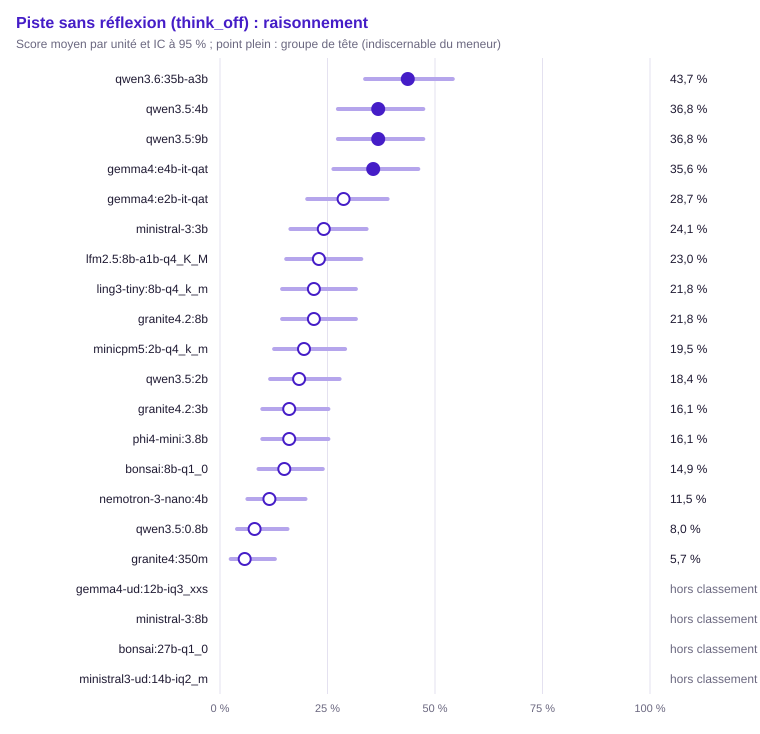

| Groupe | Rang | Modèle | Score (unités communes) | IC 95 % | IC simultané | ET groupée | Unités communes | Score (toutes unités définies) | Couverture | Exclues | Contexte dépassé : modèle / banc | Troncature |
|---|---|---|---|---|---|---|---|---|---|---|---|---|
| 1 | 1 | `qwen3.6:35b-a3b` | 43,7 % | [33,7 % ; 54,1 %] | [29,2 % ; 59,3 %] | 0,053 | 87 | 42,2 % (90) | 100,0 % | 0 | 0 / 0 | 31,5 % (41/130) |
| 1 | 1 | `qwen3.5:4b` | 36,8 % | [27,4 % ; 47,3 %] | [23,3 % ; 52,7 %] | 0,052 | 87 | 35,6 % (90) | 100,0 % | 0 | 0 / 0 | 30,0 % (39/130) |
| 1 | 1 | `qwen3.5:9b` (hors usage) | 36,8 % | [27,4 % ; 47,3 %] | [23,3 % ; 52,7 %] | 0,052 | 87 | 35,6 % (90) | 100,0 % | 0 | 0 / 0 | 30,8 % (40/130) |
| 1 | 1 | `gemma4:e4b-it-qat` | 35,6 % | [26,4 % ; 46,1 %] | [22,4 % ; 51,6 %] | 0,051 | 87 | 34,4 % (90) | 100,0 % | 0 | 0 / 0 | 20,0 % (26/130) |
| 2 | 1 | `gemma4:e2b-it-qat` | 28,7 % | [20,3 % ; 39,0 %] | [16,8 % ; 44,6 %] | 0,049 | 87 | 27,8 % (90) | 100,0 % | 0 | 0 / 0 | 22,3 % (29/130) |
| 2 | 1 | `ministral-3:3b` | 24,1 % | [16,4 % ; 34,1 %] | [13,3 % ; 39,7 %] | 0,046 | 87 | 23,9 % (88) | 97,8 % | 2 | 0 / 2 | 14,8 % (19/128) |
| 2 | 1 | `lfm2.5:8b-a1b-q4_K_M` | 23,0 % | [15,4 % ; 32,9 %] | [12,5 % ; 38,5 %] | 0,045 | 87 | 22,5 % (89) | 98,9 % | 1 | 0 / 0 | 24,0 % (31/129) |
| 2 | 1 | `ling3-tiny:8b-q4_k_m` | 21,8 % | [14,5 % ; 31,6 %] | [11,6 % ; 37,3 %] | 0,044 | 87 | 21,1 % (90) | 100,0 % | 0 | 0 / 0 | 32,3 % (42/130) |
| 2 | 1 | `granite4.2:8b` (hors usage) | 21,8 % | [14,5 % ; 31,6 %] | [11,6 % ; 37,3 %] | 0,044 | 87 | 21,1 % (90) | 100,0 % | 0 | 0 / 0 | 42,3 % (55/130) |
| 2 | 1 | `minicpm5:2b-q4_k_m` | 19,5 % | [12,6 % ; 29,1 %] | [10,0 % ; 34,7 %] | 0,043 | 87 | 18,9 % (90) | 100,0 % | 0 | 0 / 0 | 10,8 % (14/130) |
| 2 | 1 | `qwen3.5:2b` | 18,4 % | [11,6 % ; 27,8 %] | [9,2 % ; 33,4 %] | 0,042 | 87 | 17,8 % (90) | 100,0 % | 0 | 0 / 0 | 25,4 % (33/130) |
| 2 | 1 | `granite4.2:3b` | 16,1 % | [9,8 % ; 25,2 %] | [7,6 % ; 30,8 %] | 0,039 | 87 | 15,6 % (90) | 100,0 % | 0 | 0 / 0 | 48,5 % (63/130) |
| 2 | 1 | `phi4-mini:3.8b` | 16,1 % | [9,8 % ; 25,2 %] | [7,6 % ; 30,8 %] | 0,039 | 87 | 15,6 % (90) | 100,0 % | 0 | 0 / 0 | 2,3 % (3/130) |
| 2 | 1 | `bonsai:8b-q1_0` | 14,9 % | [8,9 % ; 23,9 %] | [6,9 % ; 29,5 %] | 0,038 | 87 | 14,4 % (90) | 100,0 % | 0 | 0 / 0 | 25,4 % (33/130) |
| 2 | 2 | `nemotron-3-nano:4b` | 11,5 % | [6,4 % ; 19,9 %] | [4,7 % ; 25,4 %] | 0,034 | 87 | 11,1 % (90) | 100,0 % | 0 | 0 / 0 | 0,8 % (1/130) |
| 3 | 5 | `qwen3.5:0.8b` | 8,0 % | [4,0 % ; 15,7 %] | [2,8 % ; 21,0 %] | 0,029 | 87 | 7,8 % (90) | 100,0 % | 0 | 0 / 0 | 28,5 % (37/130) |
| 3 | 5 | `granite4:350m` | 5,7 % | [2,5 % ; 12,8 %] | [1,7 % ; 18,0 %] | 0,025 | 87 | 5,6 % (90) | 100,0 % | 0 | 0 / 0 | 0,8 % (1/130) |
| — | — | `gemma4-ud:12b-iq3_xxs` | — | — | — | — | 0 | — (0) | 0,0 % (hors classement) | 90 | 0 / 0 | — (0/0) |
| — | — | `ministral-3:8b` | — | — | — | — | 0 | — (0) | 0,0 % (hors classement) | 90 | 0 / 0 | — (0/0) |
| — | — | `bonsai:27b-q1_0` | — | — | — | — | 0 | — (0) | 0,0 % (hors classement) | 90 | 0 / 0 | — (0/0) |
| — | — | `ministral3-ud:14b-iq2_m` | — | — | — | — | 0 | — (0) | 0,0 % (hors classement) | 90 | 0 / 0 | — (0/0) |

Comparaisons au meneur (Holm sur les m − 1 comparaisons au meneur, m modèles du périmètre) :

| Modèle | Unités | Différence | ET appariée | IC 95 % | b | c | Corrélation | p | p (Holm) | Distingué |
|---|---|---|---|---|---|---|---|---|---|---|
| `granite4:350m` | 87 | +37,9 pts | 0,055 | [+27,2 pts ; +48,6 pts] | 34 | 1 | 0,18 | < 0,001 | < 0,001 | oui |
| `qwen3.5:0.8b` | 87 | +35,6 pts | 0,056 | [+24,6 pts ; +46,7 pts] | 33 | 2 | 0,17 | < 0,001 | < 0,001 | oui |
| `lfm2.5:8b-a1b-q4_K_M` | 87 | +20,7 pts | 0,049 | [+11,1 pts ; +30,3 pts] | 20 | 2 | 0,51 | < 0,001 | < 0,001 | oui |
| `ling3-tiny:8b-q4_k_m` | 87 | +21,8 pts | 0,044 | [+13,2 pts ; +30,5 pts] | 19 | 0 | 0,60 | < 0,001 | < 0,001 | oui |
| `minicpm5:2b-q4_k_m` | 87 | +24,1 pts | 0,054 | [+13,6 pts ; +34,7 pts] | 24 | 3 | 0,38 | < 0,001 | < 0,001 | oui |
| `gemma4:e2b-it-qat` | 87 | +14,9 pts | 0,050 | [+5,1 pts ; +24,8 pts] | 17 | 4 | 0,52 | 0,007 | 0,029 | oui |
| `bonsai:8b-q1_0` | 87 | +28,7 pts | 0,054 | [+18,2 pts ; +39,3 pts] | 27 | 2 | 0,35 | < 0,001 | < 0,001 | oui |
| `qwen3.5:2b` | 87 | +25,3 pts | 0,047 | [+16,2 pts ; +34,4 pts] | 22 | 0 | 0,54 | < 0,001 | < 0,001 | oui |
| `ministral-3:3b` | 87 | +19,5 pts | 0,060 | [+7,7 pts ; +31,4 pts] | 24 | 7 | 0,26 | 0,003 | 0,017 | oui |
| `granite4.2:3b` | 87 | +27,6 pts | 0,053 | [+17,2 pts ; +38,0 pts] | 26 | 2 | 0,37 | < 0,001 | < 0,001 | oui |
| `phi4-mini:3.8b` | 87 | +27,6 pts | 0,060 | [+15,8 pts ; +39,4 pts] | 29 | 5 | 0,18 | < 0,001 | < 0,001 | oui |
| `nemotron-3-nano:4b` | 87 | +32,2 pts | 0,057 | [+20,9 pts ; +43,4 pts] | 31 | 3 | 0,19 | < 0,001 | < 0,001 | oui |
| `qwen3.5:4b` | 87 | +6,9 pts | 0,045 | [−2,0 pts ; +15,8 pts] | 11 | 5 | 0,63 | 0,210 | 0,355 | non |
| `gemma4:e4b-it-qat` | 87 | +8,0 pts | 0,044 | [−0,5 pts ; +16,6 pts] | 11 | 4 | 0,65 | 0,118 | 0,355 | non |
| `qwen3.5:9b` | 87 | +6,9 pts | 0,039 | [−0,8 pts ; +14,6 pts] | 9 | 3 | 0,72 | 0,146 | 0,355 | non |
| `granite4.2:8b` | 87 | +21,8 pts | 0,050 | [+12,1 pts ; +31,6 pts] | 21 | 2 | 0,49 | < 0,001 | < 0,001 | oui |

Matrice exploratoire « qui bat qui » (BH) :

- `lfm2.5:8b-a1b-q4_K_M` devant `granite4:350m` (+17,2 pts, p BH 0,005)
- `ling3-tiny:8b-q4_k_m` devant `granite4:350m` (+16,1 pts, p BH 0,005)
- `minicpm5:2b-q4_k_m` devant `granite4:350m` (+13,8 pts, p BH 0,018)
- `gemma4:e2b-it-qat` devant `granite4:350m` (+23,0 pts, p BH < 0,001)
- `qwen3.5:2b` devant `granite4:350m` (+12,6 pts, p BH 0,018)
- `ministral-3:3b` devant `granite4:350m` (+18,4 pts, p BH 0,002)
- `granite4.2:3b` devant `granite4:350m` (+10,3 pts, p BH 0,027)
- `qwen3.5:4b` devant `granite4:350m` (+31,0 pts, p BH < 0,001)
- `gemma4:e4b-it-qat` devant `granite4:350m` (+29,9 pts, p BH < 0,001)
- `qwen3.5:9b` devant `granite4:350m` (+31,0 pts, p BH < 0,001)
- `qwen3.6:35b-a3b` devant `granite4:350m` (+37,9 pts, p BH < 0,001)
- `granite4.2:8b` devant `granite4:350m` (+16,1 pts, p BH 0,005)
- `lfm2.5:8b-a1b-q4_K_M` devant `qwen3.5:0.8b` (+14,9 pts, p BH 0,012)
- `ling3-tiny:8b-q4_k_m` devant `qwen3.5:0.8b` (+13,8 pts, p BH 0,018)
- `gemma4:e2b-it-qat` devant `qwen3.5:0.8b` (+20,7 pts, p BH 0,002)
- `qwen3.5:2b` devant `qwen3.5:0.8b` (+10,3 pts, p BH 0,048)
- `ministral-3:3b` devant `qwen3.5:0.8b` (+16,1 pts, p BH 0,008)
- `qwen3.5:4b` devant `qwen3.5:0.8b` (+28,7 pts, p BH < 0,001)
- `gemma4:e4b-it-qat` devant `qwen3.5:0.8b` (+27,6 pts, p BH < 0,001)
- `qwen3.5:9b` devant `qwen3.5:0.8b` (+28,7 pts, p BH < 0,001)
- `qwen3.6:35b-a3b` devant `qwen3.5:0.8b` (+35,6 pts, p BH < 0,001)
- `granite4.2:8b` devant `qwen3.5:0.8b` (+13,8 pts, p BH 0,012)
- `qwen3.5:4b` devant `lfm2.5:8b-a1b-q4_K_M` (+13,8 pts, p BH 0,002)
- `gemma4:e4b-it-qat` devant `lfm2.5:8b-a1b-q4_K_M` (+12,6 pts, p BH 0,028)
- `qwen3.5:9b` devant `lfm2.5:8b-a1b-q4_K_M` (+13,8 pts, p BH 0,037)
- `qwen3.6:35b-a3b` devant `lfm2.5:8b-a1b-q4_K_M` (+20,7 pts, p BH < 0,001)
- `qwen3.5:4b` devant `ling3-tiny:8b-q4_k_m` (+14,9 pts, p BH 0,025)
- `gemma4:e4b-it-qat` devant `ling3-tiny:8b-q4_k_m` (+13,8 pts, p BH 0,018)
- `qwen3.5:9b` devant `ling3-tiny:8b-q4_k_m` (+14,9 pts, p BH 0,001)
- `qwen3.6:35b-a3b` devant `ling3-tiny:8b-q4_k_m` (+21,8 pts, p BH < 0,001)
- `qwen3.5:4b` devant `minicpm5:2b-q4_k_m` (+17,2 pts, p BH 0,008)
- `gemma4:e4b-it-qat` devant `minicpm5:2b-q4_k_m` (+16,1 pts, p BH 0,012)
- `qwen3.5:9b` devant `minicpm5:2b-q4_k_m` (+17,2 pts, p BH 0,012)
- `qwen3.6:35b-a3b` devant `minicpm5:2b-q4_k_m` (+24,1 pts, p BH < 0,001)
- `gemma4:e2b-it-qat` devant `bonsai:8b-q1_0` (+13,8 pts, p BH 0,018)
- `gemma4:e2b-it-qat` devant `granite4.2:3b` (+12,6 pts, p BH 0,028)
- `gemma4:e2b-it-qat` devant `nemotron-3-nano:4b` (+17,2 pts, p BH 0,016)
- `qwen3.6:35b-a3b` devant `gemma4:e2b-it-qat` (+14,9 pts, p BH 0,018)
- `qwen3.5:4b` devant `bonsai:8b-q1_0` (+21,8 pts, p BH < 0,001)
- `gemma4:e4b-it-qat` devant `bonsai:8b-q1_0` (+20,7 pts, p BH 0,001)
- `qwen3.5:9b` devant `bonsai:8b-q1_0` (+21,8 pts, p BH < 0,001)
- `qwen3.6:35b-a3b` devant `bonsai:8b-q1_0` (+28,7 pts, p BH < 0,001)
- `qwen3.5:4b` devant `qwen3.5:2b` (+18,4 pts, p BH 0,003)
- `gemma4:e4b-it-qat` devant `qwen3.5:2b` (+17,2 pts, p BH 0,008)
- `qwen3.5:9b` devant `qwen3.5:2b` (+18,4 pts, p BH 0,002)
- `qwen3.6:35b-a3b` devant `qwen3.5:2b` (+25,3 pts, p BH < 0,001)
- `ministral-3:3b` devant `nemotron-3-nano:4b` (+12,6 pts, p BH 0,041)
- `qwen3.6:35b-a3b` devant `ministral-3:3b` (+19,5 pts, p BH 0,010)
- `qwen3.5:4b` devant `granite4.2:3b` (+20,7 pts, p BH < 0,001)
- `gemma4:e4b-it-qat` devant `granite4.2:3b` (+19,5 pts, p BH 0,002)
- `qwen3.5:9b` devant `granite4.2:3b` (+20,7 pts, p BH < 0,001)
- `qwen3.6:35b-a3b` devant `granite4.2:3b` (+27,6 pts, p BH < 0,001)
- `qwen3.5:4b` devant `phi4-mini:3.8b` (+20,7 pts, p BH 0,002)
- `gemma4:e4b-it-qat` devant `phi4-mini:3.8b` (+19,5 pts, p BH 0,005)
- `qwen3.5:9b` devant `phi4-mini:3.8b` (+20,7 pts, p BH 0,004)
- `qwen3.6:35b-a3b` devant `phi4-mini:3.8b` (+27,6 pts, p BH < 0,001)
- `qwen3.5:4b` devant `nemotron-3-nano:4b` (+25,3 pts, p BH < 0,001)
- `gemma4:e4b-it-qat` devant `nemotron-3-nano:4b` (+24,1 pts, p BH 0,002)
- `qwen3.5:9b` devant `nemotron-3-nano:4b` (+25,3 pts, p BH < 0,001)
- `qwen3.6:35b-a3b` devant `nemotron-3-nano:4b` (+32,2 pts, p BH < 0,001)
- `qwen3.5:4b` devant `granite4.2:8b` (+14,9 pts, p BH 0,008)
- `gemma4:e4b-it-qat` devant `granite4.2:8b` (+13,8 pts, p BH 0,012)
- `qwen3.5:9b` devant `granite4.2:8b` (+14,9 pts, p BH 0,012)
- `qwen3.6:35b-a3b` devant `granite4.2:8b` (+21,8 pts, p BH < 0,001)

#### Suivi de consignes (`instructions`)

Méthode : McNemar exact apparié, intervalle de Wilson. Unités : 130, dont 125 communes aux modèles classés (classement, meneur et comparaisons). Meneur : `lfm2.5:8b-a1b-q4_K_M`.

Avertissement : hors classement, couverture sous le seuil : `gemma4-ud:12b-iq3_xxs` (0,0 %), `ministral-3:8b` (0,0 %), `bonsai:27b-q1_0` (0,0 %), `ministral3-ud:14b-iq2_m` (0,0 %). Leur score sur leurs seules unités définies est publié sans rang, groupe ni comparaison.

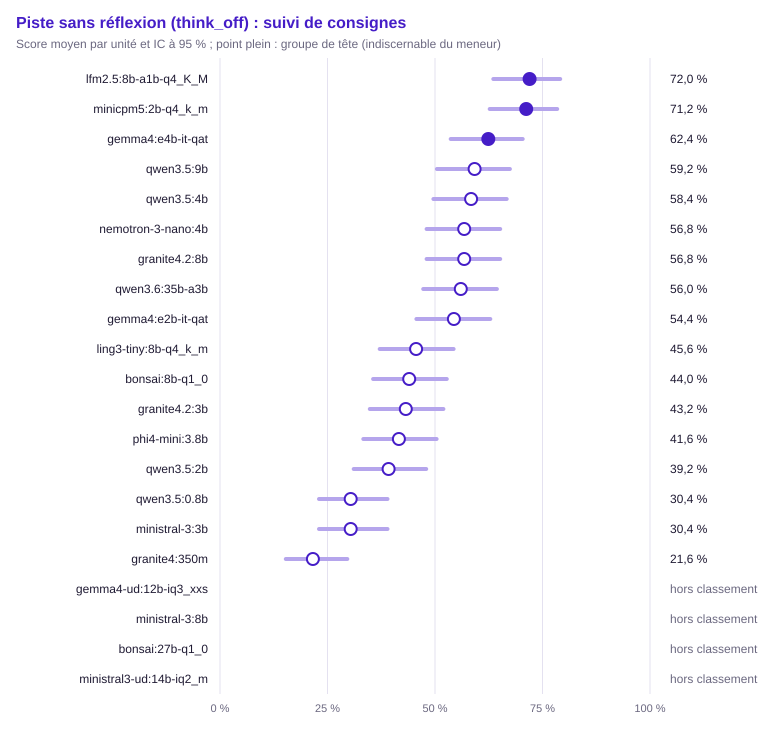

| Groupe | Rang | Modèle | Score (unités communes) | IC 95 % | IC simultané | ET groupée | Unités communes | Score (toutes unités définies) | Couverture | Exclues | Contexte dépassé : modèle / banc | Troncature |
|---|---|---|---|---|---|---|---|---|---|---|---|---|
| 1 | 1 | `lfm2.5:8b-a1b-q4_K_M` | 72,0 % | [63,6 % ; 79,1 %] | [58,9 % ; 82,2 %] | 0,040 | 125 | 72,3 % (130) | 100,0 % | 0 | 0 / 0 | 4,6 % (6/130) |
| 1 | 1 | `minicpm5:2b-q4_k_m` | 71,2 % | [62,7 % ; 78,4 %] | [58,1 % ; 81,5 %] | 0,041 | 125 | 70,8 % (130) | 100,0 % | 0 | 0 / 0 | 3,8 % (5/130) |
| 1 | 1 | `gemma4:e4b-it-qat` | 62,4 % | [53,7 % ; 70,4 %] | [49,1 % ; 74,1 %] | 0,043 | 125 | 63,8 % (130) | 100,0 % | 0 | 0 / 0 | 0,0 % (0/130) |
| 2 | 1 | `qwen3.5:9b` (hors usage) | 59,2 % | [50,4 % ; 67,4 %] | [45,9 % ; 71,2 %] | 0,044 | 125 | 60,0 % (130) | 100,0 % | 0 | 0 / 0 | 0,8 % (1/130) |
| 2 | 1 | `qwen3.5:4b` | 58,4 % | [49,6 % ; 66,7 %] | [45,2 % ; 70,5 %] | 0,044 | 125 | 58,5 % (130) | 100,0 % | 0 | 0 / 0 | 1,5 % (2/130) |
| 2 | 1 | `nemotron-3-nano:4b` | 56,8 % | [48,0 % ; 65,2 %] | [43,6 % ; 69,1 %] | 0,044 | 125 | 57,1 % (126) | 96,9 % | 4 | 0 / 0 | 10,3 % (13/126) |
| 2 | 1 | `granite4.2:8b` (hors usage) | 56,8 % | [48,0 % ; 65,2 %] | [43,6 % ; 69,1 %] | 0,044 | 125 | 56,2 % (130) | 100,0 % | 0 | 0 / 0 | 5,4 % (7/130) |
| 2 | 1 | `qwen3.6:35b-a3b` | 56,0 % | [47,2 % ; 64,4 %] | [42,8 % ; 68,4 %] | 0,044 | 125 | 55,4 % (130) | 100,0 % | 0 | 0 / 0 | 2,3 % (3/130) |
| 2 | 1 | `gemma4:e2b-it-qat` | 54,4 % | [45,7 % ; 62,9 %] | [41,3 % ; 66,9 %] | 0,045 | 125 | 53,8 % (130) | 100,0 % | 0 | 0 / 0 | 0,8 % (1/130) |
| 3 | 2 | `ling3-tiny:8b-q4_k_m` | 45,6 % | [37,1 % ; 54,3 %] | [33,1 % ; 58,7 %] | 0,045 | 125 | 45,4 % (130) | 100,0 % | 0 | 0 / 0 | 6,9 % (9/130) |
| 3 | 3 | `bonsai:8b-q1_0` | 44,0 % | [35,6 % ; 52,8 %] | [31,6 % ; 57,2 %] | 0,044 | 125 | 44,6 % (130) | 100,0 % | 0 | 0 / 0 | 5,4 % (7/130) |
| 3 | 3 | `granite4.2:3b` | 43,2 % | [34,8 % ; 52,0 %] | [30,9 % ; 56,4 %] | 0,044 | 125 | 42,3 % (130) | 100,0 % | 0 | 0 / 0 | 10,0 % (13/130) |
| 3 | 3 | `phi4-mini:3.8b` | 41,6 % | [33,3 % ; 50,4 %] | [29,5 % ; 54,8 %] | 0,044 | 125 | 42,6 % (129) | 99,2 % | 1 | 0 / 0 | 7,0 % (9/129) |
| 3 | 3 | `qwen3.5:2b` | 39,2 % | [31,1 % ; 48,0 %] | [27,3 % ; 52,5 %] | 0,044 | 125 | 37,7 % (130) | 100,0 % | 0 | 0 / 0 | 5,4 % (7/130) |
| 4 | 8 | `qwen3.5:0.8b` | 30,4 % | [23,0 % ; 38,9 %] | [19,8 % ; 43,6 %] | 0,041 | 125 | 30,0 % (130) | 100,0 % | 0 | 0 / 0 | 6,2 % (8/130) |
| 4 | 8 | `ministral-3:3b` | 30,4 % | [23,0 % ; 38,9 %] | [19,8 % ; 43,6 %] | 0,041 | 125 | 31,5 % (130) | 100,0 % | 0 | 0 / 0 | 1,5 % (2/130) |
| 4 | 10 | `granite4:350m` | 21,6 % | [15,3 % ; 29,6 %] | [12,7 % ; 34,2 %] | 0,037 | 125 | 20,9 % (129) | 99,2 % | 1 | 0 / 0 | 14,0 % (18/129) |
| — | — | `gemma4-ud:12b-iq3_xxs` | — | — | — | — | 0 | — (0) | 0,0 % (hors classement) | 130 | 0 / 0 | — (0/0) |
| — | — | `ministral-3:8b` | — | — | — | — | 0 | — (0) | 0,0 % (hors classement) | 130 | 0 / 0 | — (0/0) |
| — | — | `bonsai:27b-q1_0` | — | — | — | — | 0 | — (0) | 0,0 % (hors classement) | 130 | 0 / 0 | — (0/0) |
| — | — | `ministral3-ud:14b-iq2_m` | — | — | — | — | 0 | — (0) | 0,0 % (hors classement) | 130 | 0 / 0 | — (0/0) |

Comparaisons au meneur (Holm sur les m − 1 comparaisons au meneur, m modèles du périmètre) :

| Modèle | Unités | Différence | ET appariée | IC 95 % | b | c | Corrélation | p | p (Holm) | Distingué |
|---|---|---|---|---|---|---|---|---|---|---|
| `granite4:350m` | 125 | +50,4 pts | 0,046 | [+41,4 pts ; +59,4 pts] | 64 | 1 | 0,28 | < 0,001 | < 0,001 | oui |
| `qwen3.5:0.8b` | 125 | +41,6 pts | 0,046 | [+32,7 pts ; +50,5 pts] | 53 | 1 | 0,37 | < 0,001 | < 0,001 | oui |
| `ling3-tiny:8b-q4_k_m` | 125 | +26,4 pts | 0,048 | [+17,0 pts ; +35,8 pts] | 39 | 6 | 0,36 | < 0,001 | < 0,001 | oui |
| `minicpm5:2b-q4_k_m` | 125 | +0,8 pts | 0,042 | [−7,3 pts ; +8,9 pts] | 14 | 13 | 0,47 | 1,000 | 1,000 | non |
| `gemma4:e2b-it-qat` | 125 | +17,6 pts | 0,047 | [+8,4 pts ; +26,8 pts] | 30 | 8 | 0,39 | < 0,001 | 0,004 | oui |
| `bonsai:8b-q1_0` | 125 | +28,0 pts | 0,043 | [+19,5 pts ; +36,5 pts] | 37 | 2 | 0,48 | < 0,001 | < 0,001 | oui |
| `qwen3.5:2b` | 125 | +32,8 pts | 0,046 | [+23,7 pts ; +41,9 pts] | 44 | 3 | 0,39 | < 0,001 | < 0,001 | oui |
| `ministral-3:3b` | 125 | +41,6 pts | 0,046 | [+32,7 pts ; +50,5 pts] | 53 | 1 | 0,37 | < 0,001 | < 0,001 | oui |
| `granite4.2:3b` | 125 | +28,8 pts | 0,050 | [+18,9 pts ; +38,7 pts] | 43 | 7 | 0,29 | < 0,001 | < 0,001 | oui |
| `phi4-mini:3.8b` | 125 | +30,4 pts | 0,047 | [+21,2 pts ; +39,6 pts] | 42 | 4 | 0,38 | < 0,001 | < 0,001 | oui |
| `nemotron-3-nano:4b` | 125 | +15,2 pts | 0,041 | [+7,2 pts ; +23,2 pts] | 24 | 5 | 0,54 | < 0,001 | 0,004 | oui |
| `qwen3.5:4b` | 125 | +13,6 pts | 0,041 | [+5,5 pts ; +21,7 pts] | 23 | 6 | 0,52 | 0,002 | 0,012 | oui |
| `gemma4:e4b-it-qat` | 125 | +9,6 pts | 0,044 | [+0,9 pts ; +18,3 pts] | 22 | 10 | 0,44 | 0,050 | 0,100 | non |
| `qwen3.5:9b` | 125 | +12,8 pts | 0,048 | [+3,4 pts ; +22,2 pts] | 27 | 11 | 0,35 | 0,014 | 0,042 | oui |
| `qwen3.6:35b-a3b` | 125 | +16,0 pts | 0,046 | [+7,0 pts ; +25,0 pts] | 28 | 8 | 0,42 | 0,001 | 0,007 | oui |
| `granite4.2:8b` | 125 | +15,2 pts | 0,048 | [+5,8 pts ; +24,6 pts] | 29 | 10 | 0,36 | 0,003 | 0,014 | oui |

Matrice exploratoire « qui bat qui » (BH) :

- `lfm2.5:8b-a1b-q4_K_M` devant `granite4:350m` (+50,4 pts, p BH < 0,001)
- `ling3-tiny:8b-q4_k_m` devant `granite4:350m` (+24,0 pts, p BH < 0,001)
- `minicpm5:2b-q4_k_m` devant `granite4:350m` (+49,6 pts, p BH < 0,001)
- `gemma4:e2b-it-qat` devant `granite4:350m` (+32,8 pts, p BH < 0,001)
- `bonsai:8b-q1_0` devant `granite4:350m` (+22,4 pts, p BH < 0,001)
- `qwen3.5:2b` devant `granite4:350m` (+17,6 pts, p BH < 0,001)
- `granite4.2:3b` devant `granite4:350m` (+21,6 pts, p BH < 0,001)
- `phi4-mini:3.8b` devant `granite4:350m` (+20,0 pts, p BH < 0,001)
- `nemotron-3-nano:4b` devant `granite4:350m` (+35,2 pts, p BH < 0,001)
- `qwen3.5:4b` devant `granite4:350m` (+36,8 pts, p BH < 0,001)
- `gemma4:e4b-it-qat` devant `granite4:350m` (+40,8 pts, p BH < 0,001)
- `qwen3.5:9b` devant `granite4:350m` (+37,6 pts, p BH < 0,001)
- `qwen3.6:35b-a3b` devant `granite4:350m` (+34,4 pts, p BH < 0,001)
- `granite4.2:8b` devant `granite4:350m` (+35,2 pts, p BH < 0,001)
- `lfm2.5:8b-a1b-q4_K_M` devant `qwen3.5:0.8b` (+41,6 pts, p BH < 0,001)
- `ling3-tiny:8b-q4_k_m` devant `qwen3.5:0.8b` (+15,2 pts, p BH 0,005)
- `minicpm5:2b-q4_k_m` devant `qwen3.5:0.8b` (+40,8 pts, p BH < 0,001)
- `gemma4:e2b-it-qat` devant `qwen3.5:0.8b` (+24,0 pts, p BH < 0,001)
- `bonsai:8b-q1_0` devant `qwen3.5:0.8b` (+13,6 pts, p BH 0,008)
- `granite4.2:3b` devant `qwen3.5:0.8b` (+12,8 pts, p BH 0,025)
- `phi4-mini:3.8b` devant `qwen3.5:0.8b` (+11,2 pts, p BH 0,035)
- `nemotron-3-nano:4b` devant `qwen3.5:0.8b` (+26,4 pts, p BH < 0,001)
- `qwen3.5:4b` devant `qwen3.5:0.8b` (+28,0 pts, p BH < 0,001)
- `gemma4:e4b-it-qat` devant `qwen3.5:0.8b` (+32,0 pts, p BH < 0,001)
- `qwen3.5:9b` devant `qwen3.5:0.8b` (+28,8 pts, p BH < 0,001)
- `qwen3.6:35b-a3b` devant `qwen3.5:0.8b` (+25,6 pts, p BH < 0,001)
- `granite4.2:8b` devant `qwen3.5:0.8b` (+26,4 pts, p BH < 0,001)
- `lfm2.5:8b-a1b-q4_K_M` devant `ling3-tiny:8b-q4_k_m` (+26,4 pts, p BH < 0,001)
- `lfm2.5:8b-a1b-q4_K_M` devant `gemma4:e2b-it-qat` (+17,6 pts, p BH 0,001)
- `lfm2.5:8b-a1b-q4_K_M` devant `bonsai:8b-q1_0` (+28,0 pts, p BH < 0,001)
- `lfm2.5:8b-a1b-q4_K_M` devant `qwen3.5:2b` (+32,8 pts, p BH < 0,001)
- `lfm2.5:8b-a1b-q4_K_M` devant `ministral-3:3b` (+41,6 pts, p BH < 0,001)
- `lfm2.5:8b-a1b-q4_K_M` devant `granite4.2:3b` (+28,8 pts, p BH < 0,001)
- `lfm2.5:8b-a1b-q4_K_M` devant `phi4-mini:3.8b` (+30,4 pts, p BH < 0,001)
- `lfm2.5:8b-a1b-q4_K_M` devant `nemotron-3-nano:4b` (+15,2 pts, p BH 0,001)
- `lfm2.5:8b-a1b-q4_K_M` devant `qwen3.5:4b` (+13,6 pts, p BH 0,004)
- `lfm2.5:8b-a1b-q4_K_M` devant `qwen3.5:9b` (+12,8 pts, p BH 0,021)
- `lfm2.5:8b-a1b-q4_K_M` devant `qwen3.6:35b-a3b` (+16,0 pts, p BH 0,003)
- `lfm2.5:8b-a1b-q4_K_M` devant `granite4.2:8b` (+15,2 pts, p BH 0,006)
- `minicpm5:2b-q4_k_m` devant `ling3-tiny:8b-q4_k_m` (+25,6 pts, p BH < 0,001)
- `ling3-tiny:8b-q4_k_m` devant `ministral-3:3b` (+15,2 pts, p BH 0,003)
- `qwen3.5:4b` devant `ling3-tiny:8b-q4_k_m` (+12,8 pts, p BH 0,009)
- `gemma4:e4b-it-qat` devant `ling3-tiny:8b-q4_k_m` (+16,8 pts, p BH < 0,001)
- `qwen3.5:9b` devant `ling3-tiny:8b-q4_k_m` (+13,6 pts, p BH 0,004)
- `qwen3.6:35b-a3b` devant `ling3-tiny:8b-q4_k_m` (+10,4 pts, p BH 0,042)
- `granite4.2:8b` devant `ling3-tiny:8b-q4_k_m` (+11,2 pts, p BH 0,035)
- `minicpm5:2b-q4_k_m` devant `gemma4:e2b-it-qat` (+16,8 pts, p BH < 0,001)
- `minicpm5:2b-q4_k_m` devant `bonsai:8b-q1_0` (+27,2 pts, p BH < 0,001)
- `minicpm5:2b-q4_k_m` devant `qwen3.5:2b` (+32,0 pts, p BH < 0,001)
- `minicpm5:2b-q4_k_m` devant `ministral-3:3b` (+40,8 pts, p BH < 0,001)
- `minicpm5:2b-q4_k_m` devant `granite4.2:3b` (+28,0 pts, p BH < 0,001)
- `minicpm5:2b-q4_k_m` devant `phi4-mini:3.8b` (+29,6 pts, p BH < 0,001)
- `minicpm5:2b-q4_k_m` devant `nemotron-3-nano:4b` (+14,4 pts, p BH 0,004)
- `minicpm5:2b-q4_k_m` devant `qwen3.5:4b` (+12,8 pts, p BH 0,003)
- `minicpm5:2b-q4_k_m` devant `qwen3.5:9b` (+12,0 pts, p BH 0,013)
- `minicpm5:2b-q4_k_m` devant `qwen3.6:35b-a3b` (+15,2 pts, p BH 0,002)
- `minicpm5:2b-q4_k_m` devant `granite4.2:8b` (+14,4 pts, p BH 0,005)
- `gemma4:e2b-it-qat` devant `bonsai:8b-q1_0` (+10,4 pts, p BH 0,035)
- `gemma4:e2b-it-qat` devant `qwen3.5:2b` (+15,2 pts, p BH 0,007)
- `gemma4:e2b-it-qat` devant `ministral-3:3b` (+24,0 pts, p BH < 0,001)
- `gemma4:e2b-it-qat` devant `granite4.2:3b` (+11,2 pts, p BH 0,025)
- `gemma4:e2b-it-qat` devant `phi4-mini:3.8b` (+12,8 pts, p BH 0,006)
- `bonsai:8b-q1_0` devant `ministral-3:3b` (+13,6 pts, p BH 0,003)
- `nemotron-3-nano:4b` devant `bonsai:8b-q1_0` (+12,8 pts, p BH 0,009)
- `qwen3.5:4b` devant `bonsai:8b-q1_0` (+14,4 pts, p BH < 0,001)
- `gemma4:e4b-it-qat` devant `bonsai:8b-q1_0` (+18,4 pts, p BH < 0,001)
- `qwen3.5:9b` devant `bonsai:8b-q1_0` (+15,2 pts, p BH < 0,001)
- `qwen3.6:35b-a3b` devant `bonsai:8b-q1_0` (+12,0 pts, p BH 0,013)
- `granite4.2:8b` devant `bonsai:8b-q1_0` (+12,8 pts, p BH 0,011)
- `nemotron-3-nano:4b` devant `qwen3.5:2b` (+17,6 pts, p BH 0,003)
- `qwen3.5:4b` devant `qwen3.5:2b` (+19,2 pts, p BH < 0,001)
- `gemma4:e4b-it-qat` devant `qwen3.5:2b` (+23,2 pts, p BH < 0,001)
- `qwen3.5:9b` devant `qwen3.5:2b` (+20,0 pts, p BH < 0,001)
- `qwen3.6:35b-a3b` devant `qwen3.5:2b` (+16,8 pts, p BH 0,001)
- `granite4.2:8b` devant `qwen3.5:2b` (+17,6 pts, p BH < 0,001)
- `granite4.2:3b` devant `ministral-3:3b` (+12,8 pts, p BH 0,002)
- `phi4-mini:3.8b` devant `ministral-3:3b` (+11,2 pts, p BH 0,030)
- `nemotron-3-nano:4b` devant `ministral-3:3b` (+26,4 pts, p BH < 0,001)
- `qwen3.5:4b` devant `ministral-3:3b` (+28,0 pts, p BH < 0,001)
- `gemma4:e4b-it-qat` devant `ministral-3:3b` (+32,0 pts, p BH < 0,001)
- `qwen3.5:9b` devant `ministral-3:3b` (+28,8 pts, p BH < 0,001)
- `qwen3.6:35b-a3b` devant `ministral-3:3b` (+25,6 pts, p BH < 0,001)
- `granite4.2:8b` devant `ministral-3:3b` (+26,4 pts, p BH < 0,001)
- `nemotron-3-nano:4b` devant `granite4.2:3b` (+13,6 pts, p BH 0,008)
- `qwen3.5:4b` devant `granite4.2:3b` (+15,2 pts, p BH 0,003)
- `gemma4:e4b-it-qat` devant `granite4.2:3b` (+19,2 pts, p BH < 0,001)
- `qwen3.5:9b` devant `granite4.2:3b` (+16,0 pts, p BH < 0,001)
- `qwen3.6:35b-a3b` devant `granite4.2:3b` (+12,8 pts, p BH 0,014)
- `granite4.2:8b` devant `granite4.2:3b` (+13,6 pts, p BH 0,004)
- `nemotron-3-nano:4b` devant `phi4-mini:3.8b` (+15,2 pts, p BH 0,004)
- `qwen3.5:4b` devant `phi4-mini:3.8b` (+16,8 pts, p BH 0,002)
- `gemma4:e4b-it-qat` devant `phi4-mini:3.8b` (+20,8 pts, p BH < 0,001)
- `qwen3.5:9b` devant `phi4-mini:3.8b` (+17,6 pts, p BH < 0,001)
- `qwen3.6:35b-a3b` devant `phi4-mini:3.8b` (+14,4 pts, p BH 0,003)
- `granite4.2:8b` devant `phi4-mini:3.8b` (+15,2 pts, p BH 0,004)

Métrique continue : part de consignes suivies (`instructions_followed`), meneur `lfm2.5:8b-a1b-q4_K_M`.

| Modèle | Moyenne (unités communes) | Unités communes | Moyenne (toutes) | Couverture | Exclues |
|---|---|---|---|---|---|
| `granite4:350m` | 31,5 % | 125 | 30,8 % (129) | 99,2 % | 1 |
| `qwen3.5:0.8b` | 45,3 % | 125 | 44,6 % (130) | 100,0 % | 0 |
| `lfm2.5:8b-a1b-q4_K_M` | 79,1 % | 125 | 79,2 % (130) | 100,0 % | 0 |
| `ling3-tiny:8b-q4_k_m` | 59,0 % | 125 | 58,8 % (130) | 100,0 % | 0 |
| `minicpm5:2b-q4_k_m` | 75,8 % | 125 | 75,2 % (130) | 100,0 % | 0 |
| `gemma4:e2b-it-qat` | 65,5 % | 125 | 64,6 % (130) | 100,0 % | 0 |
| `bonsai:8b-q1_0` | 55,9 % | 125 | 56,0 % (130) | 100,0 % | 0 |
| `qwen3.5:2b` | 53,5 % | 125 | 52,3 % (130) | 100,0 % | 0 |
| `ministral-3:3b` | 47,0 % | 125 | 48,4 % (130) | 100,0 % | 0 |
| `granite4.2:3b` | 57,1 % | 125 | 56,0 % (130) | 100,0 % | 0 |
| `phi4-mini:3.8b` | 56,3 % | 125 | 56,9 % (129) | 99,2 % | 1 |
| `nemotron-3-nano:4b` | 65,3 % | 125 | 65,6 % (126) | 96,9 % | 4 |
| `qwen3.5:4b` | 67,5 % | 125 | 67,2 % (130) | 100,0 % | 0 |
| `gemma4:e4b-it-qat` | 72,1 % | 125 | 73,1 % (130) | 100,0 % | 0 |
| `qwen3.5:9b` | 68,3 % | 125 | 69,2 % (130) | 100,0 % | 0 |
| `qwen3.6:35b-a3b` | 66,9 % | 125 | 66,3 % (130) | 100,0 % | 0 |
| `granite4.2:8b` | 68,9 % | 125 | 68,3 % (130) | 100,0 % | 0 |
| `gemma4-ud:12b-iq3_xxs` | — | 0 | — (0) | 0,0 % (hors classement) | 130 |
| `ministral-3:8b` | — | 0 | — (0) | 0,0 % (hors classement) | 130 |
| `bonsai:27b-q1_0` | — | 0 | — (0) | 0,0 % (hors classement) | 130 |
| `ministral3-ud:14b-iq2_m` | — | 0 | — (0) | 0,0 % (hors classement) | 130 |

Différence au meneur, IC bootstrap apparié à 95 % :

| Modèle | Unités | Différence | IC bootstrap |
|---|---|---|---|
| `granite4:350m` | 125 | +47,6 pts | [+40,1 pts ; +55,5 pts] |
| `qwen3.5:0.8b` | 125 | +33,8 pts | [+27,0 pts ; +40,7 pts] |
| `ling3-tiny:8b-q4_k_m` | 125 | +20,1 pts | [+12,5 pts ; +27,9 pts] |
| `minicpm5:2b-q4_k_m` | 125 | +3,3 pts | [−3,8 pts ; +10,0 pts] |
| `gemma4:e2b-it-qat` | 125 | +13,6 pts | [+6,4 pts ; +20,8 pts] |
| `bonsai:8b-q1_0` | 125 | +23,3 pts | [+16,8 pts ; +30,2 pts] |
| `qwen3.5:2b` | 125 | +25,7 pts | [+19,0 pts ; +32,7 pts] |
| `ministral-3:3b` | 125 | +32,1 pts | [+25,1 pts ; +39,5 pts] |
| `granite4.2:3b` | 125 | +22,0 pts | [+14,1 pts ; +30,3 pts] |
| `phi4-mini:3.8b` | 125 | +22,8 pts | [+15,8 pts ; +30,7 pts] |
| `nemotron-3-nano:4b` | 125 | +13,8 pts | [+7,5 pts ; +20,7 pts] |
| `qwen3.5:4b` | 125 | +11,7 pts | [+5,2 pts ; +18,5 pts] |
| `gemma4:e4b-it-qat` | 125 | +7,1 pts | [+0,2 pts ; +14,1 pts] |
| `qwen3.5:9b` | 125 | +10,9 pts | [+3,4 pts ; +18,2 pts] |
| `qwen3.6:35b-a3b` | 125 | +12,3 pts | [+6,3 pts ; +18,8 pts] |
| `granite4.2:8b` | 125 | +10,3 pts | [+2,4 pts ; +17,5 pts] |

#### Appels d'outils (`tools`)

Méthode : McNemar exact apparié, intervalle de Wilson. Unités : 130, dont 120 communes aux modèles classés (classement, meneur et comparaisons). Meneur : `qwen3.5:4b`.

Avertissement : hors classement, couverture sous le seuil : `gemma4-ud:12b-iq3_xxs` (0,0 %), `ministral-3:8b` (0,0 %), `bonsai:27b-q1_0` (0,0 %), `ministral3-ud:14b-iq2_m` (0,0 %). Leur score sur leurs seules unités définies est publié sans rang, groupe ni comparaison.

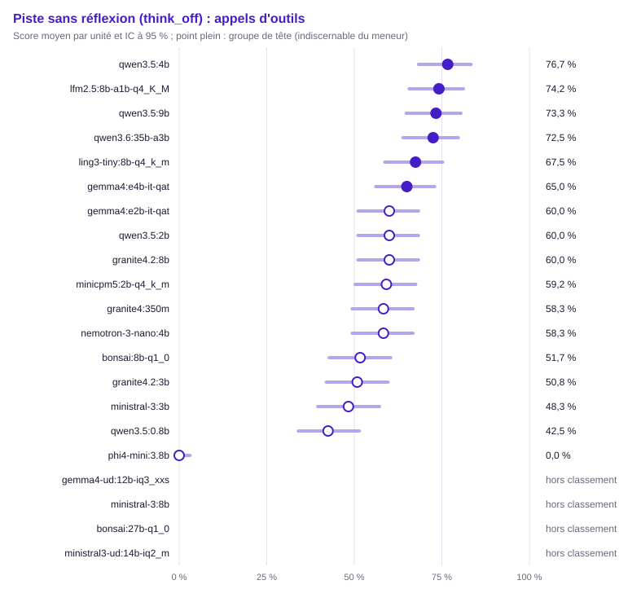

| Groupe | Rang | Modèle | Score (unités communes) | IC 95 % | IC simultané | ET groupée | Unités communes | Score (toutes unités définies) | Couverture | Exclues | Contexte dépassé : modèle / banc | Troncature |
|---|---|---|---|---|---|---|---|---|---|---|---|---|
| 1 | 1 | `qwen3.5:4b` | 76,7 % | [68,3 % ; 83,3 %] | [63,6 % ; 86,1 %] | 0,039 | 120 | 76,6 % (128) | 98,5 % | 2 | 0 / 2 | 0,0 % (0/128) |
| 1 | 1 | `lfm2.5:8b-a1b-q4_K_M` | 74,2 % | [65,7 % ; 81,2 %] | [60,9 % ; 84,1 %] | 0,040 | 120 | 71,5 % (130) | 100,0 % | 0 | 0 / 0 | 0,8 % (1/130) |
| 1 | 1 | `qwen3.5:9b` (hors usage) | 73,3 % | [64,8 % ; 80,4 %] | [60,0 % ; 83,4 %] | 0,040 | 120 | 72,9 % (129) | 99,2 % | 1 | 0 / 1 | 0,0 % (0/129) |
| 1 | 1 | `qwen3.6:35b-a3b` | 72,5 % | [63,9 % ; 79,7 %] | [59,2 % ; 82,8 %] | 0,041 | 120 | 71,1 % (128) | 98,5 % | 2 | 0 / 2 | 0,0 % (0/128) |
| 1 | 1 | `ling3-tiny:8b-q4_k_m` | 67,5 % | [58,7 % ; 75,2 %] | [54,0 % ; 78,6 %] | 0,043 | 120 | 67,4 % (129) | 99,2 % | 1 | 0 / 1 | 0,0 % (0/129) |
| 1 | 1 | `gemma4:e4b-it-qat` | 65,0 % | [56,1 % ; 72,9 %] | [51,4 % ; 76,5 %] | 0,044 | 120 | 61,5 % (130) | 100,0 % | 0 | 0 / 0 | 0,0 % (0/130) |
| 2 | 1 | `gemma4:e2b-it-qat` | 60,0 % | [51,1 % ; 68,3 %] | [46,5 % ; 72,2 %] | 0,045 | 120 | 56,9 % (130) | 100,0 % | 0 | 0 / 0 | 0,0 % (0/130) |
| 2 | 1 | `qwen3.5:2b` | 60,0 % | [51,1 % ; 68,3 %] | [46,5 % ; 72,2 %] | 0,045 | 120 | 56,7 % (127) | 97,7 % | 3 | 0 / 3 | 0,0 % (0/127) |
| 2 | 1 | `granite4.2:8b` (hors usage) | 60,0 % | [51,1 % ; 68,3 %] | [46,5 % ; 72,2 %] | 0,045 | 120 | 60,9 % (128) | 98,5 % | 2 | 0 / 2 | 0,0 % (0/128) |
| 2 | 1 | `minicpm5:2b-q4_k_m` | 59,2 % | [50,2 % ; 67,5 %] | [45,6 % ; 71,4 %] | 0,045 | 120 | 56,2 % (130) | 100,0 % | 0 | 0 / 0 | 0,0 % (0/130) |
| 2 | 1 | `granite4:350m` | 58,3 % | [49,4 % ; 66,8 %] | [44,8 % ; 70,7 %] | 0,045 | 120 | 54,6 % (130) | 100,0 % | 0 | 0 / 0 | 0,8 % (1/130) |
| 2 | 1 | `nemotron-3-nano:4b` | 58,3 % | [49,4 % ; 66,8 %] | [44,8 % ; 70,7 %] | 0,045 | 120 | 57,4 % (122) | 93,8 % | 8 | 0 / 8 | 0,8 % (1/122) |
| 2 | 1 | `bonsai:8b-q1_0` | 51,7 % | [42,8 % ; 60,4 %] | [38,5 % ; 64,6 %] | 0,046 | 120 | 48,8 % (129) | 99,2 % | 1 | 0 / 0 | 0,0 % (0/129) |
| 2 | 1 | `granite4.2:3b` | 50,8 % | [42,0 % ; 59,6 %] | [37,7 % ; 63,9 %] | 0,046 | 120 | 48,8 % (129) | 99,2 % | 1 | 0 / 1 | 0,0 % (0/129) |
| 2 | 2 | `ministral-3:3b` | 48,3 % | [39,6 % ; 57,2 %] | [35,4 % ; 61,5 %] | 0,046 | 120 | 45,7 % (129) | 99,2 % | 1 | 0 / 0 | 0,0 % (0/129) |
| 3 | 5 | `qwen3.5:0.8b` | 42,5 % | [34,0 % ; 51,4 %] | [30,1 % ; 56,0 %] | 0,045 | 120 | 42,2 % (128) | 98,5 % | 2 | 0 / 2 | 0,0 % (0/128) |
| 4 | 17 | `phi4-mini:3.8b` | 0,0 % | [0,0 % ; 3,1 %] | [0,0 % ; 6,9 %] | 0,000 | 120 | 0,0 % (130) | 100,0 % | 0 | 0 / 0 | 0,0 % (0/130) |
| — | — | `gemma4-ud:12b-iq3_xxs` | — | — | — | — | 0 | — (0) | 0,0 % (hors classement) | 130 | 0 / 0 | — (0/0) |
| — | — | `ministral-3:8b` | — | — | — | — | 0 | — (0) | 0,0 % (hors classement) | 130 | 0 / 0 | — (0/0) |
| — | — | `bonsai:27b-q1_0` | — | — | — | — | 0 | — (0) | 0,0 % (hors classement) | 130 | 0 / 0 | — (0/0) |
| — | — | `ministral3-ud:14b-iq2_m` | — | — | — | — | 0 | — (0) | 0,0 % (hors classement) | 130 | 0 / 0 | — (0/0) |

Comparaisons au meneur (Holm sur les m − 1 comparaisons au meneur, m modèles du périmètre) :

| Modèle | Unités | Différence | ET appariée | IC 95 % | b | c | Corrélation | p | p (Holm) | Distingué |
|---|---|---|---|---|---|---|---|---|---|---|
| `granite4:350m` | 120 | +18,3 pts | 0,051 | [+8,3 pts ; +28,4 pts] | 32 | 10 | 0,25 | < 0,001 | 0,007 | oui |
| `qwen3.5:0.8b` | 120 | +34,2 pts | 0,046 | [+25,1 pts ; +43,3 pts] | 43 | 2 | 0,39 | < 0,001 | < 0,001 | oui |
| `lfm2.5:8b-a1b-q4_K_M` | 120 | +2,5 pts | 0,043 | [−6,0 pts ; +11,0 pts] | 15 | 12 | 0,39 | 0,701 | 0,909 | non |
| `ling3-tiny:8b-q4_k_m` | 120 | +9,2 pts | 0,039 | [+1,5 pts ; +16,8 pts] | 17 | 6 | 0,54 | 0,035 | 0,139 | non |
| `minicpm5:2b-q4_k_m` | 120 | +17,5 pts | 0,044 | [+9,0 pts ; +26,0 pts] | 26 | 5 | 0,46 | < 0,001 | 0,002 | oui |
| `gemma4:e2b-it-qat` | 120 | +16,7 pts | 0,043 | [+8,2 pts ; +25,1 pts] | 25 | 5 | 0,47 | < 0,001 | 0,003 | oui |
| `bonsai:8b-q1_0` | 120 | +25,0 pts | 0,040 | [+17,3 pts ; +32,7 pts] | 30 | 0 | 0,57 | < 0,001 | < 0,001 | oui |
| `qwen3.5:2b` | 120 | +16,7 pts | 0,040 | [+8,9 pts ; +24,4 pts] | 23 | 3 | 0,56 | < 0,001 | < 0,001 | oui |
| `ministral-3:3b` | 120 | +28,3 pts | 0,049 | [+18,8 pts ; +37,9 pts] | 39 | 5 | 0,34 | < 0,001 | < 0,001 | oui |
| `granite4.2:3b` | 120 | +25,8 pts | 0,046 | [+16,7 pts ; +34,9 pts] | 35 | 4 | 0,40 | < 0,001 | < 0,001 | oui |
| `phi4-mini:3.8b` | 120 | +76,7 pts | 0,039 | [+69,1 pts ; +84,2 pts] | 92 | 0 | — | < 0,001 | < 0,001 | oui |
| `nemotron-3-nano:4b` | 120 | +18,3 pts | 0,044 | [+9,7 pts ; +27,0 pts] | 27 | 5 | 0,45 | < 0,001 | 0,001 | oui |
| `gemma4:e4b-it-qat` | 120 | +11,7 pts | 0,044 | [+3,0 pts ; +20,4 pts] | 22 | 8 | 0,42 | 0,016 | 0,081 | non |
| `qwen3.5:9b` | 120 | +3,3 pts | 0,033 | [−3,2 pts ; +9,8 pts] | 10 | 6 | 0,65 | 0,454 | 0,909 | non |
| `qwen3.6:35b-a3b` | 120 | +4,2 pts | 0,032 | [−2,1 pts ; +10,4 pts] | 10 | 5 | 0,68 | 0,302 | 0,905 | non |
| `granite4.2:8b` | 120 | +16,7 pts | 0,048 | [+7,3 pts ; +26,0 pts] | 28 | 8 | 0,35 | 0,001 | 0,007 | oui |

Matrice exploratoire « qui bat qui » (BH) :

- `granite4:350m` devant `qwen3.5:0.8b` (+15,8 pts, p BH 0,010)
- `lfm2.5:8b-a1b-q4_K_M` devant `granite4:350m` (+15,8 pts, p BH 0,007)
- `granite4:350m` devant `phi4-mini:3.8b` (+58,3 pts, p BH < 0,001)
- `qwen3.5:4b` devant `granite4:350m` (+18,3 pts, p BH 0,003)
- `qwen3.5:9b` devant `granite4:350m` (+15,0 pts, p BH 0,011)
- `qwen3.6:35b-a3b` devant `granite4:350m` (+14,2 pts, p BH 0,031)
- `lfm2.5:8b-a1b-q4_K_M` devant `qwen3.5:0.8b` (+31,7 pts, p BH < 0,001)
- `ling3-tiny:8b-q4_k_m` devant `qwen3.5:0.8b` (+25,0 pts, p BH < 0,001)
- `minicpm5:2b-q4_k_m` devant `qwen3.5:0.8b` (+16,7 pts, p BH 0,007)
- `gemma4:e2b-it-qat` devant `qwen3.5:0.8b` (+17,5 pts, p BH 0,003)
- `qwen3.5:2b` devant `qwen3.5:0.8b` (+17,5 pts, p BH 0,001)
- `qwen3.5:0.8b` devant `phi4-mini:3.8b` (+42,5 pts, p BH < 0,001)
- `nemotron-3-nano:4b` devant `qwen3.5:0.8b` (+15,8 pts, p BH 0,003)
- `qwen3.5:4b` devant `qwen3.5:0.8b` (+34,2 pts, p BH < 0,001)
- `gemma4:e4b-it-qat` devant `qwen3.5:0.8b` (+22,5 pts, p BH < 0,001)
- `qwen3.5:9b` devant `qwen3.5:0.8b` (+30,8 pts, p BH < 0,001)
- `qwen3.6:35b-a3b` devant `qwen3.5:0.8b` (+30,0 pts, p BH < 0,001)
- `granite4.2:8b` devant `qwen3.5:0.8b` (+17,5 pts, p BH 0,007)
- `lfm2.5:8b-a1b-q4_K_M` devant `minicpm5:2b-q4_k_m` (+15,0 pts, p BH 0,006)
- `lfm2.5:8b-a1b-q4_K_M` devant `gemma4:e2b-it-qat` (+14,2 pts, p BH 0,010)
- `lfm2.5:8b-a1b-q4_K_M` devant `bonsai:8b-q1_0` (+22,5 pts, p BH < 0,001)
- `lfm2.5:8b-a1b-q4_K_M` devant `qwen3.5:2b` (+14,2 pts, p BH 0,003)
- `lfm2.5:8b-a1b-q4_K_M` devant `ministral-3:3b` (+25,8 pts, p BH < 0,001)
- `lfm2.5:8b-a1b-q4_K_M` devant `granite4.2:3b` (+23,3 pts, p BH < 0,001)
- `lfm2.5:8b-a1b-q4_K_M` devant `phi4-mini:3.8b` (+74,2 pts, p BH < 0,001)
- `lfm2.5:8b-a1b-q4_K_M` devant `nemotron-3-nano:4b` (+15,8 pts, p BH 0,004)
- `lfm2.5:8b-a1b-q4_K_M` devant `granite4.2:8b` (+14,2 pts, p BH 0,008)
- `ling3-tiny:8b-q4_k_m` devant `bonsai:8b-q1_0` (+15,8 pts, p BH 0,003)
- `ling3-tiny:8b-q4_k_m` devant `ministral-3:3b` (+19,2 pts, p BH 0,002)
- `ling3-tiny:8b-q4_k_m` devant `granite4.2:3b` (+16,7 pts, p BH 0,003)
- `ling3-tiny:8b-q4_k_m` devant `phi4-mini:3.8b` (+67,5 pts, p BH < 0,001)
- `minicpm5:2b-q4_k_m` devant `phi4-mini:3.8b` (+59,2 pts, p BH < 0,001)
- `qwen3.5:4b` devant `minicpm5:2b-q4_k_m` (+17,5 pts, p BH < 0,001)
- `qwen3.5:9b` devant `minicpm5:2b-q4_k_m` (+14,2 pts, p BH 0,008)
- `qwen3.6:35b-a3b` devant `minicpm5:2b-q4_k_m` (+13,3 pts, p BH 0,027)
- `gemma4:e2b-it-qat` devant `phi4-mini:3.8b` (+60,0 pts, p BH < 0,001)
- `qwen3.5:4b` devant `gemma4:e2b-it-qat` (+16,7 pts, p BH 0,001)
- `qwen3.5:9b` devant `gemma4:e2b-it-qat` (+13,3 pts, p BH 0,009)
- `qwen3.6:35b-a3b` devant `gemma4:e2b-it-qat` (+12,5 pts, p BH 0,027)
- `bonsai:8b-q1_0` devant `phi4-mini:3.8b` (+51,7 pts, p BH < 0,001)
- `qwen3.5:4b` devant `bonsai:8b-q1_0` (+25,0 pts, p BH < 0,001)
- `gemma4:e4b-it-qat` devant `bonsai:8b-q1_0` (+13,3 pts, p BH 0,015)
- `qwen3.5:9b` devant `bonsai:8b-q1_0` (+21,7 pts, p BH < 0,001)
- `qwen3.6:35b-a3b` devant `bonsai:8b-q1_0` (+20,8 pts, p BH < 0,001)
- `qwen3.5:2b` devant `ministral-3:3b` (+11,7 pts, p BH 0,046)
- `qwen3.5:2b` devant `phi4-mini:3.8b` (+60,0 pts, p BH < 0,001)
- `qwen3.5:4b` devant `qwen3.5:2b` (+16,7 pts, p BH < 0,001)
- `qwen3.5:9b` devant `qwen3.5:2b` (+13,3 pts, p BH 0,015)
- `qwen3.6:35b-a3b` devant `qwen3.5:2b` (+12,5 pts, p BH 0,027)
- `ministral-3:3b` devant `phi4-mini:3.8b` (+48,3 pts, p BH < 0,001)
- `qwen3.5:4b` devant `ministral-3:3b` (+28,3 pts, p BH < 0,001)
- `gemma4:e4b-it-qat` devant `ministral-3:3b` (+16,7 pts, p BH 0,005)
- `qwen3.5:9b` devant `ministral-3:3b` (+25,0 pts, p BH < 0,001)
- `qwen3.6:35b-a3b` devant `ministral-3:3b` (+24,2 pts, p BH < 0,001)
- `granite4.2:3b` devant `phi4-mini:3.8b` (+50,8 pts, p BH < 0,001)
- `qwen3.5:4b` devant `granite4.2:3b` (+25,8 pts, p BH < 0,001)
- `gemma4:e4b-it-qat` devant `granite4.2:3b` (+14,2 pts, p BH 0,027)
- `qwen3.5:9b` devant `granite4.2:3b` (+22,5 pts, p BH < 0,001)
- `qwen3.6:35b-a3b` devant `granite4.2:3b` (+21,7 pts, p BH < 0,001)
- `nemotron-3-nano:4b` devant `phi4-mini:3.8b` (+58,3 pts, p BH < 0,001)
- `qwen3.5:4b` devant `phi4-mini:3.8b` (+76,7 pts, p BH < 0,001)
- `gemma4:e4b-it-qat` devant `phi4-mini:3.8b` (+65,0 pts, p BH < 0,001)
- `qwen3.5:9b` devant `phi4-mini:3.8b` (+73,3 pts, p BH < 0,001)
- `qwen3.6:35b-a3b` devant `phi4-mini:3.8b` (+72,5 pts, p BH < 0,001)
- `granite4.2:8b` devant `phi4-mini:3.8b` (+60,0 pts, p BH < 0,001)
- `qwen3.5:4b` devant `nemotron-3-nano:4b` (+18,3 pts, p BH < 0,001)
- `qwen3.5:9b` devant `nemotron-3-nano:4b` (+15,0 pts, p BH 0,009)
- `qwen3.6:35b-a3b` devant `nemotron-3-nano:4b` (+14,2 pts, p BH 0,008)
- `qwen3.5:4b` devant `gemma4:e4b-it-qat` (+11,7 pts, p BH 0,031)
- `qwen3.5:4b` devant `granite4.2:8b` (+16,7 pts, p BH 0,003)
- `qwen3.5:9b` devant `granite4.2:8b` (+13,3 pts, p BH 0,024)
- `qwen3.6:35b-a3b` devant `granite4.2:8b` (+12,5 pts, p BH 0,027)

#### Extraction structurée (`extraction`)

Méthode : McNemar exact apparié, intervalle de Wilson. Unités : 110, dont 110 communes aux modèles classés (classement, meneur et comparaisons). Meneur : `qwen3.6:35b-a3b`.

Avertissement : hors classement, couverture sous le seuil : `gemma4-ud:12b-iq3_xxs` (0,0 %), `ministral-3:8b` (0,0 %), `bonsai:27b-q1_0` (0,0 %), `ministral3-ud:14b-iq2_m` (0,0 %). Leur score sur leurs seules unités définies est publié sans rang, groupe ni comparaison.

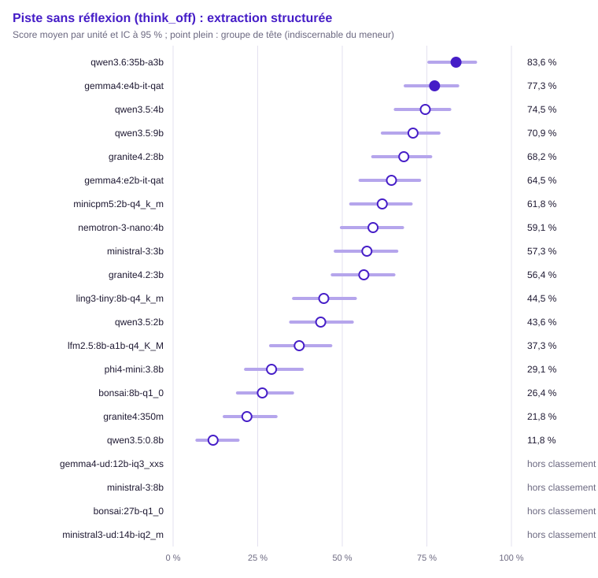

| Groupe | Rang | Modèle | Score (unités communes) | IC 95 % | IC simultané | ET groupée | Unités communes | Score (toutes unités définies) | Couverture | Exclues | Contexte dépassé : modèle / banc | Troncature |
|---|---|---|---|---|---|---|---|---|---|---|---|---|
| 1 | 1 | `qwen3.6:35b-a3b` | 83,6 % | [75,6 % ; 89,4 %] | [70,7 % ; 91,5 %] | 0,035 | 110 | 83,6 % (110) | 100,0 % | 0 | 0 / 0 | 0,0 % (0/110) |
| 1 | 1 | `gemma4:e4b-it-qat` | 77,3 % | [68,6 % ; 84,1 %] | [63,6 % ; 86,9 %] | 0,040 | 110 | 77,3 % (110) | 100,0 % | 0 | 0 / 0 | 0,0 % (0/110) |
| 2 | 1 | `qwen3.5:4b` | 74,5 % | [65,7 % ; 81,8 %] | [60,7 % ; 84,7 %] | 0,042 | 110 | 74,5 % (110) | 100,0 % | 0 | 0 / 0 | 0,0 % (0/110) |
| 2 | 1 | `qwen3.5:9b` (hors usage) | 70,9 % | [61,8 % ; 78,6 %] | [56,9 % ; 81,8 %] | 0,043 | 110 | 70,9 % (110) | 100,0 % | 0 | 0 / 0 | 0,0 % (0/110) |
| 2 | 1 | `granite4.2:8b` (hors usage) | 68,2 % | [59,0 % ; 76,1 %] | [54,1 % ; 79,6 %] | 0,044 | 110 | 68,2 % (110) | 100,0 % | 0 | 0 / 0 | 0,0 % (0/110) |
| 2 | 1 | `gemma4:e2b-it-qat` | 64,5 % | [55,3 % ; 72,9 %] | [50,4 % ; 76,6 %] | 0,046 | 110 | 64,5 % (110) | 100,0 % | 0 | 0 / 0 | 0,0 % (0/110) |
| 3 | 1 | `minicpm5:2b-q4_k_m` | 61,8 % | [52,5 % ; 70,4 %] | [47,7 % ; 74,2 %] | 0,046 | 110 | 61,8 % (110) | 100,0 % | 0 | 0 / 0 | 0,0 % (0/110) |
| 3 | 1 | `nemotron-3-nano:4b` | 59,1 % | [49,7 % ; 67,8 %] | [45,0 % ; 71,8 %] | 0,047 | 110 | 59,1 % (110) | 100,0 % | 0 | 0 / 0 | 0,0 % (0/110) |
| 3 | 2 | `ministral-3:3b` | 57,3 % | [47,9 % ; 66,1 %] | [43,2 % ; 70,2 %] | 0,047 | 110 | 57,3 % (110) | 100,0 % | 0 | 0 / 0 | 0,0 % (0/110) |
| 3 | 2 | `granite4.2:3b` | 56,4 % | [47,0 % ; 65,3 %] | [42,4 % ; 69,4 %] | 0,047 | 110 | 56,4 % (110) | 100,0 % | 0 | 0 / 0 | 0,9 % (1/110) |
| 4 | 4 | `ling3-tiny:8b-q4_k_m` | 44,5 % | [35,6 % ; 53,9 %] | [31,4 % ; 58,5 %] | 0,047 | 110 | 44,5 % (110) | 100,0 % | 0 | 0 / 0 | 0,9 % (1/110) |
| 4 | 4 | `qwen3.5:2b` | 43,6 % | [34,7 % ; 53,0 %] | [30,6 % ; 57,6 %] | 0,047 | 110 | 43,6 % (110) | 100,0 % | 0 | 0 / 0 | 0,9 % (1/110) |
| 4 | 6 | `lfm2.5:8b-a1b-q4_K_M` | 37,3 % | [28,8 % ; 46,6 %] | [25,0 % ; 51,4 %] | 0,046 | 110 | 37,3 % (110) | 100,0 % | 0 | 0 / 0 | 3,6 % (4/110) |
| 5 | 10 | `phi4-mini:3.8b` | 29,1 % | [21,4 % ; 38,2 %] | [18,2 % ; 43,1 %] | 0,043 | 110 | 29,1 % (110) | 100,0 % | 0 | 0 / 0 | 0,9 % (1/110) |
| 5 | 11 | `bonsai:8b-q1_0` | 26,4 % | [19,0 % ; 35,3 %] | [16,0 % ; 40,3 %] | 0,042 | 110 | 26,4 % (110) | 100,0 % | 0 | 0 / 0 | 3,6 % (4/110) |
| 5 | 11 | `granite4:350m` | 21,8 % | [15,1 % ; 30,4 %] | [12,5 % ; 35,4 %] | 0,039 | 110 | 21,8 % (110) | 100,0 % | 0 | 0 / 0 | 5,5 % (6/110) |
| 6 | 14 | `qwen3.5:0.8b` | 11,8 % | [7,0 % ; 19,2 %] | [5,4 % ; 23,9 %] | 0,031 | 110 | 11,8 % (110) | 100,0 % | 0 | 0 / 0 | 5,5 % (6/110) |
| — | — | `gemma4-ud:12b-iq3_xxs` | — | — | — | — | 0 | — (0) | 0,0 % (hors classement) | 110 | 0 / 0 | — (0/0) |
| — | — | `ministral-3:8b` | — | — | — | — | 0 | — (0) | 0,0 % (hors classement) | 110 | 0 / 0 | — (0/0) |
| — | — | `bonsai:27b-q1_0` | — | — | — | — | 0 | — (0) | 0,0 % (hors classement) | 110 | 0 / 0 | — (0/0) |
| — | — | `ministral3-ud:14b-iq2_m` | — | — | — | — | 0 | — (0) | 0,0 % (hors classement) | 110 | 0 / 0 | — (0/0) |

Comparaisons au meneur (Holm sur les m − 1 comparaisons au meneur, m modèles du périmètre) :

| Modèle | Unités | Différence | ET appariée | IC 95 % | b | c | Corrélation | p | p (Holm) | Distingué |
|---|---|---|---|---|---|---|---|---|---|---|
| `granite4:350m` | 110 | +61,8 pts | 0,048 | [+52,4 pts ; +71,2 pts] | 69 | 1 | 0,17 | < 0,001 | < 0,001 | oui |
| `qwen3.5:0.8b` | 110 | +71,8 pts | 0,047 | [+62,7 pts ; +80,9 pts] | 81 | 2 | 0,01 | < 0,001 | < 0,001 | oui |
| `lfm2.5:8b-a1b-q4_K_M` | 110 | +46,4 pts | 0,049 | [+36,7 pts ; +56,0 pts] | 52 | 1 | 0,29 | < 0,001 | < 0,001 | oui |
| `ling3-tiny:8b-q4_k_m` | 110 | +39,1 pts | 0,048 | [+29,6 pts ; +48,6 pts] | 44 | 1 | 0,35 | < 0,001 | < 0,001 | oui |
| `minicpm5:2b-q4_k_m` | 110 | +21,8 pts | 0,043 | [+13,3 pts ; +30,3 pts] | 26 | 2 | 0,46 | < 0,001 | < 0,001 | oui |
| `gemma4:e2b-it-qat` | 110 | +19,1 pts | 0,042 | [+10,9 pts ; +27,3 pts] | 23 | 2 | 0,49 | < 0,001 | < 0,001 | oui |
| `bonsai:8b-q1_0` | 110 | +57,3 pts | 0,051 | [+47,4 pts ; +67,2 pts] | 65 | 2 | 0,15 | < 0,001 | < 0,001 | oui |
| `qwen3.5:2b` | 110 | +40,0 pts | 0,050 | [+30,2 pts ; +49,8 pts] | 46 | 2 | 0,29 | < 0,001 | < 0,001 | oui |
| `ministral-3:3b` | 110 | +26,4 pts | 0,044 | [+17,8 pts ; +35,0 pts] | 30 | 1 | 0,46 | < 0,001 | < 0,001 | oui |
| `granite4.2:3b` | 110 | +27,3 pts | 0,044 | [+18,6 pts ; +36,0 pts] | 31 | 1 | 0,45 | < 0,001 | < 0,001 | oui |
| `phi4-mini:3.8b` | 110 | +54,5 pts | 0,049 | [+44,9 pts ; +64,2 pts] | 61 | 1 | 0,23 | < 0,001 | < 0,001 | oui |
| `nemotron-3-nano:4b` | 110 | +24,5 pts | 0,043 | [+16,1 pts ; +33,0 pts] | 28 | 1 | 0,48 | < 0,001 | < 0,001 | oui |
| `qwen3.5:4b` | 110 | +9,1 pts | 0,033 | [+2,6 pts ; +15,5 pts] | 12 | 2 | 0,64 | 0,013 | 0,026 | oui |
| `gemma4:e4b-it-qat` | 110 | +6,4 pts | 0,037 | [−0,9 pts ; +13,6 pts] | 12 | 5 | 0,52 | 0,143 | 0,143 | non |
| `qwen3.5:9b` | 110 | +12,7 pts | 0,041 | [+4,7 pts ; +20,7 pts] | 18 | 4 | 0,47 | 0,004 | 0,013 | oui |
| `granite4.2:8b` | 110 | +15,5 pts | 0,041 | [+7,4 pts ; +23,5 pts] | 20 | 3 | 0,49 | < 0,001 | 0,002 | oui |

Matrice exploratoire « qui bat qui » (BH) :

- `granite4:350m` devant `qwen3.5:0.8b` (+10,0 pts, p BH 0,010)
- `lfm2.5:8b-a1b-q4_K_M` devant `granite4:350m` (+15,5 pts, p BH 0,004)
- `ling3-tiny:8b-q4_k_m` devant `granite4:350m` (+22,7 pts, p BH < 0,001)
- `minicpm5:2b-q4_k_m` devant `granite4:350m` (+40,0 pts, p BH < 0,001)
- `gemma4:e2b-it-qat` devant `granite4:350m` (+42,7 pts, p BH < 0,001)
- `qwen3.5:2b` devant `granite4:350m` (+21,8 pts, p BH < 0,001)
- `ministral-3:3b` devant `granite4:350m` (+35,5 pts, p BH < 0,001)
- `granite4.2:3b` devant `granite4:350m` (+34,5 pts, p BH < 0,001)
- `nemotron-3-nano:4b` devant `granite4:350m` (+37,3 pts, p BH < 0,001)
- `qwen3.5:4b` devant `granite4:350m` (+52,7 pts, p BH < 0,001)
- `gemma4:e4b-it-qat` devant `granite4:350m` (+55,5 pts, p BH < 0,001)
- `qwen3.5:9b` devant `granite4:350m` (+49,1 pts, p BH < 0,001)
- `qwen3.6:35b-a3b` devant `granite4:350m` (+61,8 pts, p BH < 0,001)
- `granite4.2:8b` devant `granite4:350m` (+46,4 pts, p BH < 0,001)
- `lfm2.5:8b-a1b-q4_K_M` devant `qwen3.5:0.8b` (+25,5 pts, p BH < 0,001)
- `ling3-tiny:8b-q4_k_m` devant `qwen3.5:0.8b` (+32,7 pts, p BH < 0,001)
- `minicpm5:2b-q4_k_m` devant `qwen3.5:0.8b` (+50,0 pts, p BH < 0,001)
- `gemma4:e2b-it-qat` devant `qwen3.5:0.8b` (+52,7 pts, p BH < 0,001)
- `bonsai:8b-q1_0` devant `qwen3.5:0.8b` (+14,5 pts, p BH 0,001)
- `qwen3.5:2b` devant `qwen3.5:0.8b` (+31,8 pts, p BH < 0,001)
- `ministral-3:3b` devant `qwen3.5:0.8b` (+45,5 pts, p BH < 0,001)
- `granite4.2:3b` devant `qwen3.5:0.8b` (+44,5 pts, p BH < 0,001)
- `phi4-mini:3.8b` devant `qwen3.5:0.8b` (+17,3 pts, p BH < 0,001)
- `nemotron-3-nano:4b` devant `qwen3.5:0.8b` (+47,3 pts, p BH < 0,001)
- `qwen3.5:4b` devant `qwen3.5:0.8b` (+62,7 pts, p BH < 0,001)
- `gemma4:e4b-it-qat` devant `qwen3.5:0.8b` (+65,5 pts, p BH < 0,001)
- `qwen3.5:9b` devant `qwen3.5:0.8b` (+59,1 pts, p BH < 0,001)
- `qwen3.6:35b-a3b` devant `qwen3.5:0.8b` (+71,8 pts, p BH < 0,001)
- `granite4.2:8b` devant `qwen3.5:0.8b` (+56,4 pts, p BH < 0,001)
- `minicpm5:2b-q4_k_m` devant `lfm2.5:8b-a1b-q4_K_M` (+24,5 pts, p BH < 0,001)
- `gemma4:e2b-it-qat` devant `lfm2.5:8b-a1b-q4_K_M` (+27,3 pts, p BH < 0,001)
- `ministral-3:3b` devant `lfm2.5:8b-a1b-q4_K_M` (+20,0 pts, p BH < 0,001)
- `granite4.2:3b` devant `lfm2.5:8b-a1b-q4_K_M` (+19,1 pts, p BH < 0,001)
- `nemotron-3-nano:4b` devant `lfm2.5:8b-a1b-q4_K_M` (+21,8 pts, p BH < 0,001)
- `qwen3.5:4b` devant `lfm2.5:8b-a1b-q4_K_M` (+37,3 pts, p BH < 0,001)
- `gemma4:e4b-it-qat` devant `lfm2.5:8b-a1b-q4_K_M` (+40,0 pts, p BH < 0,001)
- `qwen3.5:9b` devant `lfm2.5:8b-a1b-q4_K_M` (+33,6 pts, p BH < 0,001)
- `qwen3.6:35b-a3b` devant `lfm2.5:8b-a1b-q4_K_M` (+46,4 pts, p BH < 0,001)
- `granite4.2:8b` devant `lfm2.5:8b-a1b-q4_K_M` (+30,9 pts, p BH < 0,001)
- `minicpm5:2b-q4_k_m` devant `ling3-tiny:8b-q4_k_m` (+17,3 pts, p BH < 0,001)
- `gemma4:e2b-it-qat` devant `ling3-tiny:8b-q4_k_m` (+20,0 pts, p BH < 0,001)
- `ling3-tiny:8b-q4_k_m` devant `bonsai:8b-q1_0` (+18,2 pts, p BH 0,002)
- `ministral-3:3b` devant `ling3-tiny:8b-q4_k_m` (+12,7 pts, p BH 0,013)
- `granite4.2:3b` devant `ling3-tiny:8b-q4_k_m` (+11,8 pts, p BH 0,031)
- `ling3-tiny:8b-q4_k_m` devant `phi4-mini:3.8b` (+15,5 pts, p BH 0,005)
- `nemotron-3-nano:4b` devant `ling3-tiny:8b-q4_k_m` (+14,5 pts, p BH 0,004)
- `qwen3.5:4b` devant `ling3-tiny:8b-q4_k_m` (+30,0 pts, p BH < 0,001)
- `gemma4:e4b-it-qat` devant `ling3-tiny:8b-q4_k_m` (+32,7 pts, p BH < 0,001)
- `qwen3.5:9b` devant `ling3-tiny:8b-q4_k_m` (+26,4 pts, p BH < 0,001)
- `qwen3.6:35b-a3b` devant `ling3-tiny:8b-q4_k_m` (+39,1 pts, p BH < 0,001)
- `granite4.2:8b` devant `ling3-tiny:8b-q4_k_m` (+23,6 pts, p BH < 0,001)
- `minicpm5:2b-q4_k_m` devant `bonsai:8b-q1_0` (+35,5 pts, p BH < 0,001)
- `minicpm5:2b-q4_k_m` devant `qwen3.5:2b` (+18,2 pts, p BH < 0,001)
- `minicpm5:2b-q4_k_m` devant `phi4-mini:3.8b` (+32,7 pts, p BH < 0,001)
- `qwen3.5:4b` devant `minicpm5:2b-q4_k_m` (+12,7 pts, p BH 0,009)
- `gemma4:e4b-it-qat` devant `minicpm5:2b-q4_k_m` (+15,5 pts, p BH < 0,001)
- `qwen3.6:35b-a3b` devant `minicpm5:2b-q4_k_m` (+21,8 pts, p BH < 0,001)
- `gemma4:e2b-it-qat` devant `bonsai:8b-q1_0` (+38,2 pts, p BH < 0,001)
- `gemma4:e2b-it-qat` devant `qwen3.5:2b` (+20,9 pts, p BH < 0,001)
- `gemma4:e2b-it-qat` devant `phi4-mini:3.8b` (+35,5 pts, p BH < 0,001)
- `qwen3.5:4b` devant `gemma4:e2b-it-qat` (+10,0 pts, p BH 0,044)
- `gemma4:e4b-it-qat` devant `gemma4:e2b-it-qat` (+12,7 pts, p BH 0,004)
- `qwen3.6:35b-a3b` devant `gemma4:e2b-it-qat` (+19,1 pts, p BH < 0,001)
- `qwen3.5:2b` devant `bonsai:8b-q1_0` (+17,3 pts, p BH 0,005)
- `ministral-3:3b` devant `bonsai:8b-q1_0` (+30,9 pts, p BH < 0,001)
- `granite4.2:3b` devant `bonsai:8b-q1_0` (+30,0 pts, p BH < 0,001)
- `nemotron-3-nano:4b` devant `bonsai:8b-q1_0` (+32,7 pts, p BH < 0,001)
- `qwen3.5:4b` devant `bonsai:8b-q1_0` (+48,2 pts, p BH < 0,001)
- `gemma4:e4b-it-qat` devant `bonsai:8b-q1_0` (+50,9 pts, p BH < 0,001)
- `qwen3.5:9b` devant `bonsai:8b-q1_0` (+44,5 pts, p BH < 0,001)
- `qwen3.6:35b-a3b` devant `bonsai:8b-q1_0` (+57,3 pts, p BH < 0,001)
- `granite4.2:8b` devant `bonsai:8b-q1_0` (+41,8 pts, p BH < 0,001)
- `ministral-3:3b` devant `qwen3.5:2b` (+13,6 pts, p BH 0,035)
- `granite4.2:3b` devant `qwen3.5:2b` (+12,7 pts, p BH 0,021)
- `qwen3.5:2b` devant `phi4-mini:3.8b` (+14,5 pts, p BH 0,010)
- `nemotron-3-nano:4b` devant `qwen3.5:2b` (+15,5 pts, p BH 0,004)
- `qwen3.5:4b` devant `qwen3.5:2b` (+30,9 pts, p BH < 0,001)
- `gemma4:e4b-it-qat` devant `qwen3.5:2b` (+33,6 pts, p BH < 0,001)
- `qwen3.5:9b` devant `qwen3.5:2b` (+27,3 pts, p BH < 0,001)
- `qwen3.6:35b-a3b` devant `qwen3.5:2b` (+40,0 pts, p BH < 0,001)
- `granite4.2:8b` devant `qwen3.5:2b` (+24,5 pts, p BH < 0,001)
- `ministral-3:3b` devant `phi4-mini:3.8b` (+28,2 pts, p BH < 0,001)
- `qwen3.5:4b` devant `ministral-3:3b` (+17,3 pts, p BH < 0,001)
- `gemma4:e4b-it-qat` devant `ministral-3:3b` (+20,0 pts, p BH < 0,001)
- `qwen3.5:9b` devant `ministral-3:3b` (+13,6 pts, p BH 0,004)
- `qwen3.6:35b-a3b` devant `ministral-3:3b` (+26,4 pts, p BH < 0,001)
- `granite4.2:8b` devant `ministral-3:3b` (+10,9 pts, p BH 0,022)
- `granite4.2:3b` devant `phi4-mini:3.8b` (+27,3 pts, p BH < 0,001)
- `qwen3.5:4b` devant `granite4.2:3b` (+18,2 pts, p BH < 0,001)
- `gemma4:e4b-it-qat` devant `granite4.2:3b` (+20,9 pts, p BH < 0,001)
- `qwen3.5:9b` devant `granite4.2:3b` (+14,5 pts, p BH < 0,001)
- `qwen3.6:35b-a3b` devant `granite4.2:3b` (+27,3 pts, p BH < 0,001)
- `granite4.2:8b` devant `granite4.2:3b` (+11,8 pts, p BH 0,002)
- `nemotron-3-nano:4b` devant `phi4-mini:3.8b` (+30,0 pts, p BH < 0,001)
- `qwen3.5:4b` devant `phi4-mini:3.8b` (+45,5 pts, p BH < 0,001)
- `gemma4:e4b-it-qat` devant `phi4-mini:3.8b` (+48,2 pts, p BH < 0,001)
- `qwen3.5:9b` devant `phi4-mini:3.8b` (+41,8 pts, p BH < 0,001)
- `qwen3.6:35b-a3b` devant `phi4-mini:3.8b` (+54,5 pts, p BH < 0,001)
- `granite4.2:8b` devant `phi4-mini:3.8b` (+39,1 pts, p BH < 0,001)
- `qwen3.5:4b` devant `nemotron-3-nano:4b` (+15,5 pts, p BH 0,001)
- `gemma4:e4b-it-qat` devant `nemotron-3-nano:4b` (+18,2 pts, p BH < 0,001)
- `qwen3.5:9b` devant `nemotron-3-nano:4b` (+11,8 pts, p BH 0,004)
- `qwen3.6:35b-a3b` devant `nemotron-3-nano:4b` (+24,5 pts, p BH < 0,001)
- `granite4.2:8b` devant `nemotron-3-nano:4b` (+9,1 pts, p BH 0,039)
- `qwen3.6:35b-a3b` devant `qwen3.5:4b` (+9,1 pts, p BH 0,017)
- `gemma4:e4b-it-qat` devant `granite4.2:8b` (+9,1 pts, p BH 0,009)
- `qwen3.6:35b-a3b` devant `qwen3.5:9b` (+12,7 pts, p BH 0,006)
- `qwen3.6:35b-a3b` devant `granite4.2:8b` (+15,5 pts, p BH < 0,001)

Métrique continue : F1 (`f1`), meneur `qwen3.5:0.8b`.

| Modèle | Moyenne (unités communes) | Unités communes | Moyenne (toutes) | Couverture | Exclues |
|---|---|---|---|---|---|
| `granite4:350m` | — | 0 | 1,0 % (86) | 81,9 % (hors classement) | 24 |
| `qwen3.5:0.8b` | 3,4 % | 97 | 3,4 % (97) | 92,4 % | 13 |
| `lfm2.5:8b-a1b-q4_K_M` | — | 0 | 3,5 % (69) | 65,7 % (hors classement) | 41 |
| `ling3-tiny:8b-q4_k_m` | — | 0 | 16,9 % (62) | 59,0 % (hors classement) | 48 |
| `minicpm5:2b-q4_k_m` | — | 0 | 36,0 % (43) | 41,0 % (hors classement) | 67 |
| `gemma4:e2b-it-qat` | — | 0 | 49,6 % (46) | 43,8 % (hors classement) | 64 |
| `bonsai:8b-q1_0` | — | 0 | 11,1 % (81) | 77,1 % (hors classement) | 29 |
| `qwen3.5:2b` | — | 0 | 28,0 % (63) | 60,0 % (hors classement) | 47 |
| `ministral-3:3b` | — | 0 | 44,8 % (52) | 49,5 % (hors classement) | 58 |
| `granite4.2:3b` | — | 0 | 24,2 % (48) | 45,7 % (hors classement) | 62 |
| `phi4-mini:3.8b` | — | 0 | 5,0 % (78) | 74,3 % (hors classement) | 32 |
| `nemotron-3-nano:4b` | — | 0 | 31,3 % (48) | 45,7 % (hors classement) | 62 |
| `qwen3.5:4b` | — | 0 | 70,6 % (39) | 37,1 % (hors classement) | 71 |
| `gemma4:e4b-it-qat` | — | 0 | 73,1 % (36) | 34,3 % (hors classement) | 74 |
| `qwen3.5:9b` | — | 0 | 59,1 % (38) | 36,2 % (hors classement) | 72 |
| `qwen3.6:35b-a3b` | — | 0 | 80,5 % (36) | 34,3 % (hors classement) | 74 |
| `granite4.2:8b` | — | 0 | 53,4 % (36) | 34,3 % (hors classement) | 74 |
| `gemma4-ud:12b-iq3_xxs` | — | 0 | — (0) | 0,0 % (hors classement) | 110 |
| `ministral-3:8b` | — | 0 | — (0) | 0,0 % (hors classement) | 110 |
| `bonsai:27b-q1_0` | — | 0 | — (0) | 0,0 % (hors classement) | 110 |
| `ministral3-ud:14b-iq2_m` | — | 0 | — (0) | 0,0 % (hors classement) | 110 |

#### Questions sur documents (RAG) (`rag`)

Méthode : McNemar exact apparié, intervalle de Wilson. Unités : 86, dont 86 communes aux modèles classés (classement, meneur et comparaisons). Meneur : `qwen3.6:35b-a3b`.

Avertissement : hors classement, couverture sous le seuil : `gemma4-ud:12b-iq3_xxs` (0,0 %), `ministral-3:8b` (0,0 %), `bonsai:27b-q1_0` (0,0 %), `ministral3-ud:14b-iq2_m` (0,0 %). Leur score sur leurs seules unités définies est publié sans rang, groupe ni comparaison.

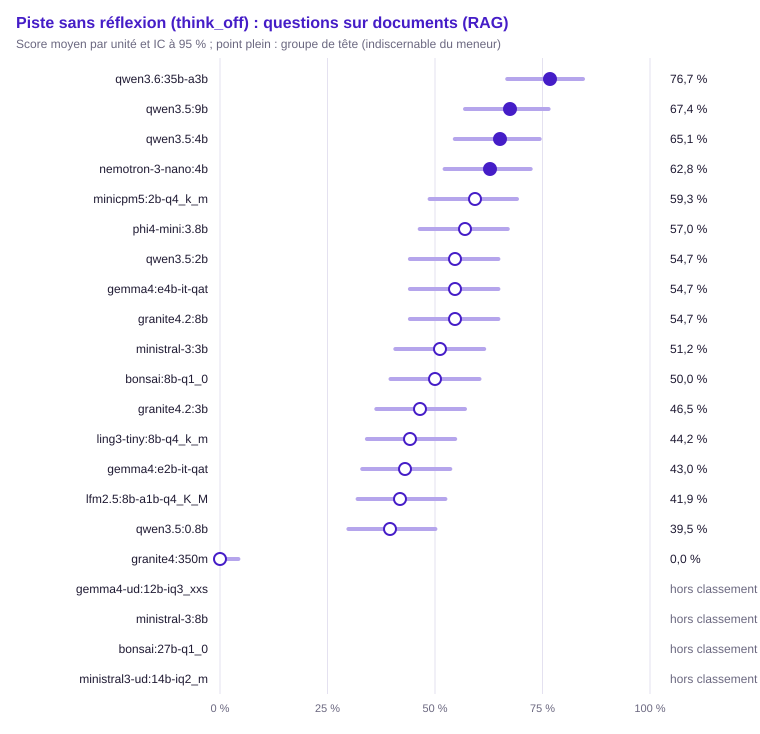

| Groupe | Rang | Modèle | Score (unités communes) | IC 95 % | IC simultané | ET groupée | Unités communes | Score (toutes unités définies) | Couverture | Exclues | Contexte dépassé : modèle / banc | Troncature |
|---|---|---|---|---|---|---|---|---|---|---|---|---|
| 1 | 1 | `qwen3.6:35b-a3b` | 76,7 % | [66,8 % ; 84,4 %] | [61,1 % ; 87,4 %] | 0,046 | 86 | 76,7 % (86) | 100,0 % | 0 | 0 / 0 | 0,0 % (0/86) |
| 1 | 1 | `qwen3.5:9b` (hors usage) | 67,4 % | [57,0 % ; 76,4 %] | [51,4 % ; 80,2 %] | 0,051 | 86 | 67,4 % (86) | 100,0 % | 0 | 0 / 0 | 0,0 % (0/86) |
| 1 | 1 | `qwen3.5:4b` | 65,1 % | [54,6 % ; 74,3 %] | [49,1 % ; 78,3 %] | 0,051 | 86 | 65,1 % (86) | 100,0 % | 0 | 0 / 0 | 0,0 % (0/86) |
| 1 | 1 | `nemotron-3-nano:4b` | 62,8 % | [52,2 % ; 72,3 %] | [46,8 % ; 76,4 %] | 0,052 | 86 | 62,8 % (86) | 100,0 % | 0 | 0 / 0 | 0,0 % (0/86) |
| 2 | 1 | `minicpm5:2b-q4_k_m` | 59,3 % | [48,7 % ; 69,1 %] | [43,4 % ; 73,5 %] | 0,053 | 86 | 59,3 % (86) | 100,0 % | 0 | 0 / 0 | 0,0 % (0/86) |
| 2 | 1 | `phi4-mini:3.8b` | 57,0 % | [46,4 % ; 66,9 %] | [41,2 % ; 71,5 %] | 0,053 | 86 | 57,0 % (86) | 100,0 % | 0 | 0 / 0 | 0,0 % (0/86) |
| 2 | 1 | `qwen3.5:2b` | 54,7 % | [44,2 % ; 64,7 %] | [39,0 % ; 69,4 %] | 0,054 | 86 | 54,7 % (86) | 100,0 % | 0 | 0 / 0 | 0,0 % (0/86) |
| 2 | 1 | `gemma4:e4b-it-qat` | 54,7 % | [44,2 % ; 64,7 %] | [39,0 % ; 69,4 %] | 0,054 | 86 | 54,7 % (86) | 100,0 % | 0 | 0 / 0 | 0,0 % (0/86) |
| 2 | 1 | `granite4.2:8b` (hors usage) | 54,7 % | [44,2 % ; 64,7 %] | [39,0 % ; 69,4 %] | 0,054 | 86 | 54,7 % (86) | 100,0 % | 0 | 0 / 0 | 0,0 % (0/86) |
| 2 | 1 | `ministral-3:3b` | 51,2 % | [40,8 % ; 61,4 %] | [35,8 % ; 66,3 %] | 0,054 | 86 | 51,2 % (86) | 100,0 % | 0 | 0 / 0 | 0,0 % (0/86) |
| 2 | 1 | `bonsai:8b-q1_0` | 50,0 % | [39,7 % ; 60,3 %] | [34,7 % ; 65,3 %] | 0,054 | 86 | 50,0 % (86) | 100,0 % | 0 | 0 / 0 | 3,5 % (3/86) |
| 2 | 1 | `granite4.2:3b` | 46,5 % | [36,3 % ; 57,0 %] | [31,6 % ; 62,1 %] | 0,054 | 86 | 46,5 % (86) | 100,0 % | 0 | 0 / 0 | 0,0 % (0/86) |
| 2 | 2 | `ling3-tiny:8b-q4_k_m` | 44,2 % | [34,2 % ; 54,7 %] | [29,6 % ; 59,9 %] | 0,054 | 86 | 44,2 % (86) | 100,0 % | 0 | 0 / 0 | 0,0 % (0/86) |
| 2 | 2 | `gemma4:e2b-it-qat` | 43,0 % | [33,1 % ; 53,6 %] | [28,5 % ; 58,8 %] | 0,053 | 86 | 43,0 % (86) | 100,0 % | 0 | 0 / 0 | 0,0 % (0/86) |
| 2 | 2 | `lfm2.5:8b-a1b-q4_K_M` | 41,9 % | [32,0 % ; 52,4 %] | [27,5 % ; 57,7 %] | 0,053 | 86 | 41,9 % (86) | 100,0 % | 0 | 0 / 0 | 2,3 % (2/86) |
| 3 | 2 | `qwen3.5:0.8b` | 39,5 % | [29,9 % ; 50,1 %] | [25,5 % ; 55,5 %] | 0,053 | 86 | 39,5 % (86) | 100,0 % | 0 | 0 / 0 | 0,0 % (0/86) |
| 4 | 17 | `granite4:350m` | 0,0 % | [0,0 % ; 4,3 %] | [0,0 % ; 9,3 %] | 0,000 | 86 | 0,0 % (86) | 100,0 % | 0 | 0 / 0 | 1,2 % (1/86) |
| — | — | `gemma4-ud:12b-iq3_xxs` | — | — | — | — | 0 | — (0) | 0,0 % (hors classement) | 86 | 0 / 0 | — (0/0) |
| — | — | `ministral-3:8b` | — | — | — | — | 0 | — (0) | 0,0 % (hors classement) | 86 | 0 / 0 | — (0/0) |
| — | — | `bonsai:27b-q1_0` | — | — | — | — | 0 | — (0) | 0,0 % (hors classement) | 86 | 0 / 0 | — (0/0) |
| — | — | `ministral3-ud:14b-iq2_m` | — | — | — | — | 0 | — (0) | 0,0 % (hors classement) | 86 | 0 / 0 | — (0/0) |

Comparaisons au meneur (Holm sur les m − 1 comparaisons au meneur, m modèles du périmètre) :

| Modèle | Unités | Différence | ET appariée | IC 95 % | b | c | Corrélation | p | p (Holm) | Distingué |
|---|---|---|---|---|---|---|---|---|---|---|
| `granite4:350m` | 86 | +76,7 pts | 0,046 | [+67,8 pts ; +85,7 pts] | 66 | 0 | — | < 0,001 | < 0,001 | oui |
| `qwen3.5:0.8b` | 86 | +37,2 pts | 0,055 | [+26,5 pts ; +47,9 pts] | 33 | 1 | 0,39 | < 0,001 | < 0,001 | oui |
| `lfm2.5:8b-a1b-q4_K_M` | 86 | +34,9 pts | 0,056 | [+23,8 pts ; +45,9 pts] | 32 | 2 | 0,36 | < 0,001 | < 0,001 | oui |
| `ling3-tiny:8b-q4_k_m` | 86 | +32,6 pts | 0,053 | [+22,1 pts ; +43,0 pts] | 29 | 1 | 0,43 | < 0,001 | < 0,001 | oui |
| `minicpm5:2b-q4_k_m` | 86 | +17,4 pts | 0,050 | [+7,7 pts ; +27,2 pts] | 18 | 3 | 0,50 | 0,001 | 0,006 | oui |
| `gemma4:e2b-it-qat` | 86 | +33,7 pts | 0,058 | [+22,3 pts ; +45,2 pts] | 32 | 3 | 0,31 | < 0,001 | < 0,001 | oui |
| `bonsai:8b-q1_0` | 86 | +26,7 pts | 0,058 | [+15,4 pts ; +38,1 pts] | 27 | 4 | 0,33 | < 0,001 | < 0,001 | oui |
| `qwen3.5:2b` | 86 | +22,1 pts | 0,050 | [+12,2 pts ; +32,0 pts] | 21 | 2 | 0,49 | < 0,001 | < 0,001 | oui |
| `ministral-3:3b` | 86 | +25,6 pts | 0,047 | [+16,4 pts ; +34,8 pts] | 22 | 0 | 0,56 | < 0,001 | < 0,001 | oui |
| `granite4.2:3b` | 86 | +30,2 pts | 0,062 | [+18,1 pts ; +42,3 pts] | 31 | 5 | 0,24 | < 0,001 | < 0,001 | oui |
| `phi4-mini:3.8b` | 86 | +19,8 pts | 0,049 | [+10,2 pts ; +29,3 pts] | 19 | 2 | 0,52 | < 0,001 | 0,001 | oui |
| `nemotron-3-nano:4b` | 86 | +14,0 pts | 0,057 | [+2,7 pts ; +25,2 pts] | 19 | 7 | 0,32 | 0,029 | 0,087 | non |
| `qwen3.5:4b` | 86 | +11,6 pts | 0,048 | [+2,3 pts ; +21,0 pts] | 14 | 4 | 0,52 | 0,031 | 0,087 | non |
| `gemma4:e4b-it-qat` | 86 | +22,1 pts | 0,056 | [+11,2 pts ; +33,0 pts] | 23 | 4 | 0,38 | < 0,001 | 0,002 | oui |
| `qwen3.5:9b` | 86 | +9,3 pts | 0,042 | [+1,0 pts ; +17,6 pts] | 11 | 3 | 0,62 | 0,057 | 0,087 | non |
| `granite4.2:8b` | 86 | +22,1 pts | 0,053 | [+11,7 pts ; +32,5 pts] | 22 | 3 | 0,44 | < 0,001 | 0,001 | oui |

Matrice exploratoire « qui bat qui » (BH) :

- `qwen3.5:0.8b` devant `granite4:350m` (+39,5 pts, p BH < 0,001)
- `lfm2.5:8b-a1b-q4_K_M` devant `granite4:350m` (+41,9 pts, p BH < 0,001)
- `ling3-tiny:8b-q4_k_m` devant `granite4:350m` (+44,2 pts, p BH < 0,001)
- `minicpm5:2b-q4_k_m` devant `granite4:350m` (+59,3 pts, p BH < 0,001)
- `gemma4:e2b-it-qat` devant `granite4:350m` (+43,0 pts, p BH < 0,001)
- `bonsai:8b-q1_0` devant `granite4:350m` (+50,0 pts, p BH < 0,001)
- `qwen3.5:2b` devant `granite4:350m` (+54,7 pts, p BH < 0,001)
- `ministral-3:3b` devant `granite4:350m` (+51,2 pts, p BH < 0,001)
- `granite4.2:3b` devant `granite4:350m` (+46,5 pts, p BH < 0,001)
- `phi4-mini:3.8b` devant `granite4:350m` (+57,0 pts, p BH < 0,001)
- `nemotron-3-nano:4b` devant `granite4:350m` (+62,8 pts, p BH < 0,001)
- `qwen3.5:4b` devant `granite4:350m` (+65,1 pts, p BH < 0,001)
- `gemma4:e4b-it-qat` devant `granite4:350m` (+54,7 pts, p BH < 0,001)
- `qwen3.5:9b` devant `granite4:350m` (+67,4 pts, p BH < 0,001)
- `qwen3.6:35b-a3b` devant `granite4:350m` (+76,7 pts, p BH < 0,001)
- `granite4.2:8b` devant `granite4:350m` (+54,7 pts, p BH < 0,001)
- `minicpm5:2b-q4_k_m` devant `qwen3.5:0.8b` (+19,8 pts, p BH 0,007)
- `qwen3.5:2b` devant `qwen3.5:0.8b` (+15,1 pts, p BH 0,013)
- `phi4-mini:3.8b` devant `qwen3.5:0.8b` (+17,4 pts, p BH 0,013)
- `nemotron-3-nano:4b` devant `qwen3.5:0.8b` (+23,3 pts, p BH < 0,001)
- `qwen3.5:4b` devant `qwen3.5:0.8b` (+25,6 pts, p BH < 0,001)
- `gemma4:e4b-it-qat` devant `qwen3.5:0.8b` (+15,1 pts, p BH 0,044)
- `qwen3.5:9b` devant `qwen3.5:0.8b` (+27,9 pts, p BH < 0,001)
- `qwen3.6:35b-a3b` devant `qwen3.5:0.8b` (+37,2 pts, p BH < 0,001)
- `granite4.2:8b` devant `qwen3.5:0.8b` (+15,1 pts, p BH 0,028)
- `minicpm5:2b-q4_k_m` devant `lfm2.5:8b-a1b-q4_K_M` (+17,4 pts, p BH 0,017)
- `phi4-mini:3.8b` devant `lfm2.5:8b-a1b-q4_K_M` (+15,1 pts, p BH 0,028)
- `nemotron-3-nano:4b` devant `lfm2.5:8b-a1b-q4_K_M` (+20,9 pts, p BH 0,005)
- `qwen3.5:4b` devant `lfm2.5:8b-a1b-q4_K_M` (+23,3 pts, p BH 0,001)
- `gemma4:e4b-it-qat` devant `lfm2.5:8b-a1b-q4_K_M` (+12,8 pts, p BH 0,044)
- `qwen3.5:9b` devant `lfm2.5:8b-a1b-q4_K_M` (+25,6 pts, p BH < 0,001)
- `qwen3.6:35b-a3b` devant `lfm2.5:8b-a1b-q4_K_M` (+34,9 pts, p BH < 0,001)
- `minicpm5:2b-q4_k_m` devant `ling3-tiny:8b-q4_k_m` (+15,1 pts, p BH 0,038)
- `nemotron-3-nano:4b` devant `ling3-tiny:8b-q4_k_m` (+18,6 pts, p BH 0,008)
- `qwen3.5:4b` devant `ling3-tiny:8b-q4_k_m` (+20,9 pts, p BH 0,001)
- `qwen3.5:9b` devant `ling3-tiny:8b-q4_k_m` (+23,3 pts, p BH 0,001)
- `qwen3.6:35b-a3b` devant `ling3-tiny:8b-q4_k_m` (+32,6 pts, p BH < 0,001)
- `minicpm5:2b-q4_k_m` devant `gemma4:e2b-it-qat` (+16,3 pts, p BH 0,018)
- `qwen3.6:35b-a3b` devant `minicpm5:2b-q4_k_m` (+17,4 pts, p BH 0,005)
- `nemotron-3-nano:4b` devant `gemma4:e2b-it-qat` (+19,8 pts, p BH 0,007)
- `qwen3.5:4b` devant `gemma4:e2b-it-qat` (+22,1 pts, p BH 0,003)
- `gemma4:e4b-it-qat` devant `gemma4:e2b-it-qat` (+11,6 pts, p BH 0,018)
- `qwen3.5:9b` devant `gemma4:e2b-it-qat` (+24,4 pts, p BH < 0,001)
- `qwen3.6:35b-a3b` devant `gemma4:e2b-it-qat` (+33,7 pts, p BH < 0,001)
- `granite4.2:8b` devant `gemma4:e2b-it-qat` (+11,6 pts, p BH 0,048)
- `qwen3.5:9b` devant `bonsai:8b-q1_0` (+17,4 pts, p BH 0,017)
- `qwen3.6:35b-a3b` devant `bonsai:8b-q1_0` (+26,7 pts, p BH < 0,001)
- `qwen3.5:9b` devant `qwen3.5:2b` (+12,8 pts, p BH 0,044)
- `qwen3.6:35b-a3b` devant `qwen3.5:2b` (+22,1 pts, p BH < 0,001)
- `qwen3.5:4b` devant `ministral-3:3b` (+14,0 pts, p BH 0,042)
- `qwen3.5:9b` devant `ministral-3:3b` (+16,3 pts, p BH 0,002)
- `qwen3.6:35b-a3b` devant `ministral-3:3b` (+25,6 pts, p BH < 0,001)
- `nemotron-3-nano:4b` devant `granite4.2:3b` (+16,3 pts, p BH 0,041)
- `qwen3.5:4b` devant `granite4.2:3b` (+18,6 pts, p BH 0,015)
- `qwen3.5:9b` devant `granite4.2:3b` (+20,9 pts, p BH 0,007)
- `qwen3.6:35b-a3b` devant `granite4.2:3b` (+30,2 pts, p BH < 0,001)
- `qwen3.6:35b-a3b` devant `phi4-mini:3.8b` (+19,8 pts, p BH < 0,001)
- `qwen3.5:9b` devant `gemma4:e4b-it-qat` (+12,8 pts, p BH 0,044)
- `qwen3.6:35b-a3b` devant `gemma4:e4b-it-qat` (+22,1 pts, p BH 0,001)
- `qwen3.6:35b-a3b` devant `granite4.2:8b` (+22,1 pts, p BH < 0,001)

Métrique continue : F1 (`f1`), meneur `qwen3.6:35b-a3b`.

| Modèle | Moyenne (unités communes) | Unités communes | Moyenne (toutes) | Couverture | Exclues |
|---|---|---|---|---|---|
| `granite4:350m` | 23,3 % | 50 | 23,3 % (50) | 92,6 % | 36 |
| `qwen3.5:0.8b` | 48,8 % | 50 | 48,8 % (50) | 92,6 % | 36 |
| `lfm2.5:8b-a1b-q4_K_M` | 53,1 % | 50 | 51,1 % (52) | 96,3 % | 34 |
| `ling3-tiny:8b-q4_k_m` | 61,5 % | 50 | 61,5 % (50) | 92,6 % | 36 |
| `minicpm5:2b-q4_k_m` | 68,8 % | 50 | 68,8 % (50) | 92,6 % | 36 |
| `gemma4:e2b-it-qat` | 51,3 % | 50 | 51,3 % (50) | 92,6 % | 36 |
| `bonsai:8b-q1_0` | 55,7 % | 50 | 52,6 % (53) | 98,1 % | 33 |
| `qwen3.5:2b` | 62,1 % | 50 | 62,1 % (50) | 92,6 % | 36 |
| `ministral-3:3b` | 55,0 % | 50 | 55,0 % (50) | 92,6 % | 36 |
| `granite4.2:3b` | 61,1 % | 50 | 61,1 % (50) | 92,6 % | 36 |
| `phi4-mini:3.8b` | 68,4 % | 50 | 68,4 % (50) | 92,6 % | 36 |
| `nemotron-3-nano:4b` | 64,7 % | 50 | 64,7 % (50) | 92,6 % | 36 |
| `qwen3.5:4b` | 74,9 % | 50 | 74,9 % (50) | 92,6 % | 36 |
| `gemma4:e4b-it-qat` | 62,8 % | 50 | 62,8 % (50) | 92,6 % | 36 |
| `qwen3.5:9b` | 74,2 % | 50 | 74,2 % (50) | 92,6 % | 36 |
| `qwen3.6:35b-a3b` | 79,2 % | 50 | 79,2 % (50) | 92,6 % | 36 |
| `granite4.2:8b` | 59,4 % | 50 | 59,4 % (50) | 92,6 % | 36 |
| `gemma4-ud:12b-iq3_xxs` | — | 0 | — (0) | 0,0 % (hors classement) | 86 |
| `ministral-3:8b` | — | 0 | — (0) | 0,0 % (hors classement) | 86 |
| `bonsai:27b-q1_0` | — | 0 | — (0) | 0,0 % (hors classement) | 86 |
| `ministral3-ud:14b-iq2_m` | — | 0 | — (0) | 0,0 % (hors classement) | 86 |

Différence au meneur, IC bootstrap apparié à 95 % :

| Modèle | Unités | Différence | IC bootstrap |
|---|---|---|---|
| `granite4:350m` | 50 | +55,9 pts | [+44,7 pts ; +66,4 pts] |
| `qwen3.5:0.8b` | 50 | +30,3 pts | [+17,7 pts ; +42,1 pts] |
| `lfm2.5:8b-a1b-q4_K_M` | 50 | +26,1 pts | [+13,9 pts ; +38,3 pts] |
| `ling3-tiny:8b-q4_k_m` | 50 | +17,6 pts | [+7,2 pts ; +28,1 pts] |
| `minicpm5:2b-q4_k_m` | 50 | +10,4 pts | [−1,1 pts ; +21,2 pts] |
| `gemma4:e2b-it-qat` | 50 | +27,9 pts | [+15,9 pts ; +39,7 pts] |
| `bonsai:8b-q1_0` | 50 | +23,4 pts | [+13,1 pts ; +33,4 pts] |
| `qwen3.5:2b` | 50 | +17,0 pts | [+6,1 pts ; +28,1 pts] |
| `ministral-3:3b` | 50 | +24,2 pts | [+15,1 pts ; +34,3 pts] |
| `granite4.2:3b` | 50 | +18,1 pts | [+6,8 pts ; +29,1 pts] |
| `phi4-mini:3.8b` | 50 | +10,8 pts | [+0,1 pts ; +21,5 pts] |
| `nemotron-3-nano:4b` | 50 | +14,5 pts | [+2,3 pts ; +26,6 pts] |
| `qwen3.5:4b` | 50 | +4,3 pts | [−5,9 pts ; +13,8 pts] |
| `gemma4:e4b-it-qat` | 50 | +16,4 pts | [+4,7 pts ; +28,1 pts] |
| `qwen3.5:9b` | 50 | +4,9 pts | [−4,5 pts ; +14,4 pts] |
| `granite4.2:8b` | 50 | +19,7 pts | [+9,1 pts ; +29,9 pts] |

#### Abstention (`abstention`)

Méthode : McNemar exact apparié, intervalle de Wilson. Unités : 110, dont 110 communes aux modèles classés (classement, meneur et comparaisons). Meneur : `gemma4:e4b-it-qat`.

Avertissement : hors classement, couverture sous le seuil : `gemma4-ud:12b-iq3_xxs` (0,0 %), `ministral-3:8b` (0,0 %), `bonsai:27b-q1_0` (0,0 %), `ministral3-ud:14b-iq2_m` (0,0 %). Leur score sur leurs seules unités définies est publié sans rang, groupe ni comparaison.

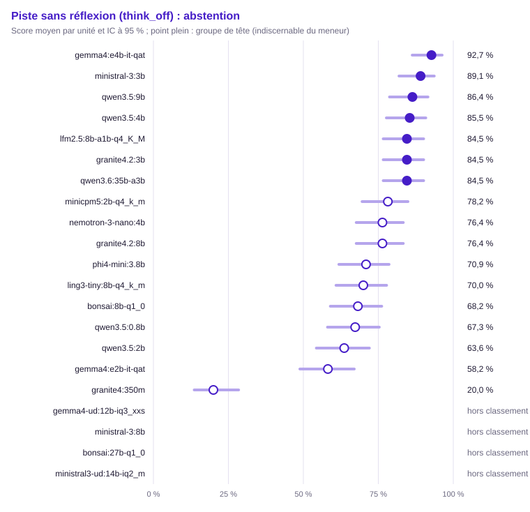

| Groupe | Rang | Modèle | Score (unités communes) | IC 95 % | IC simultané | ET groupée | Unités communes | Score (toutes unités définies) | Couverture | Exclues | Contexte dépassé : modèle / banc | Troncature |
|---|---|---|---|---|---|---|---|---|---|---|---|---|
| 1 | 1 | `gemma4:e4b-it-qat` | 92,7 % | [86,3 % ; 96,3 %] | [81,8 % ; 97,3 %] | 0,025 | 110 | 92,7 % (110) | 100,0 % | 0 | 0 / 0 | 0,0 % (0/110) |
| 1 | 1 | `ministral-3:3b` | 89,1 % | [81,9 % ; 93,6 %] | [77,2 % ; 95,2 %] | 0,030 | 110 | 89,1 % (110) | 100,0 % | 0 | 0 / 0 | 0,0 % (0/110) |
| 1 | 1 | `qwen3.5:9b` (hors usage) | 86,4 % | [78,7 % ; 91,6 %] | [73,9 % ; 93,4 %] | 0,033 | 110 | 86,4 % (110) | 100,0 % | 0 | 0 / 0 | 0,0 % (0/110) |
| 1 | 1 | `qwen3.5:4b` | 85,5 % | [77,7 % ; 90,8 %] | [72,8 % ; 92,8 %] | 0,034 | 110 | 85,5 % (110) | 100,0 % | 0 | 0 / 0 | 0,0 % (0/110) |
| 1 | 1 | `lfm2.5:8b-a1b-q4_K_M` | 84,5 % | [76,6 % ; 90,1 %] | [71,8 % ; 92,2 %] | 0,034 | 110 | 84,5 % (110) | 100,0 % | 0 | 0 / 0 | 1,8 % (2/110) |
| 1 | 1 | `granite4.2:3b` | 84,5 % | [76,6 % ; 90,1 %] | [71,8 % ; 92,2 %] | 0,034 | 110 | 84,5 % (110) | 100,0 % | 0 | 0 / 0 | 0,0 % (0/110) |
| 1 | 1 | `qwen3.6:35b-a3b` | 84,5 % | [76,6 % ; 90,1 %] | [71,8 % ; 92,2 %] | 0,034 | 110 | 84,5 % (110) | 100,0 % | 0 | 0 / 0 | 0,0 % (0/110) |
| 2 | 1 | `minicpm5:2b-q4_k_m` | 78,2 % | [69,6 % ; 84,9 %] | [64,6 % ; 87,5 %] | 0,039 | 110 | 78,2 % (110) | 100,0 % | 0 | 0 / 0 | 0,0 % (0/110) |
| 2 | 1 | `nemotron-3-nano:4b` | 76,4 % | [67,6 % ; 83,3 %] | [62,6 % ; 86,2 %] | 0,041 | 110 | 76,4 % (110) | 100,0 % | 0 | 0 / 0 | 0,0 % (0/110) |
| 2 | 1 | `granite4.2:8b` (hors usage) | 76,4 % | [67,6 % ; 83,3 %] | [62,6 % ; 86,2 %] | 0,041 | 110 | 76,4 % (110) | 100,0 % | 0 | 0 / 0 | 0,0 % (0/110) |
| 2 | 1 | `phi4-mini:3.8b` | 70,9 % | [61,8 % ; 78,6 %] | [56,9 % ; 81,8 %] | 0,043 | 110 | 70,9 % (110) | 100,0 % | 0 | 0 / 0 | 0,0 % (0/110) |
| 2 | 2 | `ling3-tiny:8b-q4_k_m` | 70,0 % | [60,9 % ; 77,8 %] | [55,9 % ; 81,1 %] | 0,044 | 110 | 70,0 % (110) | 100,0 % | 0 | 0 / 0 | 0,0 % (0/110) |
| 2 | 2 | `bonsai:8b-q1_0` | 68,2 % | [59,0 % ; 76,1 %] | [54,1 % ; 79,6 %] | 0,044 | 110 | 68,2 % (110) | 100,0 % | 0 | 0 / 0 | 0,0 % (0/110) |
| 2 | 2 | `qwen3.5:0.8b` | 67,3 % | [58,1 % ; 75,3 %] | [53,1 % ; 78,9 %] | 0,045 | 110 | 67,3 % (110) | 100,0 % | 0 | 0 / 0 | 0,9 % (1/110) |
| 2 | 3 | `qwen3.5:2b` | 63,6 % | [54,3 % ; 72,0 %] | [49,5 % ; 75,8 %] | 0,046 | 110 | 63,6 % (110) | 100,0 % | 0 | 0 / 0 | 0,0 % (0/110) |
| 3 | 8 | `gemma4:e2b-it-qat` | 58,2 % | [48,8 % ; 67,0 %] | [44,1 % ; 71,0 %] | 0,047 | 110 | 58,2 % (110) | 100,0 % | 0 | 0 / 0 | 0,0 % (0/110) |
| 4 | 17 | `granite4:350m` | 20,0 % | [13,6 % ; 28,4 %] | [11,1 % ; 33,4 %] | 0,038 | 110 | 20,0 % (110) | 100,0 % | 0 | 0 / 0 | 0,0 % (0/110) |
| — | — | `gemma4-ud:12b-iq3_xxs` | — | — | — | — | 0 | — (0) | 0,0 % (hors classement) | 110 | 0 / 0 | — (0/0) |
| — | — | `ministral-3:8b` | — | — | — | — | 0 | — (0) | 0,0 % (hors classement) | 110 | 0 / 0 | — (0/0) |
| — | — | `bonsai:27b-q1_0` | — | — | — | — | 0 | — (0) | 0,0 % (hors classement) | 110 | 0 / 0 | — (0/0) |
| — | — | `ministral3-ud:14b-iq2_m` | — | — | — | — | 0 | — (0) | 0,0 % (hors classement) | 110 | 0 / 0 | — (0/0) |

Comparaisons au meneur (Holm sur les m − 1 comparaisons au meneur, m modèles du périmètre) :

| Modèle | Unités | Différence | ET appariée | IC 95 % | b | c | Corrélation | p | p (Holm) | Distingué |
|---|---|---|---|---|---|---|---|---|---|---|
| `granite4:350m` | 110 | +72,7 pts | 0,042 | [+64,4 pts ; +81,0 pts] | 80 | 0 | 0,14 | < 0,001 | < 0,001 | oui |
| `qwen3.5:0.8b` | 110 | +25,5 pts | 0,049 | [+15,9 pts ; +35,0 pts] | 32 | 4 | 0,10 | < 0,001 | < 0,001 | oui |
| `lfm2.5:8b-a1b-q4_K_M` | 110 | +8,2 pts | 0,039 | [+0,6 pts ; +15,8 pts] | 14 | 5 | 0,17 | 0,064 | 0,191 | non |
| `ling3-tiny:8b-q4_k_m` | 110 | +22,7 pts | 0,044 | [+14,1 pts ; +31,3 pts] | 27 | 2 | 0,28 | < 0,001 | < 0,001 | oui |
| `minicpm5:2b-q4_k_m` | 110 | +14,5 pts | 0,044 | [+5,9 pts ; +23,2 pts] | 21 | 5 | 0,11 | 0,002 | 0,017 | oui |
| `gemma4:e2b-it-qat` | 110 | +34,5 pts | 0,047 | [+25,3 pts ; +43,8 pts] | 39 | 1 | 0,26 | < 0,001 | < 0,001 | oui |
| `bonsai:8b-q1_0` | 110 | +24,5 pts | 0,047 | [+15,4 pts ; +33,7 pts] | 30 | 3 | 0,18 | < 0,001 | < 0,001 | oui |
| `qwen3.5:2b` | 110 | +29,1 pts | 0,047 | [+19,9 pts ; +38,3 pts] | 34 | 2 | 0,22 | < 0,001 | < 0,001 | oui |
| `ministral-3:3b` | 110 | +3,6 pts | 0,029 | [−2,0 pts ; +9,2 pts] | 7 | 3 | 0,46 | 0,344 | 0,344 | non |
| `granite4.2:3b` | 110 | +8,2 pts | 0,032 | [+1,9 pts ; +14,4 pts] | 11 | 2 | 0,46 | 0,022 | 0,135 | non |
| `phi4-mini:3.8b` | 110 | +21,8 pts | 0,049 | [+12,3 pts ; +31,4 pts] | 29 | 5 | 0,05 | < 0,001 | < 0,001 | oui |
| `nemotron-3-nano:4b` | 110 | +16,4 pts | 0,042 | [+8,2 pts ; +24,5 pts] | 21 | 3 | 0,26 | < 0,001 | 0,002 | oui |
| `qwen3.5:4b` | 110 | +7,3 pts | 0,031 | [+1,3 pts ; +13,3 pts] | 10 | 2 | 0,48 | 0,039 | 0,154 | non |
| `qwen3.5:9b` | 110 | +6,4 pts | 0,032 | [+0,1 pts ; +12,7 pts] | 10 | 3 | 0,40 | 0,092 | 0,191 | non |
| `qwen3.6:35b-a3b` | 110 | +8,2 pts | 0,032 | [+1,9 pts ; +14,4 pts] | 11 | 2 | 0,46 | 0,022 | 0,135 | non |
| `granite4.2:8b` | 110 | +16,4 pts | 0,040 | [+8,6 pts ; +24,1 pts] | 20 | 2 | 0,34 | < 0,001 | 0,001 | oui |

Matrice exploratoire « qui bat qui » (BH) :

- `qwen3.5:0.8b` devant `granite4:350m` (+47,3 pts, p BH < 0,001)
- `lfm2.5:8b-a1b-q4_K_M` devant `granite4:350m` (+64,5 pts, p BH < 0,001)
- `ling3-tiny:8b-q4_k_m` devant `granite4:350m` (+50,0 pts, p BH < 0,001)
- `minicpm5:2b-q4_k_m` devant `granite4:350m` (+58,2 pts, p BH < 0,001)
- `gemma4:e2b-it-qat` devant `granite4:350m` (+38,2 pts, p BH < 0,001)
- `bonsai:8b-q1_0` devant `granite4:350m` (+48,2 pts, p BH < 0,001)
- `qwen3.5:2b` devant `granite4:350m` (+43,6 pts, p BH < 0,001)
- `ministral-3:3b` devant `granite4:350m` (+69,1 pts, p BH < 0,001)
- `granite4.2:3b` devant `granite4:350m` (+64,5 pts, p BH < 0,001)
- `phi4-mini:3.8b` devant `granite4:350m` (+50,9 pts, p BH < 0,001)
- `nemotron-3-nano:4b` devant `granite4:350m` (+56,4 pts, p BH < 0,001)
- `qwen3.5:4b` devant `granite4:350m` (+65,5 pts, p BH < 0,001)
- `gemma4:e4b-it-qat` devant `granite4:350m` (+72,7 pts, p BH < 0,001)
- `qwen3.5:9b` devant `granite4:350m` (+66,4 pts, p BH < 0,001)
- `qwen3.6:35b-a3b` devant `granite4:350m` (+64,5 pts, p BH < 0,001)
- `granite4.2:8b` devant `granite4:350m` (+56,4 pts, p BH < 0,001)
- `lfm2.5:8b-a1b-q4_K_M` devant `qwen3.5:0.8b` (+17,3 pts, p BH 0,003)
- `ministral-3:3b` devant `qwen3.5:0.8b` (+21,8 pts, p BH < 0,001)
- `granite4.2:3b` devant `qwen3.5:0.8b` (+17,3 pts, p BH 0,005)
- `qwen3.5:4b` devant `qwen3.5:0.8b` (+18,2 pts, p BH 0,002)
- `gemma4:e4b-it-qat` devant `qwen3.5:0.8b` (+25,5 pts, p BH < 0,001)
- `qwen3.5:9b` devant `qwen3.5:0.8b` (+19,1 pts, p BH < 0,001)
- `qwen3.6:35b-a3b` devant `qwen3.5:0.8b` (+17,3 pts, p BH 0,002)
- `lfm2.5:8b-a1b-q4_K_M` devant `ling3-tiny:8b-q4_k_m` (+14,5 pts, p BH 0,024)
- `lfm2.5:8b-a1b-q4_K_M` devant `gemma4:e2b-it-qat` (+26,4 pts, p BH < 0,001)
- `lfm2.5:8b-a1b-q4_K_M` devant `bonsai:8b-q1_0` (+16,4 pts, p BH 0,005)
- `lfm2.5:8b-a1b-q4_K_M` devant `qwen3.5:2b` (+20,9 pts, p BH < 0,001)
- `ministral-3:3b` devant `ling3-tiny:8b-q4_k_m` (+19,1 pts, p BH < 0,001)
- `granite4.2:3b` devant `ling3-tiny:8b-q4_k_m` (+14,5 pts, p BH 0,012)
- `qwen3.5:4b` devant `ling3-tiny:8b-q4_k_m` (+15,5 pts, p BH 0,002)
- `gemma4:e4b-it-qat` devant `ling3-tiny:8b-q4_k_m` (+22,7 pts, p BH < 0,001)
- `qwen3.5:9b` devant `ling3-tiny:8b-q4_k_m` (+16,4 pts, p BH < 0,001)
- `qwen3.6:35b-a3b` devant `ling3-tiny:8b-q4_k_m` (+14,5 pts, p BH 0,009)
- `minicpm5:2b-q4_k_m` devant `gemma4:e2b-it-qat` (+20,0 pts, p BH < 0,001)
- `minicpm5:2b-q4_k_m` devant `qwen3.5:2b` (+14,5 pts, p BH 0,024)
- `gemma4:e4b-it-qat` devant `minicpm5:2b-q4_k_m` (+14,5 pts, p BH 0,006)
- `ministral-3:3b` devant `gemma4:e2b-it-qat` (+30,9 pts, p BH < 0,001)
- `granite4.2:3b` devant `gemma4:e2b-it-qat` (+26,4 pts, p BH < 0,001)
- `phi4-mini:3.8b` devant `gemma4:e2b-it-qat` (+12,7 pts, p BH 0,026)
- `nemotron-3-nano:4b` devant `gemma4:e2b-it-qat` (+18,2 pts, p BH 0,007)
- `qwen3.5:4b` devant `gemma4:e2b-it-qat` (+27,3 pts, p BH < 0,001)
- `gemma4:e4b-it-qat` devant `gemma4:e2b-it-qat` (+34,5 pts, p BH < 0,001)
- `qwen3.5:9b` devant `gemma4:e2b-it-qat` (+28,2 pts, p BH < 0,001)
- `qwen3.6:35b-a3b` devant `gemma4:e2b-it-qat` (+26,4 pts, p BH < 0,001)
- `granite4.2:8b` devant `gemma4:e2b-it-qat` (+18,2 pts, p BH 0,015)
- `ministral-3:3b` devant `bonsai:8b-q1_0` (+20,9 pts, p BH < 0,001)
- `granite4.2:3b` devant `bonsai:8b-q1_0` (+16,4 pts, p BH < 0,001)
- `qwen3.5:4b` devant `bonsai:8b-q1_0` (+17,3 pts, p BH 0,002)
- `gemma4:e4b-it-qat` devant `bonsai:8b-q1_0` (+24,5 pts, p BH < 0,001)
- `qwen3.5:9b` devant `bonsai:8b-q1_0` (+18,2 pts, p BH < 0,001)
- `qwen3.6:35b-a3b` devant `bonsai:8b-q1_0` (+16,4 pts, p BH 0,002)
- `ministral-3:3b` devant `qwen3.5:2b` (+25,5 pts, p BH < 0,001)
- `granite4.2:3b` devant `qwen3.5:2b` (+20,9 pts, p BH < 0,001)
- `nemotron-3-nano:4b` devant `qwen3.5:2b` (+12,7 pts, p BH 0,010)
- `qwen3.5:4b` devant `qwen3.5:2b` (+21,8 pts, p BH < 0,001)
- `gemma4:e4b-it-qat` devant `qwen3.5:2b` (+29,1 pts, p BH < 0,001)
- `qwen3.5:9b` devant `qwen3.5:2b` (+22,7 pts, p BH < 0,001)
- `qwen3.6:35b-a3b` devant `qwen3.5:2b` (+20,9 pts, p BH < 0,001)
- `granite4.2:8b` devant `qwen3.5:2b` (+12,7 pts, p BH 0,033)
- `ministral-3:3b` devant `phi4-mini:3.8b` (+18,2 pts, p BH 0,002)
- `ministral-3:3b` devant `nemotron-3-nano:4b` (+12,7 pts, p BH 0,026)
- `ministral-3:3b` devant `granite4.2:8b` (+12,7 pts, p BH 0,003)
- `granite4.2:3b` devant `phi4-mini:3.8b` (+13,6 pts, p BH 0,045)
- `gemma4:e4b-it-qat` devant `granite4.2:3b` (+8,2 pts, p BH 0,044)
- `qwen3.5:4b` devant `phi4-mini:3.8b` (+14,5 pts, p BH 0,044)
- `gemma4:e4b-it-qat` devant `phi4-mini:3.8b` (+21,8 pts, p BH < 0,001)
- `qwen3.5:9b` devant `phi4-mini:3.8b` (+15,5 pts, p BH 0,028)
- `gemma4:e4b-it-qat` devant `nemotron-3-nano:4b` (+16,4 pts, p BH < 0,001)
- `gemma4:e4b-it-qat` devant `qwen3.6:35b-a3b` (+8,2 pts, p BH 0,044)
- `gemma4:e4b-it-qat` devant `granite4.2:8b` (+16,4 pts, p BH < 0,001)
- `qwen3.5:9b` devant `granite4.2:8b` (+10,0 pts, p BH 0,003)

#### Rédaction (`writing`)

Méthode : test z sur la différence appariée (erreur-type groupée), intervalle moyenne ± z·ET, IC bootstrap apparié de la différence. Unités : 80, dont 80 communes aux modèles classés (classement, meneur et comparaisons). Meneur : `qwen3.6:35b-a3b`.

Avertissement : hors classement, couverture sous le seuil : `gemma4-ud:12b-iq3_xxs` (0,0 %), `ministral-3:8b` (0,0 %), `bonsai:27b-q1_0` (0,0 %), `ministral3-ud:14b-iq2_m` (0,0 %). Leur score sur leurs seules unités définies est publié sans rang, groupe ni comparaison.

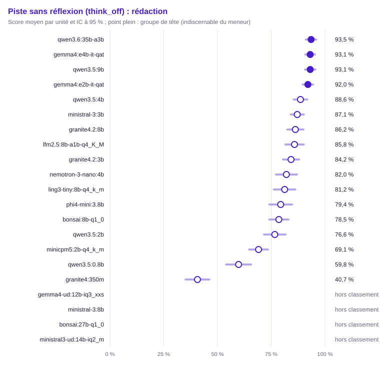

| Groupe | Rang | Modèle | Score (unités communes) | IC 95 % | IC simultané | ET groupée | Unités communes | Score (toutes unités définies) | Couverture | Exclues | Contexte dépassé : modèle / banc | Troncature |
|---|---|---|---|---|---|---|---|---|---|---|---|---|
| 1 | 1 | `qwen3.6:35b-a3b` | 93,5 % | [91,1 % ; 96,0 %] | [89,8 % ; 97,3 %] | 0,012 | 80 | 93,5 % (80) | 100,0 % | 0 | 0 / 0 | 0,0 % (0/80) |
| 1 | 1 | `gemma4:e4b-it-qat` | 93,1 % | [90,8 % ; 95,4 %] | [89,7 % ; 96,6 %] | 0,012 | 80 | 93,1 % (80) | 100,0 % | 0 | 0 / 0 | 0,0 % (0/80) |
| 1 | 1 | `qwen3.5:9b` (hors usage) | 93,1 % | [90,7 % ; 95,6 %] | [89,4 % ; 96,8 %] | 0,012 | 80 | 93,1 % (80) | 100,0 % | 0 | 0 / 0 | 0,0 % (0/80) |
| 1 | 1 | `gemma4:e2b-it-qat` | 92,0 % | [89,6 % ; 94,4 %] | [88,4 % ; 95,7 %] | 0,012 | 80 | 92,0 % (80) | 100,0 % | 0 | 0 / 0 | 0,0 % (0/80) |
| 2 | 1 | `qwen3.5:4b` | 88,6 % | [85,4 % ; 91,7 %] | [83,8 % ; 93,4 %] | 0,016 | 80 | 88,6 % (80) | 100,0 % | 0 | 0 / 0 | 0,0 % (0/80) |
| 2 | 1 | `ministral-3:3b` | 87,1 % | [84,0 % ; 90,2 %] | [82,5 % ; 91,7 %] | 0,016 | 80 | 87,1 % (80) | 100,0 % | 0 | 0 / 0 | 0,0 % (0/80) |
| 2 | 1 | `granite4.2:8b` (hors usage) | 86,2 % | [82,5 % ; 89,9 %] | [80,5 % ; 91,9 %] | 0,019 | 80 | 86,2 % (80) | 100,0 % | 0 | 0 / 0 | 0,0 % (0/80) |
| 2 | 1 | `lfm2.5:8b-a1b-q4_K_M` | 85,8 % | [81,5 % ; 90,1 %] | [79,3 % ; 92,3 %] | 0,022 | 80 | 85,8 % (80) | 100,0 % | 0 | 0 / 0 | 1,2 % (1/80) |
| 2 | 1 | `granite4.2:3b` | 84,2 % | [80,4 % ; 88,0 %] | [78,5 % ; 89,9 %] | 0,019 | 80 | 84,2 % (80) | 100,0 % | 0 | 0 / 0 | 0,0 % (0/80) |
| 3 | 3 | `nemotron-3-nano:4b` | 82,0 % | [77,2 % ; 86,9 %] | [74,6 % ; 89,4 %] | 0,025 | 80 | 82,0 % (80) | 100,0 % | 0 | 0 / 0 | 2,5 % (2/80) |
| 3 | 4 | `ling3-tiny:8b-q4_k_m` | 81,2 % | [76,3 % ; 86,2 %] | [73,7 % ; 88,8 %] | 0,025 | 80 | 81,2 % (80) | 100,0 % | 0 | 0 / 0 | 3,8 % (3/80) |
| 3 | 5 | `phi4-mini:3.8b` | 79,4 % | [74,1 % ; 84,7 %] | [71,4 % ; 87,4 %] | 0,027 | 80 | 79,4 % (80) | 100,0 % | 0 | 0 / 0 | 2,5 % (2/80) |
| 3 | 5 | `bonsai:8b-q1_0` | 78,5 % | [74,1 % ; 83,0 %] | [71,8 % ; 85,3 %] | 0,023 | 80 | 78,5 % (80) | 100,0 % | 0 | 0 / 0 | 2,5 % (2/80) |
| 3 | 5 | `qwen3.5:2b` | 76,6 % | [71,7 % ; 81,6 %] | [69,1 % ; 84,2 %] | 0,025 | 80 | 76,6 % (80) | 100,0 % | 0 | 0 / 0 | 3,8 % (3/80) |
| 4 | 10 | `minicpm5:2b-q4_k_m` | 69,1 % | [64,7 % ; 73,5 %] | [62,4 % ; 75,7 %] | 0,022 | 80 | 69,1 % (80) | 100,0 % | 0 | 0 / 0 | 0,0 % (0/80) |
| 5 | 15 | `qwen3.5:0.8b` | 59,8 % | [54,0 % ; 65,6 %] | [51,0 % ; 68,6 %] | 0,030 | 80 | 59,8 % (80) | 100,0 % | 0 | 0 / 0 | 3,8 % (3/80) |
| 6 | 17 | `granite4:350m` | 40,7 % | [35,1 % ; 46,2 %] | [32,3 % ; 49,1 %] | 0,028 | 80 | 40,7 % (80) | 100,0 % | 0 | 0 / 0 | 5,0 % (4/80) |
| — | — | `gemma4-ud:12b-iq3_xxs` | — | — | — | — | 0 | — (0) | 0,0 % (hors classement) | 80 | 0 / 0 | — (0/0) |
| — | — | `ministral-3:8b` | — | — | — | — | 0 | — (0) | 0,0 % (hors classement) | 80 | 0 / 0 | — (0/0) |
| — | — | `bonsai:27b-q1_0` | — | — | — | — | 0 | — (0) | 0,0 % (hors classement) | 80 | 0 / 0 | — (0/0) |
| — | — | `ministral3-ud:14b-iq2_m` | — | — | — | — | 0 | — (0) | 0,0 % (hors classement) | 80 | 0 / 0 | — (0/0) |

Comparaisons au meneur (Holm sur les m − 1 comparaisons au meneur, m modèles du périmètre) :

| Modèle | Unités | Différence | ET appariée | IC 95 % | IC bootstrap | Corrélation | p | p (Holm) | Distingué |
|---|---|---|---|---|---|---|---|---|---|
| `granite4:350m` | 80 | +52,9 pts | 0,030 | [+47,1 pts ; +58,7 pts] | [+47,1 pts ; +58,5 pts] | 0,10 | < 0,001 | < 0,001 | oui |
| `qwen3.5:0.8b` | 80 | +33,7 pts | 0,029 | [+28,1 pts ; +39,3 pts] | [+28,2 pts ; +39,3 pts] | 0,29 | < 0,001 | < 0,001 | oui |
| `lfm2.5:8b-a1b-q4_K_M` | 80 | +7,7 pts | 0,020 | [+3,8 pts ; +11,7 pts] | [+4,0 pts ; +11,8 pts] | 0,42 | < 0,001 | < 0,001 | oui |
| `ling3-tiny:8b-q4_k_m` | 80 | +12,3 pts | 0,025 | [+7,4 pts ; +17,2 pts] | [+7,5 pts ; +17,4 pts] | 0,27 | < 0,001 | < 0,001 | oui |
| `minicpm5:2b-q4_k_m` | 80 | +24,5 pts | 0,025 | [+19,5 pts ; +29,4 pts] | [+19,5 pts ; +29,4 pts] | 0,04 | < 0,001 | < 0,001 | oui |
| `gemma4:e2b-it-qat` | 80 | +1,5 pts | 0,015 | [−1,4 pts ; +4,4 pts] | [−1,4 pts ; +4,5 pts] | 0,26 | 0,318 | 0,954 | non |
| `bonsai:8b-q1_0` | 80 | +15,0 pts | 0,022 | [+10,6 pts ; +19,4 pts] | [+10,9 pts ; +19,6 pts] | 0,31 | < 0,001 | < 0,001 | oui |
| `qwen3.5:2b` | 80 | +16,9 pts | 0,024 | [+12,1 pts ; +21,7 pts] | [+12,3 pts ; +21,6 pts] | 0,34 | < 0,001 | < 0,001 | oui |
| `ministral-3:3b` | 80 | +6,4 pts | 0,015 | [+3,5 pts ; +9,4 pts] | [+3,5 pts ; +9,2 pts] | 0,44 | < 0,001 | < 0,001 | oui |
| `granite4.2:3b` | 80 | +9,3 pts | 0,018 | [+5,8 pts ; +12,8 pts] | [+5,9 pts ; +12,9 pts] | 0,43 | < 0,001 | < 0,001 | oui |
| `phi4-mini:3.8b` | 80 | +14,1 pts | 0,025 | [+9,2 pts ; +19,1 pts] | [+9,3 pts ; +19,0 pts] | 0,34 | < 0,001 | < 0,001 | oui |
| `nemotron-3-nano:4b` | 80 | +11,5 pts | 0,024 | [+6,8 pts ; +16,2 pts] | [+7,0 pts ; +16,2 pts] | 0,31 | < 0,001 | < 0,001 | oui |
| `qwen3.5:4b` | 80 | +5,0 pts | 0,017 | [+1,6 pts ; +8,3 pts] | [+1,6 pts ; +8,3 pts] | 0,30 | 0,004 | 0,015 | oui |
| `gemma4:e4b-it-qat` | 80 | +0,4 pts | 0,014 | [−2,4 pts ; +3,3 pts] | [−2,6 pts ; +3,3 pts] | 0,28 | 0,774 | 1,000 | non |
| `qwen3.5:9b` | 80 | +0,4 pts | 0,016 | [−2,7 pts ; +3,5 pts] | [−2,8 pts ; +3,7 pts] | 0,19 | 0,792 | 1,000 | non |
| `granite4.2:8b` | 80 | +7,3 pts | 0,020 | [+3,3 pts ; +11,3 pts] | [+3,5 pts ; +11,6 pts] | 0,22 | < 0,001 | 0,002 | oui |

Matrice exploratoire « qui bat qui » (BH) :

- `qwen3.5:0.8b` devant `granite4:350m` (+19,1 pts, p BH < 0,001)
- `lfm2.5:8b-a1b-q4_K_M` devant `granite4:350m` (+45,1 pts, p BH < 0,001)
- `ling3-tiny:8b-q4_k_m` devant `granite4:350m` (+40,6 pts, p BH < 0,001)
- `minicpm5:2b-q4_k_m` devant `granite4:350m` (+28,4 pts, p BH < 0,001)
- `gemma4:e2b-it-qat` devant `granite4:350m` (+51,4 pts, p BH < 0,001)
- `bonsai:8b-q1_0` devant `granite4:350m` (+37,9 pts, p BH < 0,001)
- `qwen3.5:2b` devant `granite4:350m` (+36,0 pts, p BH < 0,001)
- `ministral-3:3b` devant `granite4:350m` (+46,4 pts, p BH < 0,001)
- `granite4.2:3b` devant `granite4:350m` (+43,5 pts, p BH < 0,001)
- `phi4-mini:3.8b` devant `granite4:350m` (+38,7 pts, p BH < 0,001)
- `nemotron-3-nano:4b` devant `granite4:350m` (+41,4 pts, p BH < 0,001)
- `qwen3.5:4b` devant `granite4:350m` (+47,9 pts, p BH < 0,001)
- `gemma4:e4b-it-qat` devant `granite4:350m` (+52,5 pts, p BH < 0,001)
- `qwen3.5:9b` devant `granite4:350m` (+52,5 pts, p BH < 0,001)
- `qwen3.6:35b-a3b` devant `granite4:350m` (+52,9 pts, p BH < 0,001)
- `granite4.2:8b` devant `granite4:350m` (+45,5 pts, p BH < 0,001)
- `lfm2.5:8b-a1b-q4_K_M` devant `qwen3.5:0.8b` (+26,0 pts, p BH < 0,001)
- `ling3-tiny:8b-q4_k_m` devant `qwen3.5:0.8b` (+21,4 pts, p BH < 0,001)
- `minicpm5:2b-q4_k_m` devant `qwen3.5:0.8b` (+9,3 pts, p BH 0,006)
- `gemma4:e2b-it-qat` devant `qwen3.5:0.8b` (+32,2 pts, p BH < 0,001)
- `bonsai:8b-q1_0` devant `qwen3.5:0.8b` (+18,7 pts, p BH < 0,001)
- `qwen3.5:2b` devant `qwen3.5:0.8b` (+16,8 pts, p BH < 0,001)
- `ministral-3:3b` devant `qwen3.5:0.8b` (+27,3 pts, p BH < 0,001)
- `granite4.2:3b` devant `qwen3.5:0.8b` (+24,4 pts, p BH < 0,001)
- `phi4-mini:3.8b` devant `qwen3.5:0.8b` (+19,6 pts, p BH < 0,001)
- `nemotron-3-nano:4b` devant `qwen3.5:0.8b` (+22,2 pts, p BH < 0,001)
- `qwen3.5:4b` devant `qwen3.5:0.8b` (+28,8 pts, p BH < 0,001)
- `gemma4:e4b-it-qat` devant `qwen3.5:0.8b` (+33,3 pts, p BH < 0,001)
- `qwen3.5:9b` devant `qwen3.5:0.8b` (+33,3 pts, p BH < 0,001)
- `qwen3.6:35b-a3b` devant `qwen3.5:0.8b` (+33,7 pts, p BH < 0,001)
- `granite4.2:8b` devant `qwen3.5:0.8b` (+26,4 pts, p BH < 0,001)
- `lfm2.5:8b-a1b-q4_K_M` devant `minicpm5:2b-q4_k_m` (+16,7 pts, p BH < 0,001)
- `gemma4:e2b-it-qat` devant `lfm2.5:8b-a1b-q4_K_M` (+6,2 pts, p BH 0,010)
- `lfm2.5:8b-a1b-q4_K_M` devant `bonsai:8b-q1_0` (+7,3 pts, p BH 0,017)
- `lfm2.5:8b-a1b-q4_K_M` devant `qwen3.5:2b` (+9,2 pts, p BH 0,003)
- `lfm2.5:8b-a1b-q4_K_M` devant `phi4-mini:3.8b` (+6,4 pts, p BH 0,046)
- `gemma4:e4b-it-qat` devant `lfm2.5:8b-a1b-q4_K_M` (+7,3 pts, p BH 0,004)
- `qwen3.5:9b` devant `lfm2.5:8b-a1b-q4_K_M` (+7,3 pts, p BH 0,001)
- `qwen3.6:35b-a3b` devant `lfm2.5:8b-a1b-q4_K_M` (+7,7 pts, p BH < 0,001)
- `ling3-tiny:8b-q4_k_m` devant `minicpm5:2b-q4_k_m` (+12,1 pts, p BH < 0,001)
- `gemma4:e2b-it-qat` devant `ling3-tiny:8b-q4_k_m` (+10,8 pts, p BH < 0,001)
- `ministral-3:3b` devant `ling3-tiny:8b-q4_k_m` (+5,9 pts, p BH 0,035)
- `qwen3.5:4b` devant `ling3-tiny:8b-q4_k_m` (+7,4 pts, p BH 0,006)
- `gemma4:e4b-it-qat` devant `ling3-tiny:8b-q4_k_m` (+11,9 pts, p BH < 0,001)
- `qwen3.5:9b` devant `ling3-tiny:8b-q4_k_m` (+11,9 pts, p BH < 0,001)
- `qwen3.6:35b-a3b` devant `ling3-tiny:8b-q4_k_m` (+12,3 pts, p BH < 0,001)
- `gemma4:e2b-it-qat` devant `minicpm5:2b-q4_k_m` (+23,0 pts, p BH < 0,001)
- `bonsai:8b-q1_0` devant `minicpm5:2b-q4_k_m` (+9,5 pts, p BH < 0,001)
- `qwen3.5:2b` devant `minicpm5:2b-q4_k_m` (+7,6 pts, p BH 0,010)
- `ministral-3:3b` devant `minicpm5:2b-q4_k_m` (+18,0 pts, p BH < 0,001)
- `granite4.2:3b` devant `minicpm5:2b-q4_k_m` (+15,1 pts, p BH < 0,001)
- `phi4-mini:3.8b` devant `minicpm5:2b-q4_k_m` (+10,3 pts, p BH 0,001)
- `nemotron-3-nano:4b` devant `minicpm5:2b-q4_k_m` (+13,0 pts, p BH < 0,001)
- `qwen3.5:4b` devant `minicpm5:2b-q4_k_m` (+19,5 pts, p BH < 0,001)
- `gemma4:e4b-it-qat` devant `minicpm5:2b-q4_k_m` (+24,0 pts, p BH < 0,001)
- `qwen3.5:9b` devant `minicpm5:2b-q4_k_m` (+24,0 pts, p BH < 0,001)
- `qwen3.6:35b-a3b` devant `minicpm5:2b-q4_k_m` (+24,5 pts, p BH < 0,001)
- `granite4.2:8b` devant `minicpm5:2b-q4_k_m` (+17,1 pts, p BH < 0,001)
- `gemma4:e2b-it-qat` devant `bonsai:8b-q1_0` (+13,5 pts, p BH < 0,001)
- `gemma4:e2b-it-qat` devant `qwen3.5:2b` (+15,4 pts, p BH < 0,001)
- `gemma4:e2b-it-qat` devant `ministral-3:3b` (+4,9 pts, p BH 0,006)
- `gemma4:e2b-it-qat` devant `granite4.2:3b` (+7,8 pts, p BH < 0,001)
- `gemma4:e2b-it-qat` devant `phi4-mini:3.8b` (+12,6 pts, p BH < 0,001)
- `gemma4:e2b-it-qat` devant `nemotron-3-nano:4b` (+10,0 pts, p BH < 0,001)
- `gemma4:e2b-it-qat` devant `granite4.2:8b` (+5,8 pts, p BH 0,006)
- `ministral-3:3b` devant `bonsai:8b-q1_0` (+8,6 pts, p BH < 0,001)
- `granite4.2:3b` devant `bonsai:8b-q1_0` (+5,7 pts, p BH 0,034)
- `qwen3.5:4b` devant `bonsai:8b-q1_0` (+10,0 pts, p BH < 0,001)
- `gemma4:e4b-it-qat` devant `bonsai:8b-q1_0` (+14,6 pts, p BH < 0,001)
- `qwen3.5:9b` devant `bonsai:8b-q1_0` (+14,6 pts, p BH < 0,001)
- `qwen3.6:35b-a3b` devant `bonsai:8b-q1_0` (+15,0 pts, p BH < 0,001)
- `granite4.2:8b` devant `bonsai:8b-q1_0` (+7,7 pts, p BH 0,005)
- `ministral-3:3b` devant `qwen3.5:2b` (+10,5 pts, p BH < 0,001)
- `granite4.2:3b` devant `qwen3.5:2b` (+7,6 pts, p BH 0,006)
- `nemotron-3-nano:4b` devant `qwen3.5:2b` (+5,4 pts, p BH 0,046)
- `qwen3.5:4b` devant `qwen3.5:2b` (+11,9 pts, p BH < 0,001)
- `gemma4:e4b-it-qat` devant `qwen3.5:2b` (+16,5 pts, p BH < 0,001)
- `qwen3.5:9b` devant `qwen3.5:2b` (+16,5 pts, p BH < 0,001)
- `qwen3.6:35b-a3b` devant `qwen3.5:2b` (+16,9 pts, p BH < 0,001)
- `granite4.2:8b` devant `qwen3.5:2b` (+9,6 pts, p BH 0,001)
- `ministral-3:3b` devant `phi4-mini:3.8b` (+7,7 pts, p BH 0,006)
- `ministral-3:3b` devant `nemotron-3-nano:4b` (+5,1 pts, p BH 0,046)
- `gemma4:e4b-it-qat` devant `ministral-3:3b` (+6,0 pts, p BH 0,002)
- `qwen3.5:9b` devant `ministral-3:3b` (+6,0 pts, p BH 0,002)
- `qwen3.6:35b-a3b` devant `ministral-3:3b` (+6,4 pts, p BH < 0,001)
- `qwen3.5:4b` devant `granite4.2:3b` (+4,4 pts, p BH 0,029)
- `gemma4:e4b-it-qat` devant `granite4.2:3b` (+8,9 pts, p BH < 0,001)
- `qwen3.5:9b` devant `granite4.2:3b` (+8,9 pts, p BH < 0,001)
- `qwen3.6:35b-a3b` devant `granite4.2:3b` (+9,3 pts, p BH < 0,001)
- `qwen3.5:4b` devant `phi4-mini:3.8b` (+9,2 pts, p BH 0,002)
- `gemma4:e4b-it-qat` devant `phi4-mini:3.8b` (+13,7 pts, p BH < 0,001)
- `qwen3.5:9b` devant `phi4-mini:3.8b` (+13,7 pts, p BH < 0,001)
- `qwen3.6:35b-a3b` devant `phi4-mini:3.8b` (+14,1 pts, p BH < 0,001)
- `granite4.2:8b` devant `phi4-mini:3.8b` (+6,8 pts, p BH 0,032)
- `qwen3.5:4b` devant `nemotron-3-nano:4b` (+6,5 pts, p BH 0,012)
- `gemma4:e4b-it-qat` devant `nemotron-3-nano:4b` (+11,1 pts, p BH < 0,001)
- `qwen3.5:9b` devant `nemotron-3-nano:4b` (+11,1 pts, p BH < 0,001)
- `qwen3.6:35b-a3b` devant `nemotron-3-nano:4b` (+11,5 pts, p BH < 0,001)
- `gemma4:e4b-it-qat` devant `qwen3.5:4b` (+4,5 pts, p BH 0,016)
- `qwen3.5:9b` devant `qwen3.5:4b` (+4,5 pts, p BH 0,011)
- `qwen3.6:35b-a3b` devant `qwen3.5:4b` (+5,0 pts, p BH 0,006)
- `gemma4:e4b-it-qat` devant `granite4.2:8b` (+6,9 pts, p BH 0,002)
- `qwen3.5:9b` devant `granite4.2:8b` (+6,9 pts, p BH 0,002)
- `qwen3.6:35b-a3b` devant `granite4.2:8b` (+7,3 pts, p BH < 0,001)

### Conclusion transversale (k̂_Bonferroni)

Nombre d'usages, sur 7, où le meneur global `qwen3.6:35b-a3b` bat chaque modèle au seuil α/m = 0,0071 :

| Modèle | Usages gagnés |
|---|---|
| `granite4:350m` | 6 / 7 |
| `qwen3.5:0.8b` | 7 / 7 |
| `lfm2.5:8b-a1b-q4_K_M` | 4 / 7 |
| `ling3-tiny:8b-q4_k_m` | 5 / 7 |
| `minicpm5:2b-q4_k_m` | 4 / 7 |
| `gemma4:e2b-it-qat` | 3 / 7 |
| `bonsai:8b-q1_0` | 6 / 7 |
| `qwen3.5:2b` | 6 / 7 |
| `ministral-3:3b` | 6 / 7 |
| `granite4.2:3b` | 5 / 7 |
| `phi4-mini:3.8b` | 6 / 7 |
| `nemotron-3-nano:4b` | 4 / 7 |
| `qwen3.5:4b` | 1 / 7 |
| `gemma4:e4b-it-qat` | 1 / 7 |
| `qwen3.5:9b` | 1 / 7 |
| `granite4.2:8b` | 4 / 7 |

### Validation externe (Spearman contre l'indice AA)

Indice AA sans raisonnement, modèles mesurés appariés par tag : 1.

- ρ = —, p unilatérale = —, IC bootstrap à 95 % [— ; —]
- Conclusion : sans conclusion (moins de 8 modèles mesurés).

## Piste avec réflexion (think_on)

### Score global

Méthode : test z sur la différence appariée (erreur-type groupée), intervalle moyenne ± z·ET, IC bootstrap apparié de la différence. Unités : 736, dont 706 communes aux modèles classés (classement, meneur et comparaisons). Meneur : `gemma4:e4b-it-qat`.

Avertissement : hors classement, couverture sous le seuil : `gemma4-ud:12b-iq3_xxs` (0,0 %), `bonsai:27b-q1_0` (0,0 %). Leur score sur leurs seules unités définies est publié sans rang, groupe ni comparaison.

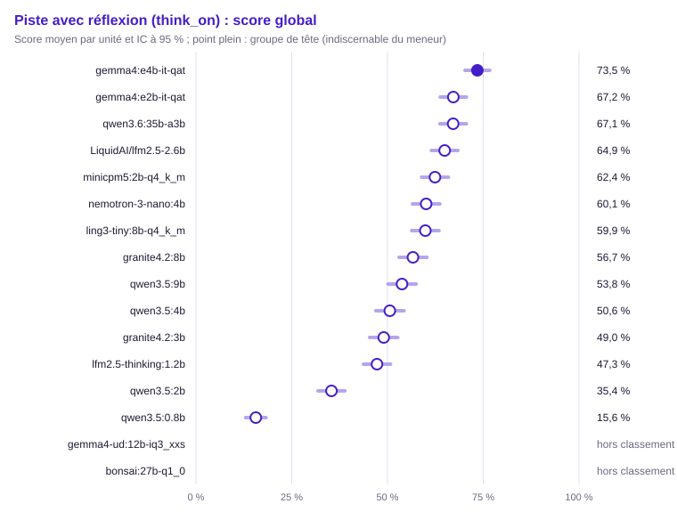

| Groupe | Rang | Modèle | Score (unités communes) | IC 95 % | IC simultané | ET groupée | Unités communes | Score (toutes unités définies) | Couverture | Exclues | Contexte dépassé : modèle / banc | Troncature |
|---|---|---|---|---|---|---|---|---|---|---|---|---|
| 1 | 1 | `gemma4:e4b-it-qat` | 73,5 % | [70,2 % ; 76,7 %] | [68,7 % ; 78,3 %] | 0,016 | 706 | 71,7 % (736) | 100,0 % | 0 | 0 / 0 | 4,9 % (38/776) |
| 2 | 1 | `gemma4:e2b-it-qat` | 67,2 % | [63,8 % ; 70,6 %] | [62,1 % ; 72,3 %] | 0,017 | 706 | 65,9 % (735) | 99,9 % | 1 | 0 / 1 | 5,5 % (43/775) |
| 2 | 1 | `qwen3.6:35b-a3b` | 67,1 % | [63,7 % ; 70,6 %] | [62,0 % ; 72,3 %] | 0,018 | 706 | 66,9 % (729) | 99,0 % | 7 | 0 / 7 | 24,1 % (185/769) |
| 2 | 1 | `LiquidAI/lfm2.5-2.6b` | 64,9 % | [61,5 % ; 68,4 %] | [59,8 % ; 70,1 %] | 0,018 | 706 | 64,9 % (719) | 97,7 % | 17 | 0 / 16 | 15,8 % (120/759) |
| 3 | 2 | `minicpm5:2b-q4_k_m` | 62,4 % | [58,9 % ; 65,9 %] | [57,2 % ; 67,6 %] | 0,018 | 706 | 60,4 % (736) | 100,0 % | 0 | 0 / 0 | 22,0 % (171/776) |
| 3 | 2 | `nemotron-3-nano:4b` | 60,1 % | [56,5 % ; 63,7 %] | [54,8 % ; 65,4 %] | 0,018 | 706 | 58,9 % (725) | 98,5 % | 11 | 0 / 10 | 9,9 % (76/765) |
| 3 | 2 | `ling3-tiny:8b-q4_k_m` | 59,9 % | [56,3 % ; 63,5 %] | [54,6 % ; 65,2 %] | 0,018 | 706 | 59,8 % (735) | 99,9 % | 1 | 0 / 1 | 21,8 % (169/775) |
| 4 | 3 | `granite4.2:8b` (hors usage) | 56,7 % | [53,0 % ; 60,3 %] | [51,3 % ; 62,1 %] | 0,019 | 706 | 56,5 % (734) | 99,7 % | 2 | 0 / 2 | 31,0 % (240/774) |
| 4 | 5 | `qwen3.5:9b` (hors usage) | 53,8 % | [50,1 % ; 57,5 %] | [48,3 % ; 59,3 %] | 0,019 | 706 | 54,2 % (732) | 99,5 % | 4 | 0 / 4 | 38,6 % (298/772) |
| 5 | 6 | `qwen3.5:4b` | 50,6 % | [46,9 % ; 54,3 %] | [45,1 % ; 56,1 %] | 0,019 | 706 | 51,0 % (732) | 99,5 % | 4 | 0 / 4 | 40,4 % (312/772) |
| 5 | 8 | `granite4.2:3b` | 49,0 % | [45,4 % ; 52,7 %] | [43,6 % ; 54,4 %] | 0,019 | 706 | 48,5 % (736) | 100,0 % | 0 | 0 / 0 | 36,0 % (279/776) |
| 5 | 8 | `lfm2.5-thinking:1.2b` | 47,3 % | [43,7 % ; 50,8 %] | [42,0 % ; 52,5 %] | 0,018 | 706 | 47,1 % (713) | 96,9 % | 23 | 0 / 20 | 9,0 % (68/753) |
| 6 | 13 | `qwen3.5:2b` | 35,4 % | [31,9 % ; 38,9 %] | [30,1 % ; 40,6 %] | 0,018 | 706 | 35,7 % (734) | 99,7 % | 2 | 0 / 2 | 53,0 % (410/774) |
| 7 | 14 | `qwen3.5:0.8b` | 15,6 % | [13,0 % ; 18,3 %] | [11,7 % ; 19,6 %] | 0,014 | 706 | 15,8 % (729) | 99,0 % | 7 | 0 / 7 | 72,7 % (559/769) |
| — | — | `gemma4-ud:12b-iq3_xxs` | — | — | — | — | 0 | — (0) | 0,0 % (hors classement) | 736 | 0 / 0 | — (0/0) |
| — | — | `bonsai:27b-q1_0` | — | — | — | — | 0 | — (0) | 0,0 % (hors classement) | 736 | 0 / 0 | — (0/0) |

Comparaisons au meneur (Holm sur les m − 1 comparaisons au meneur, m modèles du périmètre) :

| Modèle | Unités | Différence | ET appariée | IC 95 % | IC bootstrap | Corrélation | p | p (Holm) | Distingué |
|---|---|---|---|---|---|---|---|---|---|
| `lfm2.5-thinking:1.2b` | 706 | +26,2 pts | 0,019 | [+22,4 pts ; +30,0 pts] | [+22,3 pts ; +29,9 pts] | 0,37 | < 0,001 | < 0,001 | oui |
| `qwen3.5:0.8b` | 706 | +57,8 pts | 0,019 | [+54,0 pts ; +61,7 pts] | [+54,0 pts ; +61,8 pts] | 0,17 | < 0,001 | < 0,001 | oui |
| `ling3-tiny:8b-q4_k_m` | 706 | +13,6 pts | 0,018 | [+10,1 pts ; +17,1 pts] | [+10,2 pts ; +17,1 pts] | 0,47 | < 0,001 | < 0,001 | oui |
| `minicpm5:2b-q4_k_m` | 706 | +11,1 pts | 0,018 | [+7,6 pts ; +14,5 pts] | [+7,6 pts ; +14,5 pts] | 0,47 | < 0,001 | < 0,001 | oui |
| `LiquidAI/lfm2.5-2.6b` | 706 | +8,5 pts | 0,017 | [+5,2 pts ; +11,9 pts] | [+5,1 pts ; +11,8 pts] | 0,50 | < 0,001 | < 0,001 | oui |
| `gemma4:e2b-it-qat` | 706 | +6,3 pts | 0,014 | [+3,6 pts ; +9,0 pts] | [+3,6 pts ; +9,1 pts] | 0,67 | < 0,001 | < 0,001 | oui |
| `qwen3.5:2b` | 706 | +38,1 pts | 0,020 | [+34,1 pts ; +42,0 pts] | [+34,3 pts ; +42,0 pts] | 0,32 | < 0,001 | < 0,001 | oui |
| `granite4.2:3b` | 706 | +24,4 pts | 0,020 | [+20,6 pts ; +28,3 pts] | [+20,5 pts ; +28,3 pts] | 0,38 | < 0,001 | < 0,001 | oui |
| `nemotron-3-nano:4b` | 706 | +13,4 pts | 0,019 | [+9,7 pts ; +17,0 pts] | [+9,8 pts ; +16,9 pts] | 0,42 | < 0,001 | < 0,001 | oui |
| `qwen3.5:4b` | 706 | +22,8 pts | 0,019 | [+19,1 pts ; +26,6 pts] | [+19,3 pts ; +26,6 pts] | 0,42 | < 0,001 | < 0,001 | oui |
| `qwen3.5:9b` | 706 | +19,7 pts | 0,019 | [+16,0 pts ; +23,4 pts] | [+16,1 pts ; +23,4 pts] | 0,43 | < 0,001 | < 0,001 | oui |
| `qwen3.6:35b-a3b` | 706 | +6,3 pts | 0,018 | [+2,8 pts ; +9,8 pts] | [+3,0 pts ; +9,8 pts] | 0,45 | < 0,001 | < 0,001 | oui |
| `granite4.2:8b` | 706 | +16,8 pts | 0,018 | [+13,2 pts ; +20,4 pts] | [+13,3 pts ; +20,4 pts] | 0,45 | < 0,001 | < 0,001 | oui |

Matrice exploratoire « qui bat qui » (BH) :

- `lfm2.5-thinking:1.2b` devant `qwen3.5:0.8b` (+31,6 pts, p BH < 0,001)
- `ling3-tiny:8b-q4_k_m` devant `lfm2.5-thinking:1.2b` (+12,6 pts, p BH < 0,001)
- `minicpm5:2b-q4_k_m` devant `lfm2.5-thinking:1.2b` (+15,1 pts, p BH < 0,001)
- `LiquidAI/lfm2.5-2.6b` devant `lfm2.5-thinking:1.2b` (+17,7 pts, p BH < 0,001)
- `gemma4:e2b-it-qat` devant `lfm2.5-thinking:1.2b` (+19,9 pts, p BH < 0,001)
- `lfm2.5-thinking:1.2b` devant `qwen3.5:2b` (+11,9 pts, p BH < 0,001)
- `nemotron-3-nano:4b` devant `lfm2.5-thinking:1.2b` (+12,8 pts, p BH < 0,001)
- `gemma4:e4b-it-qat` devant `lfm2.5-thinking:1.2b` (+26,2 pts, p BH < 0,001)
- `qwen3.5:9b` devant `lfm2.5-thinking:1.2b` (+6,5 pts, p BH 0,003)
- `qwen3.6:35b-a3b` devant `lfm2.5-thinking:1.2b` (+19,9 pts, p BH < 0,001)
- `granite4.2:8b` devant `lfm2.5-thinking:1.2b` (+9,4 pts, p BH < 0,001)
- `ling3-tiny:8b-q4_k_m` devant `qwen3.5:0.8b` (+44,3 pts, p BH < 0,001)
- `minicpm5:2b-q4_k_m` devant `qwen3.5:0.8b` (+46,8 pts, p BH < 0,001)
- `LiquidAI/lfm2.5-2.6b` devant `qwen3.5:0.8b` (+49,3 pts, p BH < 0,001)
- `gemma4:e2b-it-qat` devant `qwen3.5:0.8b` (+51,6 pts, p BH < 0,001)
- `qwen3.5:2b` devant `qwen3.5:0.8b` (+19,7 pts, p BH < 0,001)
- `granite4.2:3b` devant `qwen3.5:0.8b` (+33,4 pts, p BH < 0,001)
- `nemotron-3-nano:4b` devant `qwen3.5:0.8b` (+44,5 pts, p BH < 0,001)
- `qwen3.5:4b` devant `qwen3.5:0.8b` (+35,0 pts, p BH < 0,001)
- `gemma4:e4b-it-qat` devant `qwen3.5:0.8b` (+57,8 pts, p BH < 0,001)
- `qwen3.5:9b` devant `qwen3.5:0.8b` (+38,2 pts, p BH < 0,001)
- `qwen3.6:35b-a3b` devant `qwen3.5:0.8b` (+51,5 pts, p BH < 0,001)
- `granite4.2:8b` devant `qwen3.5:0.8b` (+41,0 pts, p BH < 0,001)
- `LiquidAI/lfm2.5-2.6b` devant `ling3-tiny:8b-q4_k_m` (+5,1 pts, p BH 0,005)
- `gemma4:e2b-it-qat` devant `ling3-tiny:8b-q4_k_m` (+7,3 pts, p BH < 0,001)
- `ling3-tiny:8b-q4_k_m` devant `qwen3.5:2b` (+24,5 pts, p BH < 0,001)
- `ling3-tiny:8b-q4_k_m` devant `granite4.2:3b` (+10,9 pts, p BH < 0,001)
- `ling3-tiny:8b-q4_k_m` devant `qwen3.5:4b` (+9,3 pts, p BH < 0,001)
- `gemma4:e4b-it-qat` devant `ling3-tiny:8b-q4_k_m` (+13,6 pts, p BH < 0,001)
- `ling3-tiny:8b-q4_k_m` devant `qwen3.5:9b` (+6,1 pts, p BH < 0,001)
- `qwen3.6:35b-a3b` devant `ling3-tiny:8b-q4_k_m` (+7,3 pts, p BH < 0,001)
- `gemma4:e2b-it-qat` devant `minicpm5:2b-q4_k_m` (+4,8 pts, p BH 0,009)
- `minicpm5:2b-q4_k_m` devant `qwen3.5:2b` (+27,0 pts, p BH < 0,001)
- `minicpm5:2b-q4_k_m` devant `granite4.2:3b` (+13,4 pts, p BH < 0,001)
- `minicpm5:2b-q4_k_m` devant `qwen3.5:4b` (+11,8 pts, p BH < 0,001)
- `gemma4:e4b-it-qat` devant `minicpm5:2b-q4_k_m` (+11,1 pts, p BH < 0,001)
- `minicpm5:2b-q4_k_m` devant `qwen3.5:9b` (+8,6 pts, p BH < 0,001)
- `qwen3.6:35b-a3b` devant `minicpm5:2b-q4_k_m` (+4,7 pts, p BH 0,010)
- `minicpm5:2b-q4_k_m` devant `granite4.2:8b` (+5,7 pts, p BH 0,002)
- `LiquidAI/lfm2.5-2.6b` devant `qwen3.5:2b` (+29,6 pts, p BH < 0,001)
- `LiquidAI/lfm2.5-2.6b` devant `granite4.2:3b` (+15,9 pts, p BH < 0,001)
- `LiquidAI/lfm2.5-2.6b` devant `nemotron-3-nano:4b` (+4,8 pts, p BH 0,009)
- `LiquidAI/lfm2.5-2.6b` devant `qwen3.5:4b` (+14,3 pts, p BH < 0,001)
- `gemma4:e4b-it-qat` devant `LiquidAI/lfm2.5-2.6b` (+8,5 pts, p BH < 0,001)
- `LiquidAI/lfm2.5-2.6b` devant `qwen3.5:9b` (+11,1 pts, p BH < 0,001)
- `LiquidAI/lfm2.5-2.6b` devant `granite4.2:8b` (+8,3 pts, p BH < 0,001)
- `gemma4:e2b-it-qat` devant `qwen3.5:2b` (+31,8 pts, p BH < 0,001)
- `gemma4:e2b-it-qat` devant `granite4.2:3b` (+18,2 pts, p BH < 0,001)
- `gemma4:e2b-it-qat` devant `nemotron-3-nano:4b` (+7,1 pts, p BH < 0,001)
- `gemma4:e2b-it-qat` devant `qwen3.5:4b` (+16,6 pts, p BH < 0,001)
- `gemma4:e4b-it-qat` devant `gemma4:e2b-it-qat` (+6,3 pts, p BH < 0,001)
- `gemma4:e2b-it-qat` devant `qwen3.5:9b` (+13,4 pts, p BH < 0,001)
- `gemma4:e2b-it-qat` devant `granite4.2:8b` (+10,5 pts, p BH < 0,001)
- `granite4.2:3b` devant `qwen3.5:2b` (+13,6 pts, p BH < 0,001)
- `nemotron-3-nano:4b` devant `qwen3.5:2b` (+24,7 pts, p BH < 0,001)
- `qwen3.5:4b` devant `qwen3.5:2b` (+15,2 pts, p BH < 0,001)
- `gemma4:e4b-it-qat` devant `qwen3.5:2b` (+38,1 pts, p BH < 0,001)
- `qwen3.5:9b` devant `qwen3.5:2b` (+18,4 pts, p BH < 0,001)
- `qwen3.6:35b-a3b` devant `qwen3.5:2b` (+31,8 pts, p BH < 0,001)
- `granite4.2:8b` devant `qwen3.5:2b` (+21,3 pts, p BH < 0,001)
- `nemotron-3-nano:4b` devant `granite4.2:3b` (+11,1 pts, p BH < 0,001)
- `gemma4:e4b-it-qat` devant `granite4.2:3b` (+24,4 pts, p BH < 0,001)
- `qwen3.5:9b` devant `granite4.2:3b` (+4,8 pts, p BH 0,021)
- `qwen3.6:35b-a3b` devant `granite4.2:3b` (+18,1 pts, p BH < 0,001)
- `granite4.2:8b` devant `granite4.2:3b` (+7,6 pts, p BH < 0,001)
- `nemotron-3-nano:4b` devant `qwen3.5:4b` (+9,5 pts, p BH < 0,001)
- `gemma4:e4b-it-qat` devant `nemotron-3-nano:4b` (+13,4 pts, p BH < 0,001)
- `nemotron-3-nano:4b` devant `qwen3.5:9b` (+6,3 pts, p BH 0,002)
- `qwen3.6:35b-a3b` devant `nemotron-3-nano:4b` (+7,0 pts, p BH < 0,001)
- `gemma4:e4b-it-qat` devant `qwen3.5:4b` (+22,8 pts, p BH < 0,001)
- `qwen3.5:9b` devant `qwen3.5:4b` (+3,2 pts, p BH 0,020)
- `qwen3.6:35b-a3b` devant `qwen3.5:4b` (+16,5 pts, p BH < 0,001)
- `granite4.2:8b` devant `qwen3.5:4b` (+6,0 pts, p BH < 0,001)
- `gemma4:e4b-it-qat` devant `qwen3.5:9b` (+19,7 pts, p BH < 0,001)
- `gemma4:e4b-it-qat` devant `qwen3.6:35b-a3b` (+6,3 pts, p BH < 0,001)
- `gemma4:e4b-it-qat` devant `granite4.2:8b` (+16,8 pts, p BH < 0,001)
- `qwen3.6:35b-a3b` devant `qwen3.5:9b` (+13,3 pts, p BH < 0,001)
- `qwen3.6:35b-a3b` devant `granite4.2:8b` (+10,5 pts, p BH < 0,001)

#### Raisonnement (`reasoning`)

Méthode : McNemar exact apparié, intervalle de Wilson. Unités : 90, dont 87 communes aux modèles classés (classement, meneur et comparaisons). Meneur : `gemma4:e4b-it-qat`.

Avertissement : hors classement, couverture sous le seuil : `gemma4-ud:12b-iq3_xxs` (0,0 %), `bonsai:27b-q1_0` (0,0 %). Leur score sur leurs seules unités définies est publié sans rang, groupe ni comparaison.

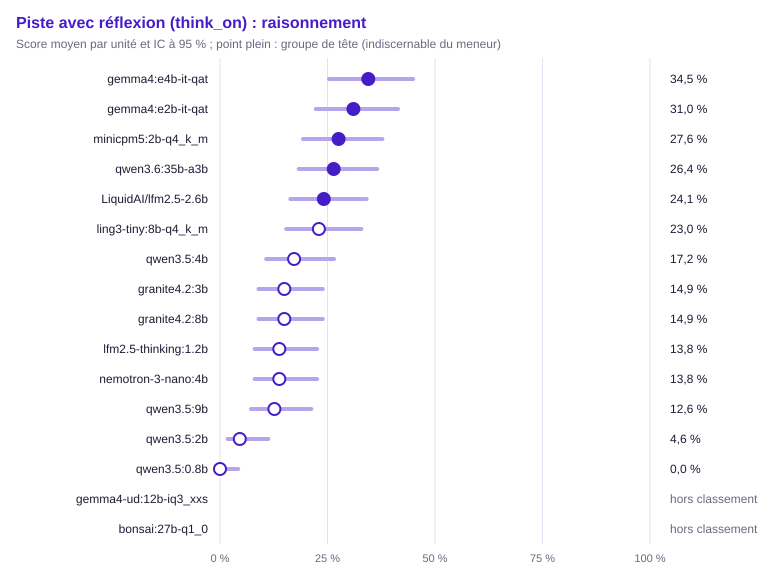

| Groupe | Rang | Modèle | Score (unités communes) | IC 95 % | IC simultané | ET groupée | Unités communes | Score (toutes unités définies) | Couverture | Exclues | Contexte dépassé : modèle / banc | Troncature |
|---|---|---|---|---|---|---|---|---|---|---|---|---|
| 1 | 1 | `gemma4:e4b-it-qat` | 34,5 % | [25,3 % ; 44,9 %] | [21,6 % ; 50,1 %] | 0,051 | 87 | 33,3 % (90) | 100,0 % | 0 | 0 / 0 | 25,4 % (33/130) |
| 1 | 1 | `gemma4:e2b-it-qat` | 31,0 % | [22,3 % ; 41,4 %] | [18,8 % ; 46,6 %] | 0,050 | 87 | 30,0 % (90) | 100,0 % | 0 | 0 / 0 | 29,2 % (38/130) |
| 1 | 1 | `minicpm5:2b-q4_k_m` | 27,6 % | [19,3 % ; 37,8 %] | [16,1 % ; 43,1 %] | 0,048 | 87 | 26,7 % (90) | 100,0 % | 0 | 0 / 0 | 43,1 % (56/130) |
| 1 | 1 | `qwen3.6:35b-a3b` | 26,4 % | [18,3 % ; 36,6 %] | [15,2 % ; 41,8 %] | 0,047 | 87 | 25,6 % (90) | 100,0 % | 0 | 0 / 0 | 51,5 % (67/130) |
| 1 | 1 | `LiquidAI/lfm2.5-2.6b` | 24,1 % | [16,4 % ; 34,1 %] | [13,5 % ; 39,4 %] | 0,046 | 87 | 23,6 % (89) | 98,9 % | 1 | 0 / 0 | 50,4 % (65/129) |
| 2 | 1 | `ling3-tiny:8b-q4_k_m` | 23,0 % | [15,4 % ; 32,9 %] | [12,6 % ; 38,2 %] | 0,045 | 87 | 22,2 % (90) | 100,0 % | 0 | 0 / 0 | 49,2 % (64/130) |
| 2 | 1 | `qwen3.5:4b` | 17,2 % | [10,7 % ; 26,5 %] | [8,5 % ; 31,8 %] | 0,040 | 87 | 16,7 % (90) | 100,0 % | 0 | 0 / 0 | 59,2 % (77/130) |
| 2 | 1 | `granite4.2:3b` | 14,9 % | [8,9 % ; 23,9 %] | [7,0 % ; 29,1 %] | 0,038 | 87 | 14,4 % (90) | 100,0 % | 0 | 0 / 0 | 57,7 % (75/130) |
| 2 | 1 | `granite4.2:8b` (hors usage) | 14,9 % | [8,9 % ; 23,9 %] | [7,0 % ; 29,1 %] | 0,038 | 87 | 14,4 % (90) | 100,0 % | 0 | 0 / 0 | 63,8 % (83/130) |
| 2 | 1 | `lfm2.5-thinking:1.2b` | 13,8 % | [8,1 % ; 22,6 %] | [6,2 % ; 27,8 %] | 0,037 | 87 | 13,8 % (87) | 96,7 % | 3 | 0 / 0 | 28,3 % (36/127) |
| 2 | 1 | `nemotron-3-nano:4b` | 13,8 % | [8,1 % ; 22,6 %] | [6,2 % ; 27,8 %] | 0,037 | 87 | 13,3 % (90) | 100,0 % | 0 | 0 / 0 | 25,4 % (33/130) |
| 2 | 1 | `qwen3.5:9b` (hors usage) | 12,6 % | [7,2 % ; 21,2 %] | [5,5 % ; 26,4 %] | 0,036 | 87 | 12,2 % (90) | 100,0 % | 0 | 0 / 0 | 63,1 % (82/130) |
| 3 | 4 | `qwen3.5:2b` | 4,6 % | [1,8 % ; 11,2 %] | [1,2 % ; 16,1 %] | 0,022 | 87 | 4,4 % (90) | 100,0 % | 0 | 0 / 0 | 83,8 % (109/130) |
| 3 | 7 | `qwen3.5:0.8b` | 0,0 % | [0,0 % ; 4,2 %] | [0,0 % ; 8,9 %] | 0,000 | 87 | 0,0 % (90) | 100,0 % | 0 | 0 / 0 | 99,2 % (129/130) |
| — | — | `gemma4-ud:12b-iq3_xxs` | — | — | — | — | 0 | — (0) | 0,0 % (hors classement) | 90 | 0 / 0 | — (0/0) |
| — | — | `bonsai:27b-q1_0` | — | — | — | — | 0 | — (0) | 0,0 % (hors classement) | 90 | 0 / 0 | — (0/0) |

Comparaisons au meneur (Holm sur les m − 1 comparaisons au meneur, m modèles du périmètre) :

| Modèle | Unités | Différence | ET appariée | IC 95 % | b | c | Corrélation | p | p (Holm) | Distingué |
|---|---|---|---|---|---|---|---|---|---|---|
| `lfm2.5-thinking:1.2b` | 87 | +20,7 pts | 0,054 | [+10,1 pts ; +31,3 pts] | 22 | 4 | 0,27 | < 0,001 | 0,004 | oui |
| `qwen3.5:0.8b` | 87 | +34,5 pts | 0,051 | [+24,5 pts ; +44,5 pts] | 30 | 0 | — | < 0,001 | < 0,001 | oui |
| `ling3-tiny:8b-q4_k_m` | 87 | +11,5 pts | 0,038 | [+4,1 pts ; +18,9 pts] | 11 | 1 | 0,70 | 0,006 | 0,032 | oui |
| `minicpm5:2b-q4_k_m` | 87 | +6,9 pts | 0,036 | [−0,1 pts ; +13,9 pts] | 8 | 2 | 0,74 | 0,109 | 0,328 | non |
| `LiquidAI/lfm2.5-2.6b` | 87 | +10,3 pts | 0,040 | [+2,5 pts ; +18,2 pts] | 11 | 2 | 0,66 | 0,022 | 0,090 | non |
| `gemma4:e2b-it-qat` | 87 | +3,4 pts | 0,038 | [−4,0 pts ; +10,9 pts] | 7 | 4 | 0,72 | 0,549 | 0,549 | non |
| `qwen3.5:2b` | 87 | +29,9 pts | 0,049 | [+20,3 pts ; +39,5 pts] | 26 | 0 | 0,30 | < 0,001 | < 0,001 | oui |
| `granite4.2:3b` | 87 | +19,5 pts | 0,048 | [+10,1 pts ; +29,0 pts] | 19 | 2 | 0,44 | < 0,001 | 0,002 | oui |
| `nemotron-3-nano:4b` | 87 | +20,7 pts | 0,054 | [+10,1 pts ; +31,3 pts] | 22 | 4 | 0,27 | < 0,001 | 0,004 | oui |
| `qwen3.5:4b` | 87 | +17,2 pts | 0,040 | [+9,3 pts ; +25,2 pts] | 15 | 0 | 0,63 | < 0,001 | < 0,001 | oui |
| `qwen3.5:9b` | 87 | +21,8 pts | 0,044 | [+13,2 pts ; +30,5 pts] | 19 | 0 | 0,52 | < 0,001 | < 0,001 | oui |
| `qwen3.6:35b-a3b` | 87 | +8,0 pts | 0,044 | [−0,5 pts ; +16,6 pts] | 11 | 4 | 0,61 | 0,118 | 0,328 | non |
| `granite4.2:8b` | 87 | +19,5 pts | 0,046 | [+10,6 pts ; +28,5 pts] | 18 | 1 | 0,51 | < 0,001 | < 0,001 | oui |

Matrice exploratoire « qui bat qui » (BH) :

- `lfm2.5-thinking:1.2b` devant `qwen3.5:0.8b` (+13,8 pts, p BH 0,002)
- `minicpm5:2b-q4_k_m` devant `lfm2.5-thinking:1.2b` (+13,8 pts, p BH 0,038)
- `gemma4:e2b-it-qat` devant `lfm2.5-thinking:1.2b` (+17,2 pts, p BH 0,005)
- `lfm2.5-thinking:1.2b` devant `qwen3.5:2b` (+9,2 pts, p BH 0,019)
- `gemma4:e4b-it-qat` devant `lfm2.5-thinking:1.2b` (+20,7 pts, p BH 0,002)
- `ling3-tiny:8b-q4_k_m` devant `qwen3.5:0.8b` (+23,0 pts, p BH < 0,001)
- `minicpm5:2b-q4_k_m` devant `qwen3.5:0.8b` (+27,6 pts, p BH < 0,001)
- `LiquidAI/lfm2.5-2.6b` devant `qwen3.5:0.8b` (+24,1 pts, p BH < 0,001)
- `gemma4:e2b-it-qat` devant `qwen3.5:0.8b` (+31,0 pts, p BH < 0,001)
- `granite4.2:3b` devant `qwen3.5:0.8b` (+14,9 pts, p BH 0,001)
- `nemotron-3-nano:4b` devant `qwen3.5:0.8b` (+13,8 pts, p BH 0,002)
- `qwen3.5:4b` devant `qwen3.5:0.8b` (+17,2 pts, p BH < 0,001)
- `gemma4:e4b-it-qat` devant `qwen3.5:0.8b` (+34,5 pts, p BH < 0,001)
- `qwen3.5:9b` devant `qwen3.5:0.8b` (+12,6 pts, p BH 0,003)
- `qwen3.6:35b-a3b` devant `qwen3.5:0.8b` (+26,4 pts, p BH < 0,001)
- `granite4.2:8b` devant `qwen3.5:0.8b` (+14,9 pts, p BH 0,001)
- `ling3-tiny:8b-q4_k_m` devant `qwen3.5:2b` (+18,4 pts, p BH < 0,001)
- `gemma4:e4b-it-qat` devant `ling3-tiny:8b-q4_k_m` (+11,5 pts, p BH 0,017)
- `minicpm5:2b-q4_k_m` devant `qwen3.5:2b` (+23,0 pts, p BH < 0,001)
- `minicpm5:2b-q4_k_m` devant `granite4.2:3b` (+12,6 pts, p BH 0,018)
- `minicpm5:2b-q4_k_m` devant `qwen3.5:4b` (+10,3 pts, p BH 0,027)
- `minicpm5:2b-q4_k_m` devant `qwen3.5:9b` (+14,9 pts, p BH 0,007)
- `minicpm5:2b-q4_k_m` devant `granite4.2:8b` (+12,6 pts, p BH 0,018)
- `LiquidAI/lfm2.5-2.6b` devant `qwen3.5:2b` (+19,5 pts, p BH < 0,001)
- `gemma4:e4b-it-qat` devant `LiquidAI/lfm2.5-2.6b` (+10,3 pts, p BH 0,046)
- `LiquidAI/lfm2.5-2.6b` devant `qwen3.5:9b` (+11,5 pts, p BH 0,045)
- `gemma4:e2b-it-qat` devant `qwen3.5:2b` (+26,4 pts, p BH < 0,001)
- `gemma4:e2b-it-qat` devant `granite4.2:3b` (+16,1 pts, p BH 0,002)
- `gemma4:e2b-it-qat` devant `nemotron-3-nano:4b` (+17,2 pts, p BH 0,008)
- `gemma4:e2b-it-qat` devant `qwen3.5:4b` (+13,8 pts, p BH 0,011)
- `gemma4:e2b-it-qat` devant `qwen3.5:9b` (+18,4 pts, p BH 0,002)
- `gemma4:e2b-it-qat` devant `granite4.2:8b` (+16,1 pts, p BH < 0,001)
- `granite4.2:3b` devant `qwen3.5:2b` (+10,3 pts, p BH 0,011)
- `qwen3.5:4b` devant `qwen3.5:2b` (+12,6 pts, p BH 0,003)
- `gemma4:e4b-it-qat` devant `qwen3.5:2b` (+29,9 pts, p BH < 0,001)
- `qwen3.6:35b-a3b` devant `qwen3.5:2b` (+21,8 pts, p BH < 0,001)
- `granite4.2:8b` devant `qwen3.5:2b` (+10,3 pts, p BH 0,027)
- `gemma4:e4b-it-qat` devant `granite4.2:3b` (+19,5 pts, p BH 0,001)
- `gemma4:e4b-it-qat` devant `nemotron-3-nano:4b` (+20,7 pts, p BH 0,002)
- `qwen3.6:35b-a3b` devant `nemotron-3-nano:4b` (+12,6 pts, p BH 0,042)
- `gemma4:e4b-it-qat` devant `qwen3.5:4b` (+17,2 pts, p BH < 0,001)
- `gemma4:e4b-it-qat` devant `qwen3.5:9b` (+21,8 pts, p BH < 0,001)
- `gemma4:e4b-it-qat` devant `granite4.2:8b` (+19,5 pts, p BH < 0,001)
- `qwen3.6:35b-a3b` devant `qwen3.5:9b` (+13,8 pts, p BH 0,011)

#### Suivi de consignes (`instructions`)

Méthode : McNemar exact apparié, intervalle de Wilson. Unités : 130, dont 130 communes aux modèles classés (classement, meneur et comparaisons). Meneur : `nemotron-3-nano:4b`.

Avertissement : hors classement, couverture sous le seuil : `gemma4-ud:12b-iq3_xxs` (0,0 %), `bonsai:27b-q1_0` (0,0 %). Leur score sur leurs seules unités définies est publié sans rang, groupe ni comparaison.

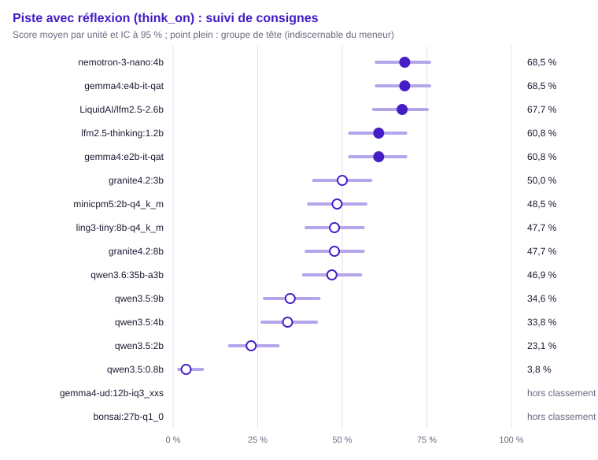

| Groupe | Rang | Modèle | Score (unités communes) | IC 95 % | IC simultané | ET groupée | Unités communes | Score (toutes unités définies) | Couverture | Exclues | Contexte dépassé : modèle / banc | Troncature |
|---|---|---|---|---|---|---|---|---|---|---|---|---|
| 1 | 1 | `nemotron-3-nano:4b` | 68,5 % | [60,0 % ; 75,8 %] | [55,8 % ; 78,9 %] | 0,041 | 130 | 68,5 % (130) | 100,0 % | 0 | 0 / 0 | 18,5 % (24/130) |
| 1 | 1 | `gemma4:e4b-it-qat` | 68,5 % | [60,0 % ; 75,8 %] | [55,8 % ; 78,9 %] | 0,041 | 130 | 68,5 % (130) | 100,0 % | 0 | 0 / 0 | 1,5 % (2/130) |
| 1 | 1 | `LiquidAI/lfm2.5-2.6b` | 67,7 % | [59,2 % ; 75,1 %] | [55,0 % ; 78,2 %] | 0,041 | 130 | 67,7 % (130) | 100,0 % | 0 | 0 / 0 | 16,9 % (22/130) |
| 1 | 1 | `lfm2.5-thinking:1.2b` | 60,8 % | [52,2 % ; 68,7 %] | [48,0 % ; 72,2 %] | 0,043 | 130 | 60,8 % (130) | 100,0 % | 0 | 0 / 0 | 6,2 % (8/130) |
| 1 | 1 | `gemma4:e2b-it-qat` | 60,8 % | [52,2 % ; 68,7 %] | [48,0 % ; 72,2 %] | 0,043 | 130 | 60,8 % (130) | 100,0 % | 0 | 0 / 0 | 0,0 % (0/130) |
| 2 | 1 | `granite4.2:3b` | 50,0 % | [41,5 % ; 58,5 %] | [37,6 % ; 62,4 %] | 0,044 | 130 | 50,0 % (130) | 100,0 % | 0 | 0 / 0 | 43,1 % (56/130) |
| 2 | 1 | `minicpm5:2b-q4_k_m` | 48,5 % | [40,0 % ; 57,0 %] | [36,2 % ; 60,9 %] | 0,044 | 130 | 48,5 % (130) | 100,0 % | 0 | 0 / 0 | 39,2 % (51/130) |
| 2 | 1 | `ling3-tiny:8b-q4_k_m` | 47,7 % | [39,3 % ; 56,2 %] | [35,5 % ; 60,2 %] | 0,044 | 130 | 47,7 % (130) | 100,0 % | 0 | 0 / 0 | 43,8 % (57/130) |
| 2 | 1 | `granite4.2:8b` (hors usage) | 47,7 % | [39,3 % ; 56,2 %] | [35,5 % ; 60,2 %] | 0,044 | 130 | 47,7 % (130) | 100,0 % | 0 | 0 / 0 | 46,9 % (61/130) |
| 2 | 1 | `qwen3.6:35b-a3b` | 46,9 % | [38,6 % ; 55,5 %] | [34,8 % ; 59,5 %] | 0,044 | 130 | 46,9 % (130) | 100,0 % | 0 | 0 / 0 | 50,0 % (65/130) |
| 3 | 6 | `qwen3.5:9b` (hors usage) | 34,6 % | [27,0 % ; 43,1 %] | [23,7 % ; 47,4 %] | 0,042 | 130 | 34,6 % (130) | 100,0 % | 0 | 0 / 0 | 62,3 % (81/130) |
| 3 | 6 | `qwen3.5:4b` | 33,8 % | [26,3 % ; 42,3 %] | [23,1 % ; 46,6 %] | 0,042 | 130 | 33,8 % (130) | 100,0 % | 0 | 0 / 0 | 63,8 % (83/130) |
| 4 | 10 | `qwen3.5:2b` | 23,1 % | [16,7 % ; 31,0 %] | [14,2 % ; 35,3 %] | 0,037 | 130 | 23,1 % (130) | 100,0 % | 0 | 0 / 0 | 73,1 % (95/130) |
| 5 | 14 | `qwen3.5:0.8b` | 3,8 % | [1,7 % ; 8,7 %] | [1,1 % ; 12,2 %] | 0,017 | 130 | 3,8 % (130) | 100,0 % | 0 | 0 / 0 | 95,4 % (124/130) |
| — | — | `gemma4-ud:12b-iq3_xxs` | — | — | — | — | 0 | — (0) | 0,0 % (hors classement) | 130 | 0 / 0 | — (0/0) |
| — | — | `bonsai:27b-q1_0` | — | — | — | — | 0 | — (0) | 0,0 % (hors classement) | 130 | 0 / 0 | — (0/0) |

Comparaisons au meneur (Holm sur les m − 1 comparaisons au meneur, m modèles du périmètre) :

| Modèle | Unités | Différence | ET appariée | IC 95 % | b | c | Corrélation | p | p (Holm) | Distingué |
|---|---|---|---|---|---|---|---|---|---|---|
| `lfm2.5-thinking:1.2b` | 130 | +7,7 pts | 0,052 | [−2,4 pts ; +17,8 pts] | 28 | 18 | 0,23 | 0,184 | 0,573 | non |
| `qwen3.5:0.8b` | 130 | +64,6 pts | 0,042 | [+56,4 pts ; +72,8 pts] | 84 | 0 | 0,14 | < 0,001 | < 0,001 | oui |
| `ling3-tiny:8b-q4_k_m` | 130 | +20,8 pts | 0,039 | [+13,2 pts ; +28,4 pts] | 29 | 2 | 0,58 | < 0,001 | < 0,001 | oui |
| `minicpm5:2b-q4_k_m` | 130 | +20,0 pts | 0,054 | [+9,5 pts ; +30,5 pts] | 40 | 14 | 0,19 | < 0,001 | 0,003 | oui |
| `LiquidAI/lfm2.5-2.6b` | 130 | +0,8 pts | 0,041 | [−7,3 pts ; +8,9 pts] | 15 | 14 | 0,49 | 1,000 | 1,000 | non |
| `gemma4:e2b-it-qat` | 130 | +7,7 pts | 0,047 | [−1,5 pts ; +16,9 pts] | 24 | 14 | 0,37 | 0,143 | 0,573 | non |
| `qwen3.5:2b` | 130 | +45,4 pts | 0,045 | [+36,6 pts ; +54,2 pts] | 60 | 1 | 0,33 | < 0,001 | < 0,001 | oui |
| `granite4.2:3b` | 130 | +18,5 pts | 0,046 | [+9,5 pts ; +27,5 pts] | 32 | 8 | 0,41 | < 0,001 | 0,001 | oui |
| `qwen3.5:4b` | 130 | +34,6 pts | 0,044 | [+25,9 pts ; +43,3 pts] | 47 | 2 | 0,42 | < 0,001 | < 0,001 | oui |
| `gemma4:e4b-it-qat` | 130 | 0,0 pts | 0,044 | [−8,5 pts ; +8,5 pts] | 16 | 16 | 0,43 | 1,000 | 1,000 | non |
| `qwen3.5:9b` | 130 | +33,8 pts | 0,046 | [+24,9 pts ; +42,8 pts] | 47 | 3 | 0,39 | < 0,001 | < 0,001 | oui |
| `qwen3.6:35b-a3b` | 130 | +21,5 pts | 0,045 | [+12,8 pts ; +30,3 pts] | 34 | 6 | 0,44 | < 0,001 | < 0,001 | oui |
| `granite4.2:8b` | 130 | +20,8 pts | 0,047 | [+11,5 pts ; +30,0 pts] | 35 | 8 | 0,38 | < 0,001 | < 0,001 | oui |

Matrice exploratoire « qui bat qui » (BH) :

- `lfm2.5-thinking:1.2b` devant `qwen3.5:0.8b` (+56,9 pts, p BH < 0,001)
- `lfm2.5-thinking:1.2b` devant `ling3-tiny:8b-q4_k_m` (+13,1 pts, p BH 0,029)
- `lfm2.5-thinking:1.2b` devant `minicpm5:2b-q4_k_m` (+12,3 pts, p BH 0,043)
- `lfm2.5-thinking:1.2b` devant `qwen3.5:2b` (+37,7 pts, p BH < 0,001)
- `lfm2.5-thinking:1.2b` devant `qwen3.5:4b` (+26,9 pts, p BH < 0,001)
- `lfm2.5-thinking:1.2b` devant `qwen3.5:9b` (+26,2 pts, p BH < 0,001)
- `lfm2.5-thinking:1.2b` devant `qwen3.6:35b-a3b` (+13,8 pts, p BH 0,017)
- `lfm2.5-thinking:1.2b` devant `granite4.2:8b` (+13,1 pts, p BH 0,029)
- `ling3-tiny:8b-q4_k_m` devant `qwen3.5:0.8b` (+43,8 pts, p BH < 0,001)
- `minicpm5:2b-q4_k_m` devant `qwen3.5:0.8b` (+44,6 pts, p BH < 0,001)
- `LiquidAI/lfm2.5-2.6b` devant `qwen3.5:0.8b` (+63,8 pts, p BH < 0,001)
- `gemma4:e2b-it-qat` devant `qwen3.5:0.8b` (+56,9 pts, p BH < 0,001)
- `qwen3.5:2b` devant `qwen3.5:0.8b` (+19,2 pts, p BH < 0,001)
- `granite4.2:3b` devant `qwen3.5:0.8b` (+46,2 pts, p BH < 0,001)
- `nemotron-3-nano:4b` devant `qwen3.5:0.8b` (+64,6 pts, p BH < 0,001)
- `qwen3.5:4b` devant `qwen3.5:0.8b` (+30,0 pts, p BH < 0,001)
- `gemma4:e4b-it-qat` devant `qwen3.5:0.8b` (+64,6 pts, p BH < 0,001)
- `qwen3.5:9b` devant `qwen3.5:0.8b` (+30,8 pts, p BH < 0,001)
- `qwen3.6:35b-a3b` devant `qwen3.5:0.8b` (+43,1 pts, p BH < 0,001)
- `granite4.2:8b` devant `qwen3.5:0.8b` (+43,8 pts, p BH < 0,001)
- `LiquidAI/lfm2.5-2.6b` devant `ling3-tiny:8b-q4_k_m` (+20,0 pts, p BH < 0,001)
- `gemma4:e2b-it-qat` devant `ling3-tiny:8b-q4_k_m` (+13,1 pts, p BH 0,011)
- `ling3-tiny:8b-q4_k_m` devant `qwen3.5:2b` (+24,6 pts, p BH < 0,001)
- `nemotron-3-nano:4b` devant `ling3-tiny:8b-q4_k_m` (+20,8 pts, p BH < 0,001)
- `ling3-tiny:8b-q4_k_m` devant `qwen3.5:4b` (+13,8 pts, p BH 0,005)
- `gemma4:e4b-it-qat` devant `ling3-tiny:8b-q4_k_m` (+20,8 pts, p BH < 0,001)
- `ling3-tiny:8b-q4_k_m` devant `qwen3.5:9b` (+13,1 pts, p BH 0,011)
- `LiquidAI/lfm2.5-2.6b` devant `minicpm5:2b-q4_k_m` (+19,2 pts, p BH < 0,001)
- `gemma4:e2b-it-qat` devant `minicpm5:2b-q4_k_m` (+12,3 pts, p BH 0,035)
- `minicpm5:2b-q4_k_m` devant `qwen3.5:2b` (+25,4 pts, p BH < 0,001)
- `nemotron-3-nano:4b` devant `minicpm5:2b-q4_k_m` (+20,0 pts, p BH < 0,001)
- `minicpm5:2b-q4_k_m` devant `qwen3.5:4b` (+14,6 pts, p BH 0,009)
- `gemma4:e4b-it-qat` devant `minicpm5:2b-q4_k_m` (+20,0 pts, p BH < 0,001)
- `minicpm5:2b-q4_k_m` devant `qwen3.5:9b` (+13,8 pts, p BH 0,019)
- `LiquidAI/lfm2.5-2.6b` devant `qwen3.5:2b` (+44,6 pts, p BH < 0,001)
- `LiquidAI/lfm2.5-2.6b` devant `granite4.2:3b` (+17,7 pts, p BH < 0,001)
- `LiquidAI/lfm2.5-2.6b` devant `qwen3.5:4b` (+33,8 pts, p BH < 0,001)
- `LiquidAI/lfm2.5-2.6b` devant `qwen3.5:9b` (+33,1 pts, p BH < 0,001)
- `LiquidAI/lfm2.5-2.6b` devant `qwen3.6:35b-a3b` (+20,8 pts, p BH < 0,001)
- `LiquidAI/lfm2.5-2.6b` devant `granite4.2:8b` (+20,0 pts, p BH < 0,001)
- `gemma4:e2b-it-qat` devant `qwen3.5:2b` (+37,7 pts, p BH < 0,001)
- `gemma4:e2b-it-qat` devant `granite4.2:3b` (+10,8 pts, p BH 0,044)
- `gemma4:e2b-it-qat` devant `qwen3.5:4b` (+26,9 pts, p BH < 0,001)
- `gemma4:e4b-it-qat` devant `gemma4:e2b-it-qat` (+7,7 pts, p BH 0,018)
- `gemma4:e2b-it-qat` devant `qwen3.5:9b` (+26,2 pts, p BH < 0,001)
- `gemma4:e2b-it-qat` devant `qwen3.6:35b-a3b` (+13,8 pts, p BH 0,010)
- `gemma4:e2b-it-qat` devant `granite4.2:8b` (+13,1 pts, p BH 0,017)
- `granite4.2:3b` devant `qwen3.5:2b` (+26,9 pts, p BH < 0,001)
- `nemotron-3-nano:4b` devant `qwen3.5:2b` (+45,4 pts, p BH < 0,001)
- `qwen3.5:4b` devant `qwen3.5:2b` (+10,8 pts, p BH 0,010)
- `gemma4:e4b-it-qat` devant `qwen3.5:2b` (+45,4 pts, p BH < 0,001)
- `qwen3.5:9b` devant `qwen3.5:2b` (+11,5 pts, p BH 0,003)
- `qwen3.6:35b-a3b` devant `qwen3.5:2b` (+23,8 pts, p BH < 0,001)
- `granite4.2:8b` devant `qwen3.5:2b` (+24,6 pts, p BH < 0,001)
- `nemotron-3-nano:4b` devant `granite4.2:3b` (+18,5 pts, p BH < 0,001)
- `granite4.2:3b` devant `qwen3.5:4b` (+16,2 pts, p BH < 0,001)
- `gemma4:e4b-it-qat` devant `granite4.2:3b` (+18,5 pts, p BH < 0,001)
- `granite4.2:3b` devant `qwen3.5:9b` (+15,4 pts, p BH 0,003)
- `nemotron-3-nano:4b` devant `qwen3.5:4b` (+34,6 pts, p BH < 0,001)
- `nemotron-3-nano:4b` devant `qwen3.5:9b` (+33,8 pts, p BH < 0,001)
- `nemotron-3-nano:4b` devant `qwen3.6:35b-a3b` (+21,5 pts, p BH < 0,001)
- `nemotron-3-nano:4b` devant `granite4.2:8b` (+20,8 pts, p BH < 0,001)
- `gemma4:e4b-it-qat` devant `qwen3.5:4b` (+34,6 pts, p BH < 0,001)
- `qwen3.6:35b-a3b` devant `qwen3.5:4b` (+13,1 pts, p BH 0,003)
- `granite4.2:8b` devant `qwen3.5:4b` (+13,8 pts, p BH 0,007)
- `gemma4:e4b-it-qat` devant `qwen3.5:9b` (+33,8 pts, p BH < 0,001)
- `gemma4:e4b-it-qat` devant `qwen3.6:35b-a3b` (+21,5 pts, p BH < 0,001)
- `gemma4:e4b-it-qat` devant `granite4.2:8b` (+20,8 pts, p BH < 0,001)
- `qwen3.6:35b-a3b` devant `qwen3.5:9b` (+12,3 pts, p BH 0,002)
- `granite4.2:8b` devant `qwen3.5:9b` (+13,1 pts, p BH 0,007)

Métrique continue : part de consignes suivies (`instructions_followed`), meneur `gemma4:e4b-it-qat`.

| Modèle | Moyenne (unités communes) | Unités communes | Moyenne (toutes) | Couverture | Exclues |
|---|---|---|---|---|---|
| `lfm2.5-thinking:1.2b` | 67,1 % | 130 | 67,1 % (130) | 100,0 % | 0 |
| `qwen3.5:0.8b` | 3,8 % | 130 | 3,8 % (130) | 100,0 % | 0 |
| `ling3-tiny:8b-q4_k_m` | 49,6 % | 130 | 49,6 % (130) | 100,0 % | 0 |
| `minicpm5:2b-q4_k_m` | 50,5 % | 130 | 50,5 % (130) | 100,0 % | 0 |
| `LiquidAI/lfm2.5-2.6b` | 73,2 % | 130 | 73,2 % (130) | 100,0 % | 0 |
| `gemma4:e2b-it-qat` | 70,1 % | 130 | 70,1 % (130) | 100,0 % | 0 |
| `qwen3.5:2b` | 23,8 % | 130 | 23,8 % (130) | 100,0 % | 0 |
| `granite4.2:3b` | 52,3 % | 130 | 52,3 % (130) | 100,0 % | 0 |
| `nemotron-3-nano:4b` | 72,3 % | 130 | 72,3 % (130) | 100,0 % | 0 |
| `qwen3.5:4b` | 33,8 % | 130 | 33,8 % (130) | 100,0 % | 0 |
| `gemma4:e4b-it-qat` | 75,8 % | 130 | 75,8 % (130) | 100,0 % | 0 |
| `qwen3.5:9b` | 35,0 % | 130 | 35,0 % (130) | 100,0 % | 0 |
| `qwen3.6:35b-a3b` | 47,3 % | 130 | 47,3 % (130) | 100,0 % | 0 |
| `granite4.2:8b` | 48,6 % | 130 | 48,6 % (130) | 100,0 % | 0 |
| `gemma4-ud:12b-iq3_xxs` | — | 0 | — (0) | 0,0 % (hors classement) | 130 |
| `bonsai:27b-q1_0` | — | 0 | — (0) | 0,0 % (hors classement) | 130 |

Différence au meneur, IC bootstrap apparié à 95 % :

| Modèle | Unités | Différence | IC bootstrap |
|---|---|---|---|
| `lfm2.5-thinking:1.2b` | 130 | +8,7 pts | [+1,2 pts ; +16,3 pts] |
| `qwen3.5:0.8b` | 130 | +71,9 pts | [+64,8 pts ; +78,8 pts] |
| `ling3-tiny:8b-q4_k_m` | 130 | +26,2 pts | [+17,9 pts ; +34,1 pts] |
| `minicpm5:2b-q4_k_m` | 130 | +25,3 pts | [+16,2 pts ; +34,6 pts] |
| `LiquidAI/lfm2.5-2.6b` | 130 | +2,6 pts | [−3,2 pts ; +8,7 pts] |
| `gemma4:e2b-it-qat` | 130 | +5,7 pts | [+1,3 pts ; +10,6 pts] |
| `qwen3.5:2b` | 130 | +51,9 pts | [+43,7 pts ; +60,2 pts] |
| `granite4.2:3b` | 130 | +23,5 pts | [+14,6 pts ; +32,3 pts] |
| `nemotron-3-nano:4b` | 130 | +3,5 pts | [−4,4 pts ; +11,2 pts] |
| `qwen3.5:4b` | 130 | +41,9 pts | [+33,6 pts ; +50,4 pts] |
| `qwen3.5:9b` | 130 | +40,8 pts | [+32,1 pts ; +49,6 pts] |
| `qwen3.6:35b-a3b` | 130 | +28,5 pts | [+20,2 pts ; +37,3 pts] |
| `granite4.2:8b` | 130 | +27,2 pts | [+18,1 pts ; +36,3 pts] |

#### Appels d'outils (`tools`)

Méthode : McNemar exact apparié, intervalle de Wilson. Unités : 130, dont 114 communes aux modèles classés (classement, meneur et comparaisons). Meneur : `qwen3.6:35b-a3b`.

Avertissement : hors classement, couverture sous le seuil : `lfm2.5-thinking:1.2b` (84,6 %), `LiquidAI/lfm2.5-2.6b` (87,7 %), `gemma4-ud:12b-iq3_xxs` (0,0 %), `bonsai:27b-q1_0` (0,0 %). Leur score sur leurs seules unités définies est publié sans rang, groupe ni comparaison.

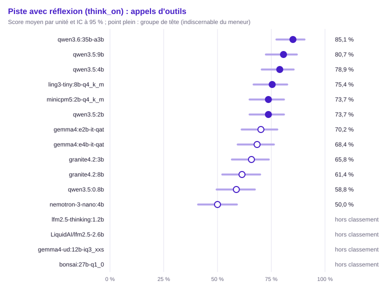

| Groupe | Rang | Modèle | Score (unités communes) | IC 95 % | IC simultané | ET groupée | Unités communes | Score (toutes unités définies) | Couverture | Exclues | Contexte dépassé : modèle / banc | Troncature |
|---|---|---|---|---|---|---|---|---|---|---|---|---|
| 1 | 1 | `qwen3.6:35b-a3b` | 85,1 % | [77,4 % ; 90,5 %] | [73,2 % ; 92,3 %] | 0,033 | 114 | 83,7 % (123) | 94,6 % | 7 | 0 / 7 | 0,0 % (0/123) |
| 1 | 1 | `qwen3.5:9b` (hors usage) | 80,7 % | [72,5 % ; 86,9 %] | [68,2 % ; 89,1 %] | 0,037 | 114 | 80,2 % (126) | 96,9 % | 4 | 0 / 4 | 0,0 % (0/126) |
| 1 | 1 | `qwen3.5:4b` | 78,9 % | [70,6 % ; 85,4 %] | [66,3 % ; 87,7 %] | 0,038 | 114 | 77,8 % (126) | 96,9 % | 4 | 0 / 4 | 0,0 % (0/126) |
| 1 | 1 | `ling3-tiny:8b-q4_k_m` | 75,4 % | [66,8 % ; 82,4 %] | [62,4 % ; 85,0 %] | 0,040 | 114 | 73,6 % (129) | 99,2 % | 1 | 0 / 1 | 0,8 % (1/129) |
| 1 | 1 | `minicpm5:2b-q4_k_m` | 73,7 % | [64,9 % ; 80,9 %] | [60,6 % ; 83,6 %] | 0,041 | 114 | 66,2 % (130) | 100,0 % | 0 | 0 / 0 | 20,0 % (26/130) |
| 1 | 1 | `qwen3.5:2b` | 73,7 % | [64,9 % ; 80,9 %] | [60,6 % ; 83,6 %] | 0,041 | 114 | 69,5 % (128) | 98,5 % | 2 | 0 / 2 | 0,8 % (1/128) |
| 2 | 1 | `gemma4:e2b-it-qat` | 70,2 % | [61,2 % ; 77,8 %] | [56,9 % ; 80,8 %] | 0,043 | 114 | 64,3 % (129) | 99,2 % | 1 | 0 / 1 | 0,0 % (0/129) |
| 2 | 1 | `gemma4:e4b-it-qat` | 68,4 % | [59,4 % ; 76,2 %] | [55,1 % ; 79,3 %] | 0,044 | 114 | 63,8 % (130) | 100,0 % | 0 | 0 / 0 | 0,0 % (0/130) |
| 2 | 1 | `granite4.2:3b` | 65,8 % | [56,7 % ; 73,9 %] | [52,4 % ; 77,1 %] | 0,044 | 114 | 61,5 % (130) | 100,0 % | 0 | 0 / 0 | 6,2 % (8/130) |
| 2 | 1 | `granite4.2:8b` (hors usage) | 61,4 % | [52,2 % ; 69,8 %] | [48,0 % ; 73,3 %] | 0,046 | 114 | 60,2 % (128) | 98,5 % | 2 | 0 / 2 | 2,3 % (3/128) |
| 2 | 2 | `qwen3.5:0.8b` | 58,8 % | [49,6 % ; 67,4 %] | [45,4 % ; 71,0 %] | 0,046 | 114 | 55,3 % (123) | 94,6 % | 7 | 0 / 7 | 0,0 % (0/123) |
| 3 | 4 | `nemotron-3-nano:4b` | 50,0 % | [41,0 % ; 59,0 %] | [37,0 % ; 63,0 %] | 0,047 | 114 | 47,5 % (120) | 92,3 % | 10 | 0 / 10 | 5,8 % (7/120) |
| — | — | `lfm2.5-thinking:1.2b` | — | — | — | — | 0 | 60,9 % (110) | 84,6 % (hors classement) | 20 | 0 / 20 | 0,0 % (0/110) |
| — | — | `LiquidAI/lfm2.5-2.6b` | — | — | — | — | 0 | 81,6 % (114) | 87,7 % (hors classement) | 16 | 0 / 16 | 0,0 % (0/114) |
| — | — | `gemma4-ud:12b-iq3_xxs` | — | — | — | — | 0 | — (0) | 0,0 % (hors classement) | 130 | 0 / 0 | — (0/0) |
| — | — | `bonsai:27b-q1_0` | — | — | — | — | 0 | — (0) | 0,0 % (hors classement) | 130 | 0 / 0 | — (0/0) |

Comparaisons au meneur (Holm sur les m − 1 comparaisons au meneur, m modèles du périmètre) :

| Modèle | Unités | Différence | ET appariée | IC 95 % | b | c | Corrélation | p | p (Holm) | Distingué |
|---|---|---|---|---|---|---|---|---|---|---|
| `qwen3.5:0.8b` | 114 | +26,3 pts | 0,045 | [+17,5 pts ; +35,1 pts] | 32 | 2 | 0,40 | < 0,001 | < 0,001 | oui |
| `ling3-tiny:8b-q4_k_m` | 114 | +9,6 pts | 0,039 | [+2,0 pts ; +17,3 pts] | 16 | 5 | 0,45 | 0,027 | 0,080 | non |
| `minicpm5:2b-q4_k_m` | 114 | +11,4 pts | 0,041 | [+3,4 pts ; +19,4 pts] | 18 | 5 | 0,42 | 0,011 | 0,053 | non |
| `gemma4:e2b-it-qat` | 114 | +14,9 pts | 0,043 | [+6,4 pts ; +23,4 pts] | 22 | 5 | 0,37 | 0,002 | 0,009 | oui |
| `qwen3.5:2b` | 114 | +11,4 pts | 0,043 | [+3,1 pts ; +19,7 pts] | 19 | 6 | 0,36 | 0,015 | 0,059 | non |
| `granite4.2:3b` | 114 | +19,3 pts | 0,046 | [+10,2 pts ; +28,4 pts] | 27 | 5 | 0,32 | < 0,001 | < 0,001 | oui |
| `nemotron-3-nano:4b` | 114 | +35,1 pts | 0,048 | [+25,7 pts ; +44,5 pts] | 42 | 2 | 0,32 | < 0,001 | < 0,001 | oui |
| `qwen3.5:4b` | 114 | +6,1 pts | 0,033 | [−0,4 pts ; +12,7 pts] | 11 | 4 | 0,57 | 0,118 | 0,237 | non |
| `gemma4:e4b-it-qat` | 114 | +16,7 pts | 0,045 | [+7,9 pts ; +25,4 pts] | 24 | 5 | 0,35 | < 0,001 | 0,004 | oui |
| `qwen3.5:9b` | 114 | +4,4 pts | 0,034 | [−2,2 pts ; +11,0 pts] | 10 | 5 | 0,54 | 0,302 | 0,302 | non |
| `granite4.2:8b` | 114 | +23,7 pts | 0,047 | [+14,5 pts ; +32,9 pts] | 31 | 4 | 0,33 | < 0,001 | < 0,001 | oui |

Matrice exploratoire « qui bat qui » (BH) :

- `ling3-tiny:8b-q4_k_m` devant `qwen3.5:0.8b` (+16,7 pts, p BH 0,007)
- `minicpm5:2b-q4_k_m` devant `qwen3.5:0.8b` (+14,9 pts, p BH 0,018)
- `qwen3.5:2b` devant `qwen3.5:0.8b` (+14,9 pts, p BH 0,010)
- `qwen3.5:4b` devant `qwen3.5:0.8b` (+20,2 pts, p BH < 0,001)
- `qwen3.5:9b` devant `qwen3.5:0.8b` (+21,9 pts, p BH < 0,001)
- `qwen3.6:35b-a3b` devant `qwen3.5:0.8b` (+26,3 pts, p BH < 0,001)
- `ling3-tiny:8b-q4_k_m` devant `nemotron-3-nano:4b` (+25,4 pts, p BH < 0,001)
- `ling3-tiny:8b-q4_k_m` devant `granite4.2:8b` (+14,0 pts, p BH 0,030)
- `minicpm5:2b-q4_k_m` devant `nemotron-3-nano:4b` (+23,7 pts, p BH < 0,001)
- `qwen3.6:35b-a3b` devant `minicpm5:2b-q4_k_m` (+11,4 pts, p BH 0,029)
- `gemma4:e2b-it-qat` devant `nemotron-3-nano:4b` (+20,2 pts, p BH 0,002)
- `qwen3.6:35b-a3b` devant `gemma4:e2b-it-qat` (+14,9 pts, p BH 0,006)
- `qwen3.5:2b` devant `nemotron-3-nano:4b` (+23,7 pts, p BH < 0,001)
- `qwen3.6:35b-a3b` devant `qwen3.5:2b` (+11,4 pts, p BH 0,037)
- `qwen3.5:2b` devant `granite4.2:8b` (+12,3 pts, p BH 0,047)
- `granite4.2:3b` devant `nemotron-3-nano:4b` (+15,8 pts, p BH 0,010)
- `qwen3.5:4b` devant `granite4.2:3b` (+13,2 pts, p BH 0,023)
- `qwen3.5:9b` devant `granite4.2:3b` (+14,9 pts, p BH 0,008)
- `qwen3.6:35b-a3b` devant `granite4.2:3b` (+19,3 pts, p BH < 0,001)
- `qwen3.5:4b` devant `nemotron-3-nano:4b` (+28,9 pts, p BH < 0,001)
- `gemma4:e4b-it-qat` devant `nemotron-3-nano:4b` (+18,4 pts, p BH 0,009)
- `qwen3.5:9b` devant `nemotron-3-nano:4b` (+30,7 pts, p BH < 0,001)
- `qwen3.6:35b-a3b` devant `nemotron-3-nano:4b` (+35,1 pts, p BH < 0,001)
- `qwen3.5:4b` devant `granite4.2:8b` (+17,5 pts, p BH < 0,001)
- `qwen3.5:9b` devant `gemma4:e4b-it-qat` (+12,3 pts, p BH 0,047)
- `qwen3.6:35b-a3b` devant `gemma4:e4b-it-qat` (+16,7 pts, p BH 0,002)
- `qwen3.5:9b` devant `granite4.2:8b` (+19,3 pts, p BH < 0,001)
- `qwen3.6:35b-a3b` devant `granite4.2:8b` (+23,7 pts, p BH < 0,001)

#### Extraction structurée (`extraction`)

Méthode : McNemar exact apparié, intervalle de Wilson. Unités : 110, dont 110 communes aux modèles classés (classement, meneur et comparaisons). Meneur : `gemma4:e4b-it-qat`.

Avertissement : hors classement, couverture sous le seuil : `gemma4-ud:12b-iq3_xxs` (0,0 %), `bonsai:27b-q1_0` (0,0 %). Leur score sur leurs seules unités définies est publié sans rang, groupe ni comparaison.

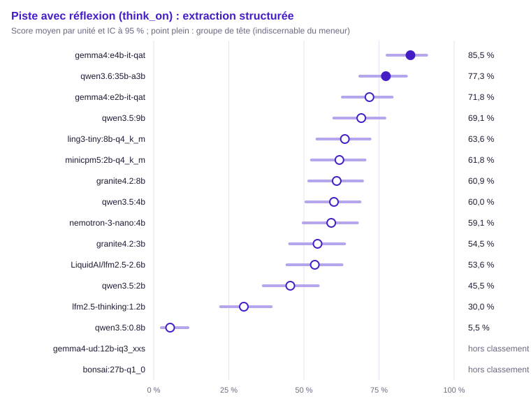

| Groupe | Rang | Modèle | Score (unités communes) | IC 95 % | IC simultané | ET groupée | Unités communes | Score (toutes unités définies) | Couverture | Exclues | Contexte dépassé : modèle / banc | Troncature |
|---|---|---|---|---|---|---|---|---|---|---|---|---|
| 1 | 1 | `gemma4:e4b-it-qat` | 85,5 % | [77,7 % ; 90,8 %] | [73,1 % ; 92,7 %] | 0,034 | 110 | 85,5 % (110) | 100,0 % | 0 | 0 / 0 | 0,0 % (0/110) |
| 1 | 1 | `qwen3.6:35b-a3b` | 77,3 % | [68,6 % ; 84,1 %] | [63,9 % ; 86,7 %] | 0,040 | 110 | 77,3 % (110) | 100,0 % | 0 | 0 / 0 | 19,1 % (21/110) |
| 2 | 1 | `gemma4:e2b-it-qat` | 71,8 % | [62,8 % ; 79,4 %] | [58,1 % ; 82,4 %] | 0,043 | 110 | 71,8 % (110) | 100,0 % | 0 | 0 / 0 | 0,0 % (0/110) |
| 2 | 1 | `qwen3.5:9b` (hors usage) | 69,1 % | [59,9 % ; 77,0 %] | [55,3 % ; 80,2 %] | 0,044 | 110 | 69,1 % (110) | 100,0 % | 0 | 0 / 0 | 30,9 % (34/110) |
| 2 | 1 | `ling3-tiny:8b-q4_k_m` | 63,6 % | [54,3 % ; 72,0 %] | [49,7 % ; 75,6 %] | 0,046 | 110 | 63,6 % (110) | 100,0 % | 0 | 0 / 0 | 18,2 % (20/110) |
| 2 | 1 | `minicpm5:2b-q4_k_m` | 61,8 % | [52,5 % ; 70,4 %] | [47,9 % ; 74,0 %] | 0,046 | 110 | 61,8 % (110) | 100,0 % | 0 | 0 / 0 | 15,5 % (17/110) |
| 2 | 1 | `granite4.2:8b` (hors usage) | 60,9 % | [51,6 % ; 69,5 %] | [47,0 % ; 73,2 %] | 0,047 | 110 | 60,9 % (110) | 100,0 % | 0 | 0 / 0 | 36,4 % (40/110) |
| 2 | 2 | `qwen3.5:4b` | 60,0 % | [50,7 % ; 68,7 %] | [46,2 % ; 72,4 %] | 0,047 | 110 | 60,0 % (110) | 100,0 % | 0 | 0 / 0 | 39,1 % (43/110) |
| 3 | 2 | `nemotron-3-nano:4b` | 59,1 % | [49,7 % ; 67,8 %] | [45,3 % ; 71,6 %] | 0,047 | 110 | 59,1 % (110) | 100,0 % | 0 | 0 / 0 | 2,7 % (3/110) |
| 3 | 2 | `granite4.2:3b` | 54,5 % | [45,2 % ; 63,5 %] | [40,9 % ; 67,6 %] | 0,047 | 110 | 54,5 % (110) | 100,0 % | 0 | 0 / 0 | 42,7 % (47/110) |
| 3 | 2 | `LiquidAI/lfm2.5-2.6b` | 53,6 % | [44,4 % ; 62,7 %] | [40,0 % ; 66,7 %] | 0,048 | 110 | 53,6 % (110) | 100,0 % | 0 | 0 / 0 | 26,4 % (29/110) |
| 4 | 3 | `qwen3.5:2b` | 45,5 % | [36,5 % ; 54,8 %] | [32,4 % ; 59,1 %] | 0,047 | 110 | 45,5 % (110) | 100,0 % | 0 | 0 / 0 | 32,7 % (36/110) |
| 5 | 10 | `lfm2.5-thinking:1.2b` | 30,0 % | [22,2 % ; 39,1 %] | [19,1 % ; 43,8 %] | 0,044 | 110 | 30,0 % (110) | 100,0 % | 0 | 0 / 0 | 15,5 % (17/110) |
| 6 | 14 | `qwen3.5:0.8b` | 5,5 % | [2,5 % ; 11,4 %] | [1,8 % ; 15,5 %] | 0,022 | 110 | 5,5 % (110) | 100,0 % | 0 | 0 / 0 | 80,9 % (89/110) |
| — | — | `gemma4-ud:12b-iq3_xxs` | — | — | — | — | 0 | — (0) | 0,0 % (hors classement) | 110 | 0 / 0 | — (0/0) |
| — | — | `bonsai:27b-q1_0` | — | — | — | — | 0 | — (0) | 0,0 % (hors classement) | 110 | 0 / 0 | — (0/0) |

Comparaisons au meneur (Holm sur les m − 1 comparaisons au meneur, m modèles du périmètre) :

| Modèle | Unités | Différence | ET appariée | IC 95 % | b | c | Corrélation | p | p (Holm) | Distingué |
|---|---|---|---|---|---|---|---|---|---|---|
| `lfm2.5-thinking:1.2b` | 110 | +55,5 pts | 0,047 | [+46,2 pts ; +64,7 pts] | 61 | 0 | 0,27 | < 0,001 | < 0,001 | oui |
| `qwen3.5:0.8b` | 110 | +80,0 pts | 0,038 | [+72,5 pts ; +87,5 pts] | 88 | 0 | 0,10 | < 0,001 | < 0,001 | oui |
| `ling3-tiny:8b-q4_k_m` | 110 | +21,8 pts | 0,041 | [+13,7 pts ; +29,9 pts] | 25 | 1 | 0,49 | < 0,001 | < 0,001 | oui |
| `minicpm5:2b-q4_k_m` | 110 | +23,6 pts | 0,046 | [+14,6 pts ; +32,7 pts] | 29 | 3 | 0,37 | < 0,001 | < 0,001 | oui |
| `LiquidAI/lfm2.5-2.6b` | 110 | +31,8 pts | 0,048 | [+22,4 pts ; +41,2 pts] | 37 | 2 | 0,34 | < 0,001 | < 0,001 | oui |
| `gemma4:e2b-it-qat` | 110 | +13,6 pts | 0,040 | [+5,9 pts ; +21,4 pts] | 18 | 3 | 0,49 | 0,001 | 0,003 | oui |
| `qwen3.5:2b` | 110 | +40,0 pts | 0,048 | [+30,5 pts ; +49,5 pts] | 45 | 1 | 0,32 | < 0,001 | < 0,001 | oui |
| `granite4.2:3b` | 110 | +30,9 pts | 0,048 | [+21,6 pts ; +40,3 pts] | 36 | 2 | 0,35 | < 0,001 | < 0,001 | oui |
| `nemotron-3-nano:4b` | 110 | +26,4 pts | 0,044 | [+17,8 pts ; +35,0 pts] | 30 | 1 | 0,44 | < 0,001 | < 0,001 | oui |
| `qwen3.5:4b` | 110 | +25,5 pts | 0,043 | [+16,9 pts ; +34,0 pts] | 29 | 1 | 0,45 | < 0,001 | < 0,001 | oui |
| `qwen3.5:9b` | 110 | +16,4 pts | 0,044 | [+7,8 pts ; +24,9 pts] | 22 | 4 | 0,39 | < 0,001 | 0,002 | oui |
| `qwen3.6:35b-a3b` | 110 | +8,2 pts | 0,043 | [−0,2 pts ; +16,6 pts] | 16 | 7 | 0,33 | 0,093 | 0,093 | non |
| `granite4.2:8b` | 110 | +24,5 pts | 0,045 | [+15,7 pts ; +33,3 pts] | 29 | 2 | 0,41 | < 0,001 | < 0,001 | oui |

Matrice exploratoire « qui bat qui » (BH) :

- `lfm2.5-thinking:1.2b` devant `qwen3.5:0.8b` (+24,5 pts, p BH < 0,001)
- `ling3-tiny:8b-q4_k_m` devant `lfm2.5-thinking:1.2b` (+33,6 pts, p BH < 0,001)
- `minicpm5:2b-q4_k_m` devant `lfm2.5-thinking:1.2b` (+31,8 pts, p BH < 0,001)
- `LiquidAI/lfm2.5-2.6b` devant `lfm2.5-thinking:1.2b` (+23,6 pts, p BH < 0,001)
- `gemma4:e2b-it-qat` devant `lfm2.5-thinking:1.2b` (+41,8 pts, p BH < 0,001)
- `qwen3.5:2b` devant `lfm2.5-thinking:1.2b` (+15,5 pts, p BH 0,003)
- `granite4.2:3b` devant `lfm2.5-thinking:1.2b` (+24,5 pts, p BH < 0,001)
- `nemotron-3-nano:4b` devant `lfm2.5-thinking:1.2b` (+29,1 pts, p BH < 0,001)
- `qwen3.5:4b` devant `lfm2.5-thinking:1.2b` (+30,0 pts, p BH < 0,001)
- `gemma4:e4b-it-qat` devant `lfm2.5-thinking:1.2b` (+55,5 pts, p BH < 0,001)
- `qwen3.5:9b` devant `lfm2.5-thinking:1.2b` (+39,1 pts, p BH < 0,001)
- `qwen3.6:35b-a3b` devant `lfm2.5-thinking:1.2b` (+47,3 pts, p BH < 0,001)
- `granite4.2:8b` devant `lfm2.5-thinking:1.2b` (+30,9 pts, p BH < 0,001)
- `ling3-tiny:8b-q4_k_m` devant `qwen3.5:0.8b` (+58,2 pts, p BH < 0,001)
- `minicpm5:2b-q4_k_m` devant `qwen3.5:0.8b` (+56,4 pts, p BH < 0,001)
- `LiquidAI/lfm2.5-2.6b` devant `qwen3.5:0.8b` (+48,2 pts, p BH < 0,001)
- `gemma4:e2b-it-qat` devant `qwen3.5:0.8b` (+66,4 pts, p BH < 0,001)
- `qwen3.5:2b` devant `qwen3.5:0.8b` (+40,0 pts, p BH < 0,001)
- `granite4.2:3b` devant `qwen3.5:0.8b` (+49,1 pts, p BH < 0,001)
- `nemotron-3-nano:4b` devant `qwen3.5:0.8b` (+53,6 pts, p BH < 0,001)
- `qwen3.5:4b` devant `qwen3.5:0.8b` (+54,5 pts, p BH < 0,001)
- `gemma4:e4b-it-qat` devant `qwen3.5:0.8b` (+80,0 pts, p BH < 0,001)
- `qwen3.5:9b` devant `qwen3.5:0.8b` (+63,6 pts, p BH < 0,001)
- `qwen3.6:35b-a3b` devant `qwen3.5:0.8b` (+71,8 pts, p BH < 0,001)
- `granite4.2:8b` devant `qwen3.5:0.8b` (+55,5 pts, p BH < 0,001)
- `gemma4:e2b-it-qat` devant `ling3-tiny:8b-q4_k_m` (+8,2 pts, p BH 0,036)
- `ling3-tiny:8b-q4_k_m` devant `qwen3.5:2b` (+18,2 pts, p BH < 0,001)
- `gemma4:e4b-it-qat` devant `ling3-tiny:8b-q4_k_m` (+21,8 pts, p BH < 0,001)
- `qwen3.6:35b-a3b` devant `ling3-tiny:8b-q4_k_m` (+13,6 pts, p BH 0,013)
- `minicpm5:2b-q4_k_m` devant `qwen3.5:2b` (+16,4 pts, p BH 0,007)
- `gemma4:e4b-it-qat` devant `minicpm5:2b-q4_k_m` (+23,6 pts, p BH < 0,001)
- `qwen3.6:35b-a3b` devant `minicpm5:2b-q4_k_m` (+15,5 pts, p BH 0,003)
- `gemma4:e2b-it-qat` devant `LiquidAI/lfm2.5-2.6b` (+18,2 pts, p BH < 0,001)
- `gemma4:e4b-it-qat` devant `LiquidAI/lfm2.5-2.6b` (+31,8 pts, p BH < 0,001)
- `qwen3.5:9b` devant `LiquidAI/lfm2.5-2.6b` (+15,5 pts, p BH 0,004)
- `qwen3.6:35b-a3b` devant `LiquidAI/lfm2.5-2.6b` (+23,6 pts, p BH < 0,001)
- `gemma4:e2b-it-qat` devant `qwen3.5:2b` (+26,4 pts, p BH < 0,001)
- `gemma4:e2b-it-qat` devant `granite4.2:3b` (+17,3 pts, p BH 0,001)
- `gemma4:e2b-it-qat` devant `nemotron-3-nano:4b` (+12,7 pts, p BH 0,011)
- `gemma4:e2b-it-qat` devant `qwen3.5:4b` (+11,8 pts, p BH 0,024)
- `gemma4:e4b-it-qat` devant `gemma4:e2b-it-qat` (+13,6 pts, p BH 0,003)
- `gemma4:e2b-it-qat` devant `granite4.2:8b` (+10,9 pts, p BH 0,036)
- `nemotron-3-nano:4b` devant `qwen3.5:2b` (+13,6 pts, p BH 0,003)
- `qwen3.5:4b` devant `qwen3.5:2b` (+14,5 pts, p BH 0,007)
- `gemma4:e4b-it-qat` devant `qwen3.5:2b` (+40,0 pts, p BH < 0,001)
- `qwen3.5:9b` devant `qwen3.5:2b` (+23,6 pts, p BH < 0,001)
- `qwen3.6:35b-a3b` devant `qwen3.5:2b` (+31,8 pts, p BH < 0,001)
- `granite4.2:8b` devant `qwen3.5:2b` (+15,5 pts, p BH 0,003)
- `gemma4:e4b-it-qat` devant `granite4.2:3b` (+30,9 pts, p BH < 0,001)
- `qwen3.5:9b` devant `granite4.2:3b` (+14,5 pts, p BH 0,003)
- `qwen3.6:35b-a3b` devant `granite4.2:3b` (+22,7 pts, p BH < 0,001)
- `gemma4:e4b-it-qat` devant `nemotron-3-nano:4b` (+26,4 pts, p BH < 0,001)
- `qwen3.6:35b-a3b` devant `nemotron-3-nano:4b` (+18,2 pts, p BH 0,002)
- `gemma4:e4b-it-qat` devant `qwen3.5:4b` (+25,5 pts, p BH < 0,001)
- `qwen3.5:9b` devant `qwen3.5:4b` (+9,1 pts, p BH 0,048)
- `qwen3.6:35b-a3b` devant `qwen3.5:4b` (+17,3 pts, p BH < 0,001)
- `gemma4:e4b-it-qat` devant `qwen3.5:9b` (+16,4 pts, p BH 0,001)
- `gemma4:e4b-it-qat` devant `granite4.2:8b` (+24,5 pts, p BH < 0,001)
- `qwen3.6:35b-a3b` devant `granite4.2:8b` (+16,4 pts, p BH 0,002)

Métrique continue : F1 (`f1`), meneur `qwen3.5:0.8b`.

| Modèle | Moyenne (unités communes) | Unités communes | Moyenne (toutes) | Couverture | Exclues |
|---|---|---|---|---|---|
| `lfm2.5-thinking:1.2b` | — | 0 | 0,2 % (77) | 72,6 % (hors classement) | 33 |
| `qwen3.5:0.8b` | 0,0 % | 104 | 0,0 % (104) | 98,1 % | 6 |
| `ling3-tiny:8b-q4_k_m` | — | 0 | 11,3 % (43) | 40,6 % (hors classement) | 67 |
| `minicpm5:2b-q4_k_m` | — | 0 | 29,1 % (45) | 42,5 % (hors classement) | 65 |
| `LiquidAI/lfm2.5-2.6b` | — | 0 | 14,8 % (55) | 51,9 % (hors classement) | 55 |
| `gemma4:e2b-it-qat` | — | 0 | 63,2 % (42) | 39,6 % (hors classement) | 68 |
| `qwen3.5:2b` | — | 0 | 4,5 % (61) | 57,5 % (hors classement) | 49 |
| `granite4.2:3b` | — | 0 | 10,6 % (54) | 50,9 % (hors classement) | 56 |
| `nemotron-3-nano:4b` | — | 0 | 16,5 % (48) | 45,3 % (hors classement) | 62 |
| `qwen3.5:4b` | — | 0 | 6,4 % (46) | 43,4 % (hors classement) | 64 |
| `gemma4:e4b-it-qat` | — | 0 | 73,5 % (36) | 34,0 % (hors classement) | 74 |
| `qwen3.5:9b` | — | 0 | 17,1 % (41) | 38,7 % (hors classement) | 69 |
| `qwen3.6:35b-a3b` | — | 0 | 39,9 % (40) | 37,7 % (hors classement) | 70 |
| `granite4.2:8b` | — | 0 | 2,3 % (44) | 41,5 % (hors classement) | 66 |
| `gemma4-ud:12b-iq3_xxs` | — | 0 | — (0) | 0,0 % (hors classement) | 110 |
| `bonsai:27b-q1_0` | — | 0 | — (0) | 0,0 % (hors classement) | 110 |

#### Questions sur documents (RAG) (`rag`)

Méthode : McNemar exact apparié, intervalle de Wilson. Unités : 86, dont 86 communes aux modèles classés (classement, meneur et comparaisons). Meneur : `qwen3.6:35b-a3b`.

Avertissement : hors classement, couverture sous le seuil : `gemma4-ud:12b-iq3_xxs` (0,0 %), `bonsai:27b-q1_0` (0,0 %). Leur score sur leurs seules unités définies est publié sans rang, groupe ni comparaison.

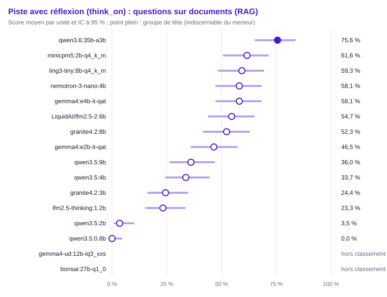

| Groupe | Rang | Modèle | Score (unités communes) | IC 95 % | IC simultané | ET groupée | Unités communes | Score (toutes unités définies) | Couverture | Exclues | Contexte dépassé : modèle / banc | Troncature |
|---|---|---|---|---|---|---|---|---|---|---|---|---|
| 1 | 1 | `qwen3.6:35b-a3b` | 75,6 % | [65,5 % ; 83,4 %] | [60,2 % ; 86,4 %] | 0,046 | 86 | 75,6 % (86) | 100,0 % | 0 | 0 / 0 | 7,0 % (6/86) |
| 2 | 1 | `minicpm5:2b-q4_k_m` | 61,6 % | [51,1 % ; 71,2 %] | [46,0 % ; 75,2 %] | 0,052 | 86 | 61,6 % (86) | 100,0 % | 0 | 0 / 0 | 4,7 % (4/86) |
| 2 | 1 | `ling3-tiny:8b-q4_k_m` | 59,3 % | [48,7 % ; 69,1 %] | [43,7 % ; 73,2 %] | 0,053 | 86 | 59,3 % (86) | 100,0 % | 0 | 0 / 0 | 3,5 % (3/86) |
| 2 | 1 | `nemotron-3-nano:4b` | 58,1 % | [47,6 % ; 68,0 %] | [42,6 % ; 72,2 %] | 0,053 | 86 | 58,1 % (86) | 100,0 % | 0 | 0 / 0 | 1,2 % (1/86) |
| 2 | 1 | `gemma4:e4b-it-qat` | 58,1 % | [47,6 % ; 68,0 %] | [42,6 % ; 72,2 %] | 0,053 | 86 | 58,1 % (86) | 100,0 % | 0 | 0 / 0 | 1,2 % (1/86) |
| 2 | 1 | `LiquidAI/lfm2.5-2.6b` | 54,7 % | [44,2 % ; 64,7 %] | [39,3 % ; 69,2 %] | 0,054 | 86 | 54,7 % (86) | 100,0 % | 0 | 0 / 0 | 3,5 % (3/86) |
| 2 | 1 | `granite4.2:8b` (hors usage) | 52,3 % | [41,9 % ; 62,6 %] | [37,1 % ; 67,1 %] | 0,054 | 86 | 52,3 % (86) | 100,0 % | 0 | 0 / 0 | 26,7 % (23/86) |
| 3 | 1 | `gemma4:e2b-it-qat` | 46,5 % | [36,3 % ; 57,0 %] | [31,9 % ; 61,8 %] | 0,054 | 86 | 46,5 % (86) | 100,0 % | 0 | 0 / 0 | 2,3 % (2/86) |
| 3 | 2 | `qwen3.5:9b` (hors usage) | 36,0 % | [26,7 % ; 46,6 %] | [22,9 % ; 51,7 %] | 0,052 | 86 | 36,0 % (86) | 100,0 % | 0 | 0 / 0 | 64,0 % (55/86) |
| 4 | 2 | `qwen3.5:4b` | 33,7 % | [24,6 % ; 44,2 %] | [20,9 % ; 49,4 %] | 0,051 | 86 | 33,7 % (86) | 100,0 % | 0 | 0 / 0 | 64,0 % (55/86) |
| 4 | 6 | `granite4.2:3b` | 24,4 % | [16,6 % ; 34,5 %] | [13,6 % ; 39,8 %] | 0,046 | 86 | 24,4 % (86) | 100,0 % | 0 | 0 / 0 | 53,5 % (46/86) |
| 4 | 7 | `lfm2.5-thinking:1.2b` | 23,3 % | [15,6 % ; 33,2 %] | [12,8 % ; 38,5 %] | 0,046 | 86 | 23,3 % (86) | 100,0 % | 0 | 0 / 0 | 3,5 % (3/86) |
| 5 | 11 | `qwen3.5:2b` | 3,5 % | [1,2 % ; 9,8 %] | [0,8 % ; 14,6 %] | 0,020 | 86 | 3,5 % (86) | 100,0 % | 0 | 0 / 0 | 89,5 % (77/86) |
| 5 | 13 | `qwen3.5:0.8b` | 0,0 % | [0,0 % ; 4,3 %] | [0,0 % ; 9,0 %] | 0,000 | 86 | 0,0 % (86) | 100,0 % | 0 | 0 / 0 | 98,8 % (85/86) |
| — | — | `gemma4-ud:12b-iq3_xxs` | — | — | — | — | 0 | — (0) | 0,0 % (hors classement) | 86 | 0 / 0 | — (0/0) |
| — | — | `bonsai:27b-q1_0` | — | — | — | — | 0 | — (0) | 0,0 % (hors classement) | 86 | 0 / 0 | — (0/0) |

Comparaisons au meneur (Holm sur les m − 1 comparaisons au meneur, m modèles du périmètre) :

| Modèle | Unités | Différence | ET appariée | IC 95 % | b | c | Corrélation | p | p (Holm) | Distingué |
|---|---|---|---|---|---|---|---|---|---|---|
| `lfm2.5-thinking:1.2b` | 86 | +52,3 pts | 0,063 | [+40,0 pts ; +64,7 pts] | 49 | 4 | 0,06 | < 0,001 | < 0,001 | oui |
| `qwen3.5:0.8b` | 86 | +75,6 pts | 0,046 | [+66,5 pts ; +84,7 pts] | 65 | 0 | — | < 0,001 | < 0,001 | oui |
| `ling3-tiny:8b-q4_k_m` | 86 | +16,3 pts | 0,049 | [+6,7 pts ; +25,9 pts] | 17 | 3 | 0,52 | 0,003 | 0,010 | oui |
| `minicpm5:2b-q4_k_m` | 86 | +14,0 pts | 0,055 | [+3,2 pts ; +24,7 pts] | 18 | 6 | 0,39 | 0,023 | 0,023 | oui |
| `LiquidAI/lfm2.5-2.6b` | 86 | +20,9 pts | 0,050 | [+11,2 pts ; +30,7 pts] | 20 | 2 | 0,52 | < 0,001 | < 0,001 | oui |
| `gemma4:e2b-it-qat` | 86 | +29,1 pts | 0,061 | [+17,1 pts ; +41,1 pts] | 30 | 5 | 0,26 | < 0,001 | < 0,001 | oui |
| `qwen3.5:2b` | 86 | +72,1 pts | 0,048 | [+62,6 pts ; +81,6 pts] | 62 | 0 | 0,11 | < 0,001 | < 0,001 | oui |
| `granite4.2:3b` | 86 | +51,2 pts | 0,056 | [+40,1 pts ; +62,2 pts] | 45 | 1 | 0,26 | < 0,001 | < 0,001 | oui |
| `nemotron-3-nano:4b` | 86 | +17,4 pts | 0,052 | [+7,2 pts ; +27,7 pts] | 19 | 4 | 0,45 | 0,003 | 0,010 | oui |
| `qwen3.5:4b` | 86 | +41,9 pts | 0,053 | [+31,4 pts ; +52,3 pts] | 36 | 0 | 0,41 | < 0,001 | < 0,001 | oui |
| `gemma4:e4b-it-qat` | 86 | +17,4 pts | 0,052 | [+7,2 pts ; +27,7 pts] | 19 | 4 | 0,45 | 0,003 | 0,010 | oui |
| `qwen3.5:9b` | 86 | +39,5 pts | 0,053 | [+29,2 pts ; +49,9 pts] | 34 | 0 | 0,43 | < 0,001 | < 0,001 | oui |
| `granite4.2:8b` | 86 | +23,3 pts | 0,056 | [+12,2 pts ; +34,3 pts] | 24 | 4 | 0,38 | < 0,001 | < 0,001 | oui |

Matrice exploratoire « qui bat qui » (BH) :

- `lfm2.5-thinking:1.2b` devant `qwen3.5:0.8b` (+23,3 pts, p BH < 0,001)
- `ling3-tiny:8b-q4_k_m` devant `lfm2.5-thinking:1.2b` (+36,0 pts, p BH < 0,001)
- `minicpm5:2b-q4_k_m` devant `lfm2.5-thinking:1.2b` (+38,4 pts, p BH < 0,001)
- `LiquidAI/lfm2.5-2.6b` devant `lfm2.5-thinking:1.2b` (+31,4 pts, p BH < 0,001)
- `gemma4:e2b-it-qat` devant `lfm2.5-thinking:1.2b` (+23,3 pts, p BH < 0,001)
- `lfm2.5-thinking:1.2b` devant `qwen3.5:2b` (+19,8 pts, p BH < 0,001)
- `nemotron-3-nano:4b` devant `lfm2.5-thinking:1.2b` (+34,9 pts, p BH < 0,001)
- `gemma4:e4b-it-qat` devant `lfm2.5-thinking:1.2b` (+34,9 pts, p BH < 0,001)
- `qwen3.6:35b-a3b` devant `lfm2.5-thinking:1.2b` (+52,3 pts, p BH < 0,001)
- `granite4.2:8b` devant `lfm2.5-thinking:1.2b` (+29,1 pts, p BH < 0,001)
- `ling3-tiny:8b-q4_k_m` devant `qwen3.5:0.8b` (+59,3 pts, p BH < 0,001)
- `minicpm5:2b-q4_k_m` devant `qwen3.5:0.8b` (+61,6 pts, p BH < 0,001)
- `LiquidAI/lfm2.5-2.6b` devant `qwen3.5:0.8b` (+54,7 pts, p BH < 0,001)
- `gemma4:e2b-it-qat` devant `qwen3.5:0.8b` (+46,5 pts, p BH < 0,001)
- `granite4.2:3b` devant `qwen3.5:0.8b` (+24,4 pts, p BH < 0,001)
- `nemotron-3-nano:4b` devant `qwen3.5:0.8b` (+58,1 pts, p BH < 0,001)
- `qwen3.5:4b` devant `qwen3.5:0.8b` (+33,7 pts, p BH < 0,001)
- `gemma4:e4b-it-qat` devant `qwen3.5:0.8b` (+58,1 pts, p BH < 0,001)
- `qwen3.5:9b` devant `qwen3.5:0.8b` (+36,0 pts, p BH < 0,001)
- `qwen3.6:35b-a3b` devant `qwen3.5:0.8b` (+75,6 pts, p BH < 0,001)
- `granite4.2:8b` devant `qwen3.5:0.8b` (+52,3 pts, p BH < 0,001)
- `ling3-tiny:8b-q4_k_m` devant `gemma4:e2b-it-qat` (+12,8 pts, p BH 0,038)
- `ling3-tiny:8b-q4_k_m` devant `qwen3.5:2b` (+55,8 pts, p BH < 0,001)
- `ling3-tiny:8b-q4_k_m` devant `granite4.2:3b` (+34,9 pts, p BH < 0,001)
- `ling3-tiny:8b-q4_k_m` devant `qwen3.5:4b` (+25,6 pts, p BH < 0,001)
- `ling3-tiny:8b-q4_k_m` devant `qwen3.5:9b` (+23,3 pts, p BH < 0,001)
- `qwen3.6:35b-a3b` devant `ling3-tiny:8b-q4_k_m` (+16,3 pts, p BH 0,004)
- `minicpm5:2b-q4_k_m` devant `gemma4:e2b-it-qat` (+15,1 pts, p BH 0,004)
- `minicpm5:2b-q4_k_m` devant `qwen3.5:2b` (+58,1 pts, p BH < 0,001)
- `minicpm5:2b-q4_k_m` devant `granite4.2:3b` (+37,2 pts, p BH < 0,001)
- `minicpm5:2b-q4_k_m` devant `qwen3.5:4b` (+27,9 pts, p BH < 0,001)
- `minicpm5:2b-q4_k_m` devant `qwen3.5:9b` (+25,6 pts, p BH < 0,001)
- `qwen3.6:35b-a3b` devant `minicpm5:2b-q4_k_m` (+14,0 pts, p BH 0,033)
- `LiquidAI/lfm2.5-2.6b` devant `qwen3.5:2b` (+51,2 pts, p BH < 0,001)
- `LiquidAI/lfm2.5-2.6b` devant `granite4.2:3b` (+30,2 pts, p BH < 0,001)
- `LiquidAI/lfm2.5-2.6b` devant `qwen3.5:4b` (+20,9 pts, p BH < 0,001)
- `LiquidAI/lfm2.5-2.6b` devant `qwen3.5:9b` (+18,6 pts, p BH 0,002)
- `qwen3.6:35b-a3b` devant `LiquidAI/lfm2.5-2.6b` (+20,9 pts, p BH < 0,001)
- `gemma4:e2b-it-qat` devant `qwen3.5:2b` (+43,0 pts, p BH < 0,001)
- `gemma4:e2b-it-qat` devant `granite4.2:3b` (+22,1 pts, p BH < 0,001)
- `gemma4:e2b-it-qat` devant `qwen3.5:4b` (+12,8 pts, p BH 0,028)
- `qwen3.6:35b-a3b` devant `gemma4:e2b-it-qat` (+29,1 pts, p BH < 0,001)
- `granite4.2:3b` devant `qwen3.5:2b` (+20,9 pts, p BH < 0,001)
- `nemotron-3-nano:4b` devant `qwen3.5:2b` (+54,7 pts, p BH < 0,001)
- `qwen3.5:4b` devant `qwen3.5:2b` (+30,2 pts, p BH < 0,001)
- `gemma4:e4b-it-qat` devant `qwen3.5:2b` (+54,7 pts, p BH < 0,001)
- `qwen3.5:9b` devant `qwen3.5:2b` (+32,6 pts, p BH < 0,001)
- `qwen3.6:35b-a3b` devant `qwen3.5:2b` (+72,1 pts, p BH < 0,001)
- `granite4.2:8b` devant `qwen3.5:2b` (+48,8 pts, p BH < 0,001)
- `nemotron-3-nano:4b` devant `granite4.2:3b` (+33,7 pts, p BH < 0,001)
- `gemma4:e4b-it-qat` devant `granite4.2:3b` (+33,7 pts, p BH < 0,001)
- `qwen3.6:35b-a3b` devant `granite4.2:3b` (+51,2 pts, p BH < 0,001)
- `granite4.2:8b` devant `granite4.2:3b` (+27,9 pts, p BH < 0,001)
- `nemotron-3-nano:4b` devant `qwen3.5:4b` (+24,4 pts, p BH < 0,001)
- `nemotron-3-nano:4b` devant `qwen3.5:9b` (+22,1 pts, p BH < 0,001)
- `qwen3.6:35b-a3b` devant `nemotron-3-nano:4b` (+17,4 pts, p BH 0,004)
- `gemma4:e4b-it-qat` devant `qwen3.5:4b` (+24,4 pts, p BH < 0,001)
- `qwen3.6:35b-a3b` devant `qwen3.5:4b` (+41,9 pts, p BH < 0,001)
- `granite4.2:8b` devant `qwen3.5:4b` (+18,6 pts, p BH < 0,001)
- `gemma4:e4b-it-qat` devant `qwen3.5:9b` (+22,1 pts, p BH < 0,001)
- `qwen3.6:35b-a3b` devant `gemma4:e4b-it-qat` (+17,4 pts, p BH 0,004)
- `qwen3.6:35b-a3b` devant `qwen3.5:9b` (+39,5 pts, p BH < 0,001)
- `granite4.2:8b` devant `qwen3.5:9b` (+16,3 pts, p BH 0,002)
- `qwen3.6:35b-a3b` devant `granite4.2:8b` (+23,3 pts, p BH < 0,001)

Métrique continue : F1 (`f1`), meneur `qwen3.5:2b`.

| Modèle | Moyenne (unités communes) | Unités communes | Moyenne (toutes) | Couverture | Exclues |
|---|---|---|---|---|---|
| `lfm2.5-thinking:1.2b` | — | 0 | 45,8 % (51) | 59,3 % (hors classement) | 35 |
| `qwen3.5:0.8b` | 0,5 % | 83 | 0,5 % (86) | 100,0 % | 0 |
| `ling3-tiny:8b-q4_k_m` | — | 0 | 60,4 % (51) | 59,3 % (hors classement) | 35 |
| `minicpm5:2b-q4_k_m` | — | 0 | 66,7 % (50) | 58,1 % (hors classement) | 36 |
| `LiquidAI/lfm2.5-2.6b` | — | 0 | 64,7 % (51) | 59,3 % (hors classement) | 35 |
| `gemma4:e2b-it-qat` | — | 0 | 56,7 % (52) | 60,5 % (hors classement) | 34 |
| `qwen3.5:2b` | 3,9 % | 83 | 3,9 % (83) | 96,5 % | 3 |
| `granite4.2:3b` | — | 0 | 22,3 % (72) | 83,7 % (hors classement) | 14 |
| `nemotron-3-nano:4b` | — | 0 | 60,8 % (51) | 59,3 % (hors classement) | 35 |
| `qwen3.5:4b` | — | 0 | 3,1 % (58) | 67,4 % (hors classement) | 28 |
| `gemma4:e4b-it-qat` | — | 0 | 71,1 % (51) | 59,3 % (hors classement) | 35 |
| `qwen3.5:9b` | — | 0 | 3,5 % (57) | 66,3 % (hors classement) | 29 |
| `qwen3.6:35b-a3b` | — | 0 | 73,9 % (50) | 58,1 % (hors classement) | 36 |
| `granite4.2:8b` | — | 0 | 41,8 % (53) | 61,6 % (hors classement) | 33 |
| `gemma4-ud:12b-iq3_xxs` | — | 0 | — (0) | 0,0 % (hors classement) | 86 |
| `bonsai:27b-q1_0` | — | 0 | — (0) | 0,0 % (hors classement) | 86 |

Différence au meneur, IC bootstrap apparié à 95 % :

| Modèle | Unités | Différence | IC bootstrap |
|---|---|---|---|
| `qwen3.5:0.8b` | 83 | +3,3 pts | [+0,5 pts ; +7,0 pts] |

#### Abstention (`abstention`)

Méthode : McNemar exact apparié, intervalle de Wilson. Unités : 110, dont 109 communes aux modèles classés (classement, meneur et comparaisons). Meneur : `gemma4:e4b-it-qat`.

Avertissement : hors classement, couverture sous le seuil : `gemma4-ud:12b-iq3_xxs` (0,0 %), `bonsai:27b-q1_0` (0,0 %). Leur score sur leurs seules unités définies est publié sans rang, groupe ni comparaison.

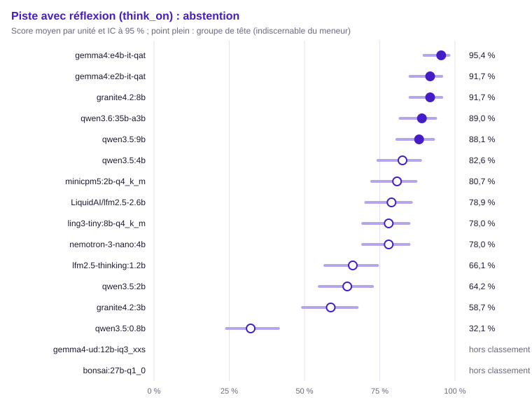

| Groupe | Rang | Modèle | Score (unités communes) | IC 95 % | IC simultané | ET groupée | Unités communes | Score (toutes unités définies) | Couverture | Exclues | Contexte dépassé : modèle / banc | Troncature |
|---|---|---|---|---|---|---|---|---|---|---|---|---|
| 1 | 1 | `gemma4:e4b-it-qat` | 95,4 % | [89,7 % ; 98,0 %] | [85,6 % ; 98,6 %] | 0,020 | 109 | 95,5 % (110) | 100,0 % | 0 | 0 / 0 | 1,8 % (2/110) |
| 1 | 1 | `gemma4:e2b-it-qat` | 91,7 % | [85,0 % ; 95,6 %] | [80,7 % ; 96,7 %] | 0,026 | 109 | 91,8 % (110) | 100,0 % | 0 | 0 / 0 | 2,7 % (3/110) |
| 1 | 1 | `granite4.2:8b` (hors usage) | 91,7 % | [85,0 % ; 95,6 %] | [80,7 % ; 96,7 %] | 0,026 | 109 | 91,8 % (110) | 100,0 % | 0 | 0 / 0 | 1,8 % (2/110) |
| 1 | 1 | `qwen3.6:35b-a3b` | 89,0 % | [81,7 % ; 93,6 %] | [77,3 % ; 95,0 %] | 0,030 | 109 | 88,2 % (110) | 100,0 % | 0 | 0 / 0 | 0,9 % (1/110) |
| 1 | 1 | `qwen3.5:9b` (hors usage) | 88,1 % | [80,7 % ; 92,9 %] | [76,2 % ; 94,5 %] | 0,031 | 109 | 87,3 % (110) | 100,0 % | 0 | 0 / 0 | 2,7 % (3/110) |
| 2 | 1 | `qwen3.5:4b` | 82,6 % | [74,4 % ; 88,5 %] | [69,7 % ; 90,7 %] | 0,036 | 109 | 81,8 % (110) | 100,0 % | 0 | 0 / 0 | 5,5 % (6/110) |
| 2 | 1 | `minicpm5:2b-q4_k_m` | 80,7 % | [72,3 % ; 87,0 %] | [67,7 % ; 89,3 %] | 0,038 | 109 | 80,0 % (110) | 100,0 % | 0 | 0 / 0 | 10,0 % (11/110) |
| 2 | 1 | `LiquidAI/lfm2.5-2.6b` | 78,9 % | [70,3 % ; 85,5 %] | [65,6 % ; 88,0 %] | 0,039 | 109 | 78,2 % (110) | 100,0 % | 0 | 0 / 0 | 0,0 % (0/110) |
| 2 | 1 | `ling3-tiny:8b-q4_k_m` | 78,0 % | [69,3 % ; 84,7 %] | [64,6 % ; 87,3 %] | 0,040 | 109 | 77,3 % (110) | 100,0 % | 0 | 0 / 0 | 5,5 % (6/110) |
| 2 | 1 | `nemotron-3-nano:4b` | 78,0 % | [69,3 % ; 84,7 %] | [64,6 % ; 87,3 %] | 0,040 | 109 | 78,0 % (109) | 99,1 % | 1 | 0 / 0 | 3,7 % (4/109) |
| 3 | 4 | `lfm2.5-thinking:1.2b` | 66,1 % | [56,8 % ; 74,3 %] | [52,1 % ; 77,7 %] | 0,045 | 109 | 66,4 % (110) | 100,0 % | 0 | 0 / 0 | 2,7 % (3/110) |
| 3 | 6 | `qwen3.5:2b` | 64,2 % | [54,9 % ; 72,6 %] | [50,3 % ; 76,1 %] | 0,046 | 109 | 64,5 % (110) | 100,0 % | 0 | 0 / 0 | 25,5 % (28/110) |
| 3 | 6 | `granite4.2:3b` | 58,7 % | [49,3 % ; 67,5 %] | [44,8 % ; 71,3 %] | 0,047 | 109 | 59,1 % (110) | 100,0 % | 0 | 0 / 0 | 21,8 % (24/110) |
| 4 | 13 | `qwen3.5:0.8b` | 32,1 % | [24,1 % ; 41,4 %] | [20,8 % ; 46,0 %] | 0,045 | 109 | 31,8 % (110) | 100,0 % | 0 | 0 / 0 | 49,1 % (54/110) |
| — | — | `gemma4-ud:12b-iq3_xxs` | — | — | — | — | 0 | — (0) | 0,0 % (hors classement) | 110 | 0 / 0 | — (0/0) |
| — | — | `bonsai:27b-q1_0` | — | — | — | — | 0 | — (0) | 0,0 % (hors classement) | 110 | 0 / 0 | — (0/0) |

Comparaisons au meneur (Holm sur les m − 1 comparaisons au meneur, m modèles du périmètre) :

| Modèle | Unités | Différence | ET appariée | IC 95 % | b | c | Corrélation | p | p (Holm) | Distingué |
|---|---|---|---|---|---|---|---|---|---|---|
| `lfm2.5-thinking:1.2b` | 109 | +29,4 pts | 0,047 | [+20,1 pts ; +38,6 pts] | 34 | 2 | 0,12 | < 0,001 | < 0,001 | oui |
| `qwen3.5:0.8b` | 109 | +63,3 pts | 0,046 | [+54,3 pts ; +72,4 pts] | 69 | 0 | 0,15 | < 0,001 | < 0,001 | oui |
| `ling3-tiny:8b-q4_k_m` | 109 | +17,4 pts | 0,043 | [+9,1 pts ; +25,8 pts] | 22 | 3 | 0,10 | < 0,001 | 0,001 | oui |
| `minicpm5:2b-q4_k_m` | 109 | +14,7 pts | 0,041 | [+6,7 pts ; +22,6 pts] | 19 | 3 | 0,12 | < 0,001 | 0,005 | oui |
| `LiquidAI/lfm2.5-2.6b` | 109 | +16,5 pts | 0,042 | [+8,3 pts ; +24,8 pts] | 21 | 3 | 0,10 | < 0,001 | 0,002 | oui |
| `gemma4:e2b-it-qat` | 109 | +3,7 pts | 0,032 | [−2,5 pts ; +9,9 pts] | 8 | 4 | 0,09 | 0,388 | 0,688 | non |
| `qwen3.5:2b` | 109 | +31,2 pts | 0,044 | [+22,5 pts ; +39,9 pts] | 34 | 0 | 0,29 | < 0,001 | < 0,001 | oui |
| `granite4.2:3b` | 109 | +36,7 pts | 0,048 | [+27,3 pts ; +46,1 pts] | 41 | 1 | 0,17 | < 0,001 | < 0,001 | oui |
| `nemotron-3-nano:4b` | 109 | +17,4 pts | 0,045 | [+8,7 pts ; +26,2 pts] | 23 | 4 | −0,01 | < 0,001 | 0,002 | oui |
| `qwen3.5:4b` | 109 | +12,8 pts | 0,039 | [+5,2 pts ; +20,5 pts] | 17 | 3 | 0,13 | 0,003 | 0,013 | oui |
| `qwen3.5:9b` | 109 | +7,3 pts | 0,034 | [+0,8 pts ; +13,9 pts] | 11 | 3 | 0,19 | 0,057 | 0,229 | non |
| `qwen3.6:35b-a3b` | 109 | +6,4 pts | 0,033 | [+0,1 pts ; +12,8 pts] | 10 | 3 | 0,20 | 0,092 | 0,277 | non |
| `granite4.2:8b` | 109 | +3,7 pts | 0,029 | [−2,0 pts ; +9,3 pts] | 7 | 3 | 0,25 | 0,344 | 0,688 | non |

Matrice exploratoire « qui bat qui » (BH) :

- `lfm2.5-thinking:1.2b` devant `qwen3.5:0.8b` (+33,9 pts, p BH < 0,001)
- `minicpm5:2b-q4_k_m` devant `lfm2.5-thinking:1.2b` (+14,7 pts, p BH 0,027)
- `gemma4:e2b-it-qat` devant `lfm2.5-thinking:1.2b` (+25,7 pts, p BH < 0,001)
- `qwen3.5:4b` devant `lfm2.5-thinking:1.2b` (+16,5 pts, p BH 0,008)
- `gemma4:e4b-it-qat` devant `lfm2.5-thinking:1.2b` (+29,4 pts, p BH < 0,001)
- `qwen3.5:9b` devant `lfm2.5-thinking:1.2b` (+22,0 pts, p BH < 0,001)
- `qwen3.6:35b-a3b` devant `lfm2.5-thinking:1.2b` (+22,9 pts, p BH < 0,001)
- `granite4.2:8b` devant `lfm2.5-thinking:1.2b` (+25,7 pts, p BH < 0,001)
- `ling3-tiny:8b-q4_k_m` devant `qwen3.5:0.8b` (+45,9 pts, p BH < 0,001)
- `minicpm5:2b-q4_k_m` devant `qwen3.5:0.8b` (+48,6 pts, p BH < 0,001)
- `LiquidAI/lfm2.5-2.6b` devant `qwen3.5:0.8b` (+46,8 pts, p BH < 0,001)
- `gemma4:e2b-it-qat` devant `qwen3.5:0.8b` (+59,6 pts, p BH < 0,001)
- `qwen3.5:2b` devant `qwen3.5:0.8b` (+32,1 pts, p BH < 0,001)
- `granite4.2:3b` devant `qwen3.5:0.8b` (+26,6 pts, p BH < 0,001)
- `nemotron-3-nano:4b` devant `qwen3.5:0.8b` (+45,9 pts, p BH < 0,001)
- `qwen3.5:4b` devant `qwen3.5:0.8b` (+50,5 pts, p BH < 0,001)
- `gemma4:e4b-it-qat` devant `qwen3.5:0.8b` (+63,3 pts, p BH < 0,001)
- `qwen3.5:9b` devant `qwen3.5:0.8b` (+56,0 pts, p BH < 0,001)
- `qwen3.6:35b-a3b` devant `qwen3.5:0.8b` (+56,9 pts, p BH < 0,001)
- `granite4.2:8b` devant `qwen3.5:0.8b` (+59,6 pts, p BH < 0,001)
- `gemma4:e2b-it-qat` devant `ling3-tiny:8b-q4_k_m` (+13,8 pts, p BH 0,005)
- `ling3-tiny:8b-q4_k_m` devant `qwen3.5:2b` (+13,8 pts, p BH 0,022)
- `ling3-tiny:8b-q4_k_m` devant `granite4.2:3b` (+19,3 pts, p BH 0,005)
- `gemma4:e4b-it-qat` devant `ling3-tiny:8b-q4_k_m` (+17,4 pts, p BH < 0,001)
- `qwen3.5:9b` devant `ling3-tiny:8b-q4_k_m` (+10,1 pts, p BH 0,040)
- `qwen3.6:35b-a3b` devant `ling3-tiny:8b-q4_k_m` (+11,0 pts, p BH 0,013)
- `granite4.2:8b` devant `ling3-tiny:8b-q4_k_m` (+13,8 pts, p BH 0,005)
- `gemma4:e2b-it-qat` devant `minicpm5:2b-q4_k_m` (+11,0 pts, p BH 0,027)
- `minicpm5:2b-q4_k_m` devant `qwen3.5:2b` (+16,5 pts, p BH 0,006)
- `minicpm5:2b-q4_k_m` devant `granite4.2:3b` (+22,0 pts, p BH 0,002)
- `gemma4:e4b-it-qat` devant `minicpm5:2b-q4_k_m` (+14,7 pts, p BH 0,002)
- `qwen3.6:35b-a3b` devant `minicpm5:2b-q4_k_m` (+8,3 pts, p BH 0,035)
- `granite4.2:8b` devant `minicpm5:2b-q4_k_m` (+11,0 pts, p BH 0,004)
- `gemma4:e2b-it-qat` devant `LiquidAI/lfm2.5-2.6b` (+12,8 pts, p BH 0,012)
- `LiquidAI/lfm2.5-2.6b` devant `qwen3.5:2b` (+14,7 pts, p BH 0,016)
- `LiquidAI/lfm2.5-2.6b` devant `granite4.2:3b` (+20,2 pts, p BH 0,002)
- `gemma4:e4b-it-qat` devant `LiquidAI/lfm2.5-2.6b` (+16,5 pts, p BH < 0,001)
- `qwen3.5:9b` devant `LiquidAI/lfm2.5-2.6b` (+9,2 pts, p BH 0,033)
- `qwen3.6:35b-a3b` devant `LiquidAI/lfm2.5-2.6b` (+10,1 pts, p BH 0,007)
- `granite4.2:8b` devant `LiquidAI/lfm2.5-2.6b` (+12,8 pts, p BH 0,003)
- `gemma4:e2b-it-qat` devant `qwen3.5:2b` (+27,5 pts, p BH < 0,001)
- `gemma4:e2b-it-qat` devant `granite4.2:3b` (+33,0 pts, p BH < 0,001)
- `gemma4:e2b-it-qat` devant `nemotron-3-nano:4b` (+13,8 pts, p BH 0,008)
- `gemma4:e2b-it-qat` devant `qwen3.5:4b` (+9,2 pts, p BH 0,045)
- `nemotron-3-nano:4b` devant `qwen3.5:2b` (+13,8 pts, p BH 0,014)
- `qwen3.5:4b` devant `qwen3.5:2b` (+18,3 pts, p BH < 0,001)
- `gemma4:e4b-it-qat` devant `qwen3.5:2b` (+31,2 pts, p BH < 0,001)
- `qwen3.5:9b` devant `qwen3.5:2b` (+23,9 pts, p BH < 0,001)
- `qwen3.6:35b-a3b` devant `qwen3.5:2b` (+24,8 pts, p BH < 0,001)
- `granite4.2:8b` devant `qwen3.5:2b` (+27,5 pts, p BH < 0,001)
- `nemotron-3-nano:4b` devant `granite4.2:3b` (+19,3 pts, p BH 0,003)
- `qwen3.5:4b` devant `granite4.2:3b` (+23,9 pts, p BH < 0,001)
- `gemma4:e4b-it-qat` devant `granite4.2:3b` (+36,7 pts, p BH < 0,001)
- `qwen3.5:9b` devant `granite4.2:3b` (+29,4 pts, p BH < 0,001)
- `qwen3.6:35b-a3b` devant `granite4.2:3b` (+30,3 pts, p BH < 0,001)
- `granite4.2:8b` devant `granite4.2:3b` (+33,0 pts, p BH < 0,001)
- `gemma4:e4b-it-qat` devant `nemotron-3-nano:4b` (+17,4 pts, p BH < 0,001)
- `qwen3.5:9b` devant `nemotron-3-nano:4b` (+10,1 pts, p BH 0,040)
- `qwen3.6:35b-a3b` devant `nemotron-3-nano:4b` (+11,0 pts, p BH 0,008)
- `granite4.2:8b` devant `nemotron-3-nano:4b` (+13,8 pts, p BH 0,003)
- `gemma4:e4b-it-qat` devant `qwen3.5:4b` (+12,8 pts, p BH 0,005)
- `granite4.2:8b` devant `qwen3.5:4b` (+9,2 pts, p BH 0,022)

#### Rédaction (`writing`)

Méthode : test z sur la différence appariée (erreur-type groupée), intervalle moyenne ± z·ET, IC bootstrap apparié de la différence. Unités : 80, dont 80 communes aux modèles classés (classement, meneur et comparaisons). Meneur : `gemma4:e4b-it-qat`.

Avertissement : hors classement, couverture sous le seuil : `gemma4-ud:12b-iq3_xxs` (0,0 %), `bonsai:27b-q1_0` (0,0 %). Leur score sur leurs seules unités définies est publié sans rang, groupe ni comparaison.

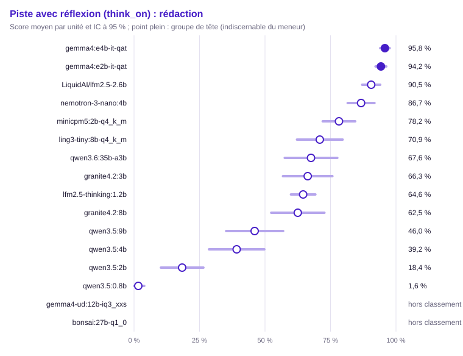

| Groupe | Rang | Modèle | Score (unités communes) | IC 95 % | IC simultané | ET groupée | Unités communes | Score (toutes unités définies) | Couverture | Exclues | Contexte dépassé : modèle / banc | Troncature |
|---|---|---|---|---|---|---|---|---|---|---|---|---|
| 1 | 1 | `gemma4:e4b-it-qat` | 95,8 % | [93,9 % ; 97,6 %] | [93,1 % ; 98,5 %] | 0,009 | 80 | 95,8 % (80) | 100,0 % | 0 | 0 / 0 | 0,0 % (0/80) |
| 1 | 1 | `gemma4:e2b-it-qat` | 94,2 % | [92,2 % ; 96,3 %] | [91,2 % ; 97,3 %] | 0,011 | 80 | 94,2 % (80) | 100,0 % | 0 | 0 / 0 | 0,0 % (0/80) |
| 2 | 1 | `LiquidAI/lfm2.5-2.6b` | 90,5 % | [87,1 % ; 94,0 %] | [85,4 % ; 95,7 %] | 0,018 | 80 | 90,5 % (80) | 100,0 % | 0 | 0 / 0 | 1,2 % (1/80) |
| 2 | 1 | `nemotron-3-nano:4b` | 86,7 % | [81,5 % ; 91,8 %] | [79,1 % ; 94,3 %] | 0,026 | 80 | 86,7 % (80) | 100,0 % | 0 | 0 / 0 | 5,0 % (4/80) |
| 3 | 3 | `minicpm5:2b-q4_k_m` | 78,2 % | [72,0 % ; 84,4 %] | [69,0 % ; 87,5 %] | 0,032 | 80 | 78,2 % (80) | 100,0 % | 0 | 0 / 0 | 7,5 % (6/80) |
| 3 | 4 | `ling3-tiny:8b-q4_k_m` | 70,9 % | [62,2 % ; 79,6 %] | [58,0 % ; 83,9 %] | 0,044 | 80 | 70,9 % (80) | 100,0 % | 0 | 0 / 0 | 22,5 % (18/80) |
| 3 | 4 | `qwen3.6:35b-a3b` | 67,6 % | [57,5 % ; 77,6 %] | [52,6 % ; 82,5 %] | 0,051 | 80 | 67,6 % (80) | 100,0 % | 0 | 0 / 0 | 31,2 % (25/80) |
| 3 | 4 | `granite4.2:3b` | 66,3 % | [56,9 % ; 75,7 %] | [52,3 % ; 80,3 %] | 0,048 | 80 | 66,3 % (80) | 100,0 % | 0 | 0 / 0 | 28,7 % (23/80) |
| 4 | 5 | `lfm2.5-thinking:1.2b` | 64,6 % | [59,9 % ; 69,2 %] | [57,6 % ; 71,5 %] | 0,024 | 80 | 64,6 % (80) | 100,0 % | 0 | 0 / 0 | 1,2 % (1/80) |
| 4 | 5 | `granite4.2:8b` (hors usage) | 62,5 % | [52,4 % ; 72,7 %] | [47,4 % ; 77,6 %] | 0,052 | 80 | 62,5 % (80) | 100,0 % | 0 | 0 / 0 | 35,0 % (28/80) |
| 5 | 6 | `qwen3.5:9b` (hors usage) | 46,0 % | [35,2 % ; 56,9 %] | [29,9 % ; 62,2 %] | 0,056 | 80 | 46,0 % (80) | 100,0 % | 0 | 0 / 0 | 53,8 % (43/80) |
| 5 | 8 | `qwen3.5:4b` | 39,2 % | [28,6 % ; 49,7 %] | [23,5 % ; 54,9 %] | 0,054 | 80 | 39,2 % (80) | 100,0 % | 0 | 0 / 0 | 60,0 % (48/80) |
| 6 | 11 | `qwen3.5:2b` | 18,4 % | [10,3 % ; 26,5 %] | [6,3 % ; 30,5 %] | 0,041 | 80 | 18,4 % (80) | 100,0 % | 0 | 0 / 0 | 80,0 % (64/80) |
| 7 | 14 | `qwen3.5:0.8b` | 1,6 % | [0,0 % ; 3,9 %] | [0,0 % ; 5,0 %] | 0,012 | 80 | 1,6 % (80) | 100,0 % | 0 | 0 / 0 | 97,5 % (78/80) |
| — | — | `gemma4-ud:12b-iq3_xxs` | — | — | — | — | 0 | — (0) | 0,0 % (hors classement) | 80 | 0 / 0 | — (0/0) |
| — | — | `bonsai:27b-q1_0` | — | — | — | — | 0 | — (0) | 0,0 % (hors classement) | 80 | 0 / 0 | — (0/0) |

Comparaisons au meneur (Holm sur les m − 1 comparaisons au meneur, m modèles du périmètre) :

| Modèle | Unités | Différence | ET appariée | IC 95 % | IC bootstrap | Corrélation | p | p (Holm) | Distingué |
|---|---|---|---|---|---|---|---|---|---|
| `lfm2.5-thinking:1.2b` | 80 | +31,2 pts | 0,024 | [+26,4 pts ; +36,0 pts] | [+26,6 pts ; +35,9 pts] | 0,13 | < 0,001 | < 0,001 | oui |
| `qwen3.5:0.8b` | 80 | +94,1 pts | 0,014 | [+91,3 pts ; +97,0 pts] | [+91,2 pts ; +96,6 pts] | 0,08 | < 0,001 | < 0,001 | oui |
| `ling3-tiny:8b-q4_k_m` | 80 | +24,9 pts | 0,045 | [+16,1 pts ; +33,6 pts] | [+16,1 pts ; +34,0 pts] | 0,08 | < 0,001 | < 0,001 | oui |
| `minicpm5:2b-q4_k_m` | 80 | +17,5 pts | 0,033 | [+11,0 pts ; +24,1 pts] | [+11,3 pts ; +24,4 pts] | −0,04 | < 0,001 | < 0,001 | oui |
| `LiquidAI/lfm2.5-2.6b` | 80 | +5,2 pts | 0,018 | [+1,7 pts ; +8,7 pts] | [+1,9 pts ; +9,0 pts] | 0,24 | 0,003 | 0,007 | oui |
| `gemma4:e2b-it-qat` | 80 | +1,5 pts | 0,011 | [−0,7 pts ; +3,7 pts] | [−0,6 pts ; +3,7 pts] | 0,36 | 0,176 | 0,176 | non |
| `qwen3.5:2b` | 80 | +77,4 pts | 0,043 | [+68,9 pts ; +85,9 pts] | [+68,5 pts ; +85,1 pts] | −0,09 | < 0,001 | < 0,001 | oui |
| `granite4.2:3b` | 80 | +29,5 pts | 0,049 | [+19,8 pts ; +39,2 pts] | [+20,0 pts ; +39,5 pts] | −0,05 | < 0,001 | < 0,001 | oui |
| `nemotron-3-nano:4b` | 80 | +9,1 pts | 0,027 | [+3,8 pts ; +14,4 pts] | [+4,0 pts ; +14,8 pts] | 0,07 | < 0,001 | 0,002 | oui |
| `qwen3.5:4b` | 80 | +56,6 pts | 0,054 | [+46,1 pts ; +67,1 pts] | [+46,2 pts ; +66,5 pts] | 0,12 | < 0,001 | < 0,001 | oui |
| `qwen3.5:9b` | 80 | +49,7 pts | 0,056 | [+38,8 pts ; +60,7 pts] | [+38,6 pts ; +59,6 pts] | 0,05 | < 0,001 | < 0,001 | oui |
| `qwen3.6:35b-a3b` | 80 | +28,2 pts | 0,053 | [+17,8 pts ; +38,6 pts] | [+18,0 pts ; +38,7 pts] | −0,10 | < 0,001 | < 0,001 | oui |
| `granite4.2:8b` | 80 | +33,2 pts | 0,053 | [+23,0 pts ; +43,5 pts] | [+23,5 pts ; +43,7 pts] | 0,01 | < 0,001 | < 0,001 | oui |

Matrice exploratoire « qui bat qui » (BH) :

- `lfm2.5-thinking:1.2b` devant `qwen3.5:0.8b` (+62,9 pts, p BH < 0,001)
- `minicpm5:2b-q4_k_m` devant `lfm2.5-thinking:1.2b` (+13,7 pts, p BH < 0,001)
- `LiquidAI/lfm2.5-2.6b` devant `lfm2.5-thinking:1.2b` (+26,0 pts, p BH < 0,001)
- `gemma4:e2b-it-qat` devant `lfm2.5-thinking:1.2b` (+29,7 pts, p BH < 0,001)
- `lfm2.5-thinking:1.2b` devant `qwen3.5:2b` (+46,2 pts, p BH < 0,001)
- `nemotron-3-nano:4b` devant `lfm2.5-thinking:1.2b` (+22,1 pts, p BH < 0,001)
- `lfm2.5-thinking:1.2b` devant `qwen3.5:4b` (+25,4 pts, p BH < 0,001)
- `gemma4:e4b-it-qat` devant `lfm2.5-thinking:1.2b` (+31,2 pts, p BH < 0,001)
- `lfm2.5-thinking:1.2b` devant `qwen3.5:9b` (+18,5 pts, p BH 0,002)
- `ling3-tiny:8b-q4_k_m` devant `qwen3.5:0.8b` (+69,3 pts, p BH < 0,001)
- `minicpm5:2b-q4_k_m` devant `qwen3.5:0.8b` (+76,6 pts, p BH < 0,001)
- `LiquidAI/lfm2.5-2.6b` devant `qwen3.5:0.8b` (+88,9 pts, p BH < 0,001)
- `gemma4:e2b-it-qat` devant `qwen3.5:0.8b` (+92,6 pts, p BH < 0,001)
- `qwen3.5:2b` devant `qwen3.5:0.8b` (+16,8 pts, p BH < 0,001)
- `granite4.2:3b` devant `qwen3.5:0.8b` (+64,7 pts, p BH < 0,001)
- `nemotron-3-nano:4b` devant `qwen3.5:0.8b` (+85,0 pts, p BH < 0,001)
- `qwen3.5:4b` devant `qwen3.5:0.8b` (+37,6 pts, p BH < 0,001)
- `gemma4:e4b-it-qat` devant `qwen3.5:0.8b` (+94,1 pts, p BH < 0,001)
- `qwen3.5:9b` devant `qwen3.5:0.8b` (+44,4 pts, p BH < 0,001)
- `qwen3.6:35b-a3b` devant `qwen3.5:0.8b` (+65,9 pts, p BH < 0,001)
- `granite4.2:8b` devant `qwen3.5:0.8b` (+60,9 pts, p BH < 0,001)
- `LiquidAI/lfm2.5-2.6b` devant `ling3-tiny:8b-q4_k_m` (+19,6 pts, p BH < 0,001)
- `gemma4:e2b-it-qat` devant `ling3-tiny:8b-q4_k_m` (+23,3 pts, p BH < 0,001)
- `ling3-tiny:8b-q4_k_m` devant `qwen3.5:2b` (+52,5 pts, p BH < 0,001)
- `nemotron-3-nano:4b` devant `ling3-tiny:8b-q4_k_m` (+15,8 pts, p BH 0,002)
- `ling3-tiny:8b-q4_k_m` devant `qwen3.5:4b` (+31,7 pts, p BH < 0,001)
- `gemma4:e4b-it-qat` devant `ling3-tiny:8b-q4_k_m` (+24,9 pts, p BH < 0,001)
- `ling3-tiny:8b-q4_k_m` devant `qwen3.5:9b` (+24,9 pts, p BH < 0,001)
- `LiquidAI/lfm2.5-2.6b` devant `minicpm5:2b-q4_k_m` (+12,3 pts, p BH < 0,001)
- `gemma4:e2b-it-qat` devant `minicpm5:2b-q4_k_m` (+16,0 pts, p BH < 0,001)
- `minicpm5:2b-q4_k_m` devant `qwen3.5:2b` (+59,9 pts, p BH < 0,001)
- `minicpm5:2b-q4_k_m` devant `granite4.2:3b` (+11,9 pts, p BH 0,039)
- `nemotron-3-nano:4b` devant `minicpm5:2b-q4_k_m` (+8,4 pts, p BH 0,024)
- `minicpm5:2b-q4_k_m` devant `qwen3.5:4b` (+39,0 pts, p BH < 0,001)
- `gemma4:e4b-it-qat` devant `minicpm5:2b-q4_k_m` (+17,5 pts, p BH < 0,001)
- `minicpm5:2b-q4_k_m` devant `qwen3.5:9b` (+32,2 pts, p BH < 0,001)
- `minicpm5:2b-q4_k_m` devant `qwen3.6:35b-a3b` (+10,7 pts, p BH 0,045)
- `minicpm5:2b-q4_k_m` devant `granite4.2:8b` (+15,7 pts, p BH 0,003)
- `gemma4:e2b-it-qat` devant `LiquidAI/lfm2.5-2.6b` (+3,7 pts, p BH 0,020)
- `LiquidAI/lfm2.5-2.6b` devant `qwen3.5:2b` (+72,2 pts, p BH < 0,001)
- `LiquidAI/lfm2.5-2.6b` devant `granite4.2:3b` (+24,2 pts, p BH < 0,001)
- `LiquidAI/lfm2.5-2.6b` devant `qwen3.5:4b` (+51,4 pts, p BH < 0,001)
- `gemma4:e4b-it-qat` devant `LiquidAI/lfm2.5-2.6b` (+5,2 pts, p BH 0,004)
- `LiquidAI/lfm2.5-2.6b` devant `qwen3.5:9b` (+44,5 pts, p BH < 0,001)
- `LiquidAI/lfm2.5-2.6b` devant `qwen3.6:35b-a3b` (+23,0 pts, p BH < 0,001)
- `LiquidAI/lfm2.5-2.6b` devant `granite4.2:8b` (+28,0 pts, p BH < 0,001)
- `gemma4:e2b-it-qat` devant `qwen3.5:2b` (+75,9 pts, p BH < 0,001)
- `gemma4:e2b-it-qat` devant `granite4.2:3b` (+28,0 pts, p BH < 0,001)
- `gemma4:e2b-it-qat` devant `nemotron-3-nano:4b` (+7,6 pts, p BH 0,008)
- `gemma4:e2b-it-qat` devant `qwen3.5:4b` (+55,1 pts, p BH < 0,001)
- `gemma4:e2b-it-qat` devant `qwen3.5:9b` (+48,2 pts, p BH < 0,001)
- `gemma4:e2b-it-qat` devant `qwen3.6:35b-a3b` (+26,7 pts, p BH < 0,001)
- `gemma4:e2b-it-qat` devant `granite4.2:8b` (+31,7 pts, p BH < 0,001)
- `granite4.2:3b` devant `qwen3.5:2b` (+47,9 pts, p BH < 0,001)
- `nemotron-3-nano:4b` devant `qwen3.5:2b` (+68,3 pts, p BH < 0,001)
- `qwen3.5:4b` devant `qwen3.5:2b` (+20,8 pts, p BH < 0,001)
- `gemma4:e4b-it-qat` devant `qwen3.5:2b` (+77,4 pts, p BH < 0,001)
- `qwen3.5:9b` devant `qwen3.5:2b` (+27,7 pts, p BH < 0,001)
- `qwen3.6:35b-a3b` devant `qwen3.5:2b` (+49,2 pts, p BH < 0,001)
- `granite4.2:8b` devant `qwen3.5:2b` (+44,1 pts, p BH < 0,001)
- `nemotron-3-nano:4b` devant `granite4.2:3b` (+20,4 pts, p BH < 0,001)
- `granite4.2:3b` devant `qwen3.5:4b` (+27,1 pts, p BH < 0,001)
- `gemma4:e4b-it-qat` devant `granite4.2:3b` (+29,5 pts, p BH < 0,001)
- `granite4.2:3b` devant `qwen3.5:9b` (+20,2 pts, p BH 0,005)
- `nemotron-3-nano:4b` devant `qwen3.5:4b` (+47,5 pts, p BH < 0,001)
- `gemma4:e4b-it-qat` devant `nemotron-3-nano:4b` (+9,1 pts, p BH 0,001)
- `nemotron-3-nano:4b` devant `qwen3.5:9b` (+40,6 pts, p BH < 0,001)
- `nemotron-3-nano:4b` devant `qwen3.6:35b-a3b` (+19,1 pts, p BH < 0,001)
- `nemotron-3-nano:4b` devant `granite4.2:8b` (+24,1 pts, p BH < 0,001)
- `gemma4:e4b-it-qat` devant `qwen3.5:4b` (+56,6 pts, p BH < 0,001)
- `qwen3.6:35b-a3b` devant `qwen3.5:4b` (+28,4 pts, p BH < 0,001)
- `granite4.2:8b` devant `qwen3.5:4b` (+23,3 pts, p BH < 0,001)
- `gemma4:e4b-it-qat` devant `qwen3.5:9b` (+49,7 pts, p BH < 0,001)
- `gemma4:e4b-it-qat` devant `qwen3.6:35b-a3b` (+28,2 pts, p BH < 0,001)
- `gemma4:e4b-it-qat` devant `granite4.2:8b` (+33,2 pts, p BH < 0,001)
- `qwen3.6:35b-a3b` devant `qwen3.5:9b` (+21,5 pts, p BH < 0,001)
- `granite4.2:8b` devant `qwen3.5:9b` (+16,5 pts, p BH 0,009)

### Conclusion transversale (k̂_Bonferroni)

Nombre d'usages, sur 7, où le meneur global `gemma4:e4b-it-qat` bat chaque modèle au seuil α/m = 0,0071 :

| Modèle | Usages gagnés |
|---|---|
| `lfm2.5-thinking:1.2b` | 5 / 7 |
| `qwen3.5:0.8b` | 6 / 7 |
| `ling3-tiny:8b-q4_k_m` | 5 / 7 |
| `minicpm5:2b-q4_k_m` | 4 / 7 |
| `LiquidAI/lfm2.5-2.6b` | 3 / 7 |
| `gemma4:e2b-it-qat` | 1 / 7 |
| `qwen3.5:2b` | 6 / 7 |
| `granite4.2:3b` | 6 / 7 |
| `nemotron-3-nano:4b` | 5 / 7 |
| `qwen3.5:4b` | 6 / 7 |
| `qwen3.5:9b` | 5 / 7 |
| `qwen3.6:35b-a3b` | 2 / 7 |
| `granite4.2:8b` | 4 / 7 |

### Validation externe (Spearman contre l'indice AA)

Indice AA en raisonnement, modèles mesurés appariés par tag : 8.

- ρ = 0,209, p unilatérale = 0,310, IC bootstrap à 95 % [−0,601 ; 0,981]
- Conclusion : non significatif (ne disqualifie pas le banc).

## Références

Indice AA du 2026-10-17 : `references/aa-2026-10-17.json` (sha256 `14860c29f48f80cb9321905db49e52f812af791891665390732bf9c28a18770b`).
